# Support reader real-structure test cases

<!-- Written by scripts/real-support-catalogue.py; edit the script, not this page. -->

Every case of the real-structure support suite (`backend/tests/support_real`): support structures cut out of real pre-supported models whose Lychee project is known, with a picture of what is expected and what the [support reader](support-reader.md) reads. The [synthetic cases](support-reader-tests.md) generate one thing under test; these cases hold the structures real creators build.

A case is one support structure (one connected Lychee tree with its braces) or a self-contained section of one: the named supports with the hosts under them down to the plate, and only the braces whose both hosts are kept. Its `supports.stl` holds the original support shells of those supports and the raft under them; its `model.stl` holds small closed cuts of the model where the supports meet it (boxes up to 1.5 mm round each contact, the cut faces capped), never the whole model; its `truth.json` holds the Lychee supports in the STL's frame; its `expected.png` shows the expected result.

Regenerate this page and its images with `python3 scripts/real-support-catalogue.py` (it runs the suite with `REAL_DUMP`, renders the images and rewrites this page). The cases themselves are cut by `scripts/real-support-cases.py` from the case list `backend/tests/support_real/cases.json`, the Lychee truth files and the split meshes of the source models (see the script's header). Sources are Lychee projects (`.lys`) only: the few `.ctb` files in the collection are sliced plates, which hold no support structure to take a truth from.

## Reading the results

- **validate** checks the truth against its own meshes before any failure is trusted. Every truth contact lies on the cut model (within 0.15 mm). At least 90% of every truth line (shafts, tip cones, braces) lies inside the support mesh, and no stretch of a line longer than 1 mm is bare of it. The mesh must be the line's own: a point held only by shells that are another element's alone (a shell at least 90% explained by a primitive of another support or brace) does not count, unless the line's whole width there lies inside another primitive (a rod's end buried in its host). The truth's primitives (shafts, tip cones, braces and the feet as measured on the mesh) explain the support mesh: at least 90% of it above the root zone, at least 90% of every connected piece of it down to the plate, and no stretch of it larger than 1 mm is left over (a corner of the mesh is explained within 0.3 mm of a primitive; the raft kept under a case is the raft's, and stays under 6 mm). The original supports make a contact loop at every truth tip. A case that fails validate is a fixture fault, to be fixed in `scripts/real-support-cases.py` or the case list, not a reader problem.
- **1 tips**: every truth tip has a reader tip with its contact within 0.3 mm (one to one, nearest first); no reader tip is left over. Two Lychee supports ending at one point (within 0.05 mm) are one contact, answered by one reader tip.
- **1 tip shape**: the reader's contact width is 0.7 to 1.5 times Lychee's point diameter (the reader sizes the loop the cone really makes, which is wider than the nominal point on a slope), its direction is within 15 degrees of Lychee's axis (taken from the contact to the socket, or along the support to 0.5 mm from the contact where the socket is nearer: a hair support's sockets sit a few hundredths of a millimetre from its contacts), and on tips with a cone the body width is within 0.75 to 1.33 times Lychee's and the socket within 1 mm.
- **2 routes**: each tip's line from the contact down to the plate (or to the model) is covered: 90% of each side's line within 0.5 mm of the other's, above 2 mm (roots and rafts are drawn differently by design). Which of two supports sharing a shaft is the trunk and which the branch is the author's choice in Lychee, so the same line under another base passes; where the lines are too short to compare, the base (plate, another support, or the model) must be the same. A support between two parts of the model is followed on both sides to its other contact. A reader support on the plate stands upright in its root: its line is drawn from its foot straight up to 2 mm and on from there, as DragonFruit builds it.
- **2 shafts**: at least 90% of Lychee's shaft length has a reader shaft within 0.3 mm, and at least 90% of the reader's shaft length (supports, posts and legs) lies on a Lychee shaft.
- **2 braces**: every Lychee brace has a reader brace with both ends within 1 mm, no reader brace is left over, the reader has no posts, every Lychee kickstand is read as one leg with the same knee and no other leg is left over (see the vocabulary and the accepted readings below).
- **2 joints**: no support has more bends than Lychee's (the owner prefers fewer joints), and no leg has more joints than its kickstand has bends (one, its knee).
- **4a clips** and **4b loops** run on the nominal build (`support_synthetic/nominal.rs`, the layout meshed roughly as DragonFruit builds what the VOXL writer writes): 4a, nothing but tips inside the cut model beyond what the original supports clip themselves; 4b, a contact loop at every truth tip within 0.15 mm of the loop the original support makes and within 20% of its area, and no contact the originals do not have.
- Results are held to `backend/tests/support_real/expected.json`; a stage that starts or stops passing fails `cargo test -p findamodel --test support_real` (`REAL_UPDATE=1` rewrites the file).

### Lychee's vocabulary and the reader's

Only what means the same on both sides is compared.

| Lychee | Reader (DragonFruit) | Compared as |
| --- | --- | --- |
| trunk (base on the plate) | trunk | a support standing on the plate |
| branch (base on another support) | branch | a support standing on another support; its route is its own line and then the parent's line down |
| leaf (a mini support on a host: one tapered rod, no cone) | branch with a blunt tip | a support standing on another support; only the contact, its width and the rod's direction are compared at the tip |
| mesh to mesh (both ends on the model, mini or cone-ended) | strut, stick, twig or micro support | a support standing on the model, with a tip at each end |
| kickstand (base on the plate, an upright pillar, then a lean onto a support) | one leg with a knee (DragonFruit kickstand) | one leg per kickstand (owner, 2026-11-25): the leg's knot within 1 mm of where the kickstand meets its host, at least 90% of the leg's line above 2 mm within 0.3 mm of the kickstand's line and at least 90% of the kickstand's line within 0.3 mm of the leg's, and no more bends than the kickstand has. The pillar read as a post and the lean as a brace is not accepted, nor is a leg that stops at the knee or cuts its corner. The leg's line counts as a shaft |
| brace (two hosts) | brace | both ends within 1 mm |
| (none) | post | Lychee has no posts: a reader post counts against the braces stage |
| foot (disc or plate, with or without a cone), raft, foundation webs | root, raft | not compared: lines under 2 mm are left out |
| ball joints at knees and sockets | joints and knots | not stored by Lychee; only the number of bends per support is compared |

### Accepted readings

Seven readings differ from Lychee's in name only. The scorer accepts each by a geometric rule (`backend/tests/support_real/score.rs`); a case's result says where one was used.

| Lychee | Accepted reading | Rule |
| --- | --- | --- |
| a brace whose lower end is under 2 mm (inside its host's root) | a leg | the leg's knot is within 1 mm of the brace's upper end, and at least 90% of the leg's line above 2 mm lies within 0.3 mm of the brace. The brace then counts as found, the leg is not counted against Lychee's kickstands, and the leg's line counts as lying on a Lychee line in the shafts stage |
| a brace lying wholly under 2 mm (both ends inside the root zone) | nothing | both ends of the Lychee brace are under 2 mm, where the reader has roots and routes and shafts are not compared either: the braces stage leaves it out (owner). A brace with one end at or above 2 mm is compared as any other |
| a branch hanging from a kickstand | a support standing in the kickstand's foot, beside the leg | DragonFruit's kickstand holds up a support and carries no branch, so the branch's support stands on the plate and runs up the kickstand's pillar to where the branch leaves it. Accepted when it bends within 0.5 mm of that point and at least 90% of its line below the bend, above 2 mm, lies within 0.3 mm of the kickstand's line: that bend is not counted against Lychee's joints. The kickstand itself must still be read as one leg |
| a branch that joins a trunk under 2 mm (inside the trunk's foot) | a support with a foot of its own on the plate | the tip's line above 2 mm is compared as any other (90% of each side within 0.5 mm of the other); where it passes, or is too short to compare, standing on the plate instead of on the trunk is accepted |
| one brace that passes through other supports between its ends | one brace per stretch | two or more reader braces, each with both ends within 0.3 mm of the Lychee brace's line, run end to end (each starts within 0.3 mm of where the last one stopped), start and stop within 1 mm of the Lychee brace's ends, and meet on Lychee supports (each meeting point within 0.3 mm of a support's centre line). All of them then count as that one brace |
| a branch's shaft and a brace ending at its socket that the mesh cannot tell apart | the tip hanging from the brace's other host, with the shaft as the brace | the branch hangs from its parent by one straight shaft and nothing hangs from the branch; the brace ends within 0.3 mm of the socket; the two rods have the same width (within 10%), both slope down from the socket (neither within 25 degrees of straight down nor level), turn off the tip cone's line within 5 degrees of each other, and no other brace ends on either between its ends. The tip's line down the brace and on down the brace's other host is then compared as any other; where it passes, the Lychee brace counts as found, a reader brace along the Lychee shaft counts as that shaft, and both count as lying on a line in the shafts stage |
| a trunk whose own tip the reader misses | a post | at least 90% of the post's line above 2 mm lies within 0.3 mm of that trunk's line (one post per missed tip). The missed tip fails the tips stage; the post is not counted against the braces stage as well |

Nothing else is waived: a leg off the brace's line, a branch that joins its trunk above 2 mm and is stood on the plate with a different line, braces that meet in mid air or stop short, a post with every tip found, and a shaft and brace swapped where one leaves the socket more steeply or carries another brace all fail as before.

### Images

Left to right: the original supports and the expected structure from the front, the same from the side, then the reader's nominal build from the front and from the side. The model cuts are drawn under the supports. The view is scaled to the supports (a small support on a large cut would be a speck), and a tall structure is drawn in parts side by side, the part on the plate left, so its braces stay readable. Shafts and braces are drawn as wide as the mesh has them where that differs from Lychee's setting (`d_lychee` in `truth.json` keeps the setting). Each foot is drawn as the mesh has it (`foot_pieces` in `truth.json`, measured by the builder): a flat disc or plate of the real width, height and number of sides, with the cone on it where the mesh has one; a support that stands on the raft alone has none.

| Colour | Part |
| --- | --- |
|  | model cuts |
|  | original supports |
|  | tips (a mini support's rod end is a short stub) |
|  | trunks |
|  | branches and mini supports on a host |
|  | supports between two parts of the model |
|  | posts (reader only) |
|  | kickstands (reader: legs) |
|  | braces and their end knots |
|  | feet (expected: as measured on the mesh; reader: its roots) |
|  | knots where a branch or leg meets its host (reader only) |
|  | raft (the part kept under the case's feet) |

## Summary

92 cases from 27 creators (Bite the Bullet 1, Brotherwise Games 2, Bulkamancer 2, Cast n Play 3, Claymore Miniatures 7, Creature Caster 3, Creature Crusade 4, DM Stash 5, Death x Tiles 4, Dragon Trappers Lodge 2, Dungeon Classics 4, Factory Fortress 1, Flesh of Gods 3, GoonMaster 1, Heroes Infinite 6, Kinsfolk Miniatures 2, Loot Studios 5, Malediction 4, Mezgike 1, MrModulork 4, Nerikson 11, One Page Rules 3, PiperMakes 5, SolGood Creations 1, Station Forge 5, The Witchguild 2, h3LL Creator 1), 17.1 MB of mesh. The truth validates on 92 cases; the reader passes every stage on 62 of those.

| Stage | Cases passing |
| --- | --- |
| validate | 92 of 92 |
| 1 tips | 92 of 92 |
| 1 tip shape | 91 of 92 |
| 2 routes | 90 of 92 |
| 2 shafts | 91 of 92 |
| 2 braces | 82 of 92 |
| 2 joints | 72 of 92 |
| 4a clips (nominal) | 92 of 92 |
| 4b loops (nominal) | 90 of 92 |

| Case | Title | Creator | V | tips | shape | routes | shafts | braces | joints | 4a | 4b |
| --- | --- | --- | --- | --- | --- | --- | --- | --- | --- | --- | --- |
| [t01_trunk_web_raft](#t01_trunk_web_raft) | An upright trunk on a web raft (Lychee's triangle foundation) | DM Stash | pass | pass | pass | pass | pass | pass | pass | pass | pass |
| [t02_trunk_wall_raft](#t02_trunk_wall_raft) | An upright trunk on a walled raft (Lychee's vector wall foundation) | Station Forge | pass | pass | pass | pass | pass | pass | pass | pass | pass |
| [t03_trunk_no_raft](#t03_trunk_no_raft) | An upright trunk on its own square foot, no raft | Loot Studios | pass | pass | pass | pass | pass | pass | pass | pass | pass |
| [t04_trunk_pixel_raft](#t04_trunk_pixel_raft) | An upright trunk on a pixelated raft | PiperMakes | pass | pass | pass | pass | pass | pass | pass | pass | pass |
| [t05_trunk_cone_foot](#t05_trunk_cone_foot) | An upright trunk on a cone foot | Heroes Infinite | pass | pass | pass | pass | pass | pass | pass | pass | pass |
| [t06_trunk_octagon_foot](#t06_trunk_octagon_foot) | A trunk on an octagon foot | Creature Caster | pass | pass | pass | pass | pass | pass | pass | pass | pass |
| [t07_trunk_knee](#t07_trunk_knee) | A trunk with a knee: an upright pillar, then a leaning run to the tip | Flesh of Gods | pass | pass | pass | pass | pass | pass | pass | pass | pass |
| [t08_trunk_long_lean](#t08_trunk_long_lean) | A trunk leaning more than 30 degrees for over 8 mm | Claymore Miniatures | pass | pass | pass | pass | pass | pass | pass | pass | pass |
| [t09_trunk_thick](#t09_trunk_thick) | A thick trunk (shaft over 1.5 mm) | Claymore Miniatures | pass | pass | pass | pass | pass | pass | pass | pass | pass |
| [t10_trunk_long_tip](#t10_trunk_long_tip) | A trunk with a tip cone over 5 mm long | Nerikson | pass | pass | pass | pass | pass | pass | pass | pass | pass |
| [t12_trunk_read_as_branch](#t12_trunk_read_as_branch) | A bare trunk with its two nearest neighbours (in its whole model the reader hangs it from one of them) | GoonMaster | pass | pass | pass | pass | pass | pass | pass | pass | pass |
| [t13_trunk_tip_missing](#t13_trunk_tip_missing) | A trunk whose tip the reader misses | Dungeon Classics | pass | pass | pass | pass | pass | pass | pass | pass | pass |
| [t14_trunk_tip_in_raft_band](#t14_trunk_tip_in_raft_band) | A trunk with its tip inside the raft band (contact under 3.5 mm) | Creature Crusade | pass | pass | pass | pass | pass | pass | pass | pass | pass |
| [t17_trunk_straight](#t17_trunk_straight) | A trunk set straight in Lychee (no knee, leaning from the foot) | Death x Tiles | pass | pass | pass | pass | pass | pass | pass | pass | pass |
| [p01_tip_tiny](#p01_tip_tiny) | A tip with a contact of 0.2 mm or less | Station Forge | pass | pass | pass | pass | pass | pass | pass | pass | pass |
| [p02_tip_wide](#p02_tip_wide) | A tip with a contact over 0.7 mm | Loot Studios | pass | pass | pass | pass | pass | pass | pass | pass | pass |
| [p03_tip_sideways](#p03_tip_sideways) | A tip reaching the model sideways | Cast n Play | pass | pass | pass | pass | pass | pass | pass | pass | pass |
| [p05_tip_grazing](#p05_tip_grazing) | A tip meeting the surface at more than 60 degrees off its normal | Heroes Infinite | pass | pass | pass | pass | pass | pass | pass | pass | pass |
| [p06_tip_grazing_missed](#p06_tip_grazing_missed) | A grazing tip the reader misses | MrModulork | pass | pass | pass | pass | pass | pass | pass | pass | pass |
| [p07_tip_thin_wall](#p07_tip_thin_wall) | A tip on a wall under 0.6 mm thick | Bulkamancer | pass | pass | pass | pass | pass | pass | pass | pass | pass |
| [p08_tip_thin_wall_size](#p08_tip_thin_wall_size) | A support between two parts of the model with a tip on a thin wall (sized wrongly in its whole model) | Loot Studios | pass | pass | pass | pass | pass | pass | pass | pass | pass |
| [p10_tip_on_edge_size](#p10_tip_on_edge_size) | Tips on an edge or fine detail (one is sized wrongly in its whole model) | DM Stash | pass | pass | pass | pass | pass | **fail** | pass | pass | pass |
| [p12_tips_close](#p12_tips_close) | Two tips less than 0.5 mm apart | Brotherwise Games | pass | pass | pass | pass | pass | pass | pass | pass | pass |
| [p13_tips_close_missed](#p13_tips_close_missed) | Two tips less than 0.5 mm apart, one missed by the reader | Flesh of Gods | pass | pass | pass | pass | pass | pass | **fail** | pass | pass |
| [p14_tip_direction](#p14_tip_direction) | A cone tip whose direction the reader gets wrong | MrModulork | pass | pass | pass | pass | pass | pass | pass | pass | pass |
| [b01_branch](#b01_branch) | A trunk with one or two branches | Dungeon Classics | pass | pass | pass | pass | pass | pass | pass | pass | pass |
| [b02_branch_fan](#b02_branch_fan) | A trunk with three or more branches | Creature Crusade | pass | pass | pass | pass | pass | pass | **fail** | pass | pass |
| [b03_tree](#b03_tree) | A whole tree: a trunk with seven or more supports hanging from it | Heroes Infinite | pass | pass | pass | pass | pass | pass | **fail** | pass | pass |
| [b04_branch_of_branch](#b04_branch_of_branch) | A branch of a branch | Bulkamancer | pass | pass | pass | pass | pass | pass | pass | pass | pass |
| [b05_branch_depth3](#b05_branch_depth3) | Branches three deep | Claymore Miniatures | pass | pass | pass | pass | pass | pass | **fail** | pass | pass |
| [b06_branch_short](#b06_branch_short) | A branch with a shaft under 1 mm (the cone almost on its host) | DM Stash | pass | pass | pass | pass | pass | pass | pass | pass | pass |
| [b07_branch_level](#b07_branch_level) | A branch running nearly level | Dungeon Classics | pass | pass | pass | pass | pass | pass | **fail** | pass | pass |
| [b08_branch_read_as_trunk](#b08_branch_read_as_trunk) | A branch the reader stands on the plate | PiperMakes | pass | pass | pass | pass | pass | pass | **fail** | pass | pass |
| [b09_branch_route](#b09_branch_route) | A branch on a trunk (routed wrongly in its whole model) | Creature Caster | pass | pass | pass | pass | pass | pass | pass | pass | pass |
| [b10_branch_braced](#b10_branch_braced) | A branch with a brace on it | Cast n Play | pass | pass | pass | pass | pass | **fail** | **fail** | pass | pass |
| [b12_kickstand](#b12_kickstand) | A kickstand: a leg from the plate leaning on a support | Creature Crusade | pass | pass | pass | pass | pass | pass | pass | pass | pass |
| [b13_branch_on_kickstand](#b13_branch_on_kickstand) | A branch hanging from a kickstand | Creature Crusade | pass | pass | pass | pass | pass | pass | pass | pass | pass |
| [b14_branch_on_strut](#b14_branch_on_strut) | A branch hanging from a support between two parts of the model | Brotherwise Games | pass | pass | pass | **fail** | pass | pass | pass | pass | pass |
| [l01_leaf](#l01_leaf) | A mini support (a tapered rod with no cone) on a trunk | Cast n Play | pass | pass | pass | pass | pass | pass | pass | pass | pass |
| [l02_leaf_read_as_trunk](#l02_leaf_read_as_trunk) | A mini support on a trunk (stood on the plate in its whole model) | MrModulork | pass | pass | pass | pass | pass | pass | pass | pass | pass |
| [l03_leaf_on_branch](#l03_leaf_on_branch) | A mini support on a branch | Claymore Miniatures | pass | pass | pass | pass | pass | pass | pass | pass | pass |
| [l04_leaf_on_strut](#l04_leaf_on_strut) | A mini support on a mini support between two parts of the model | Malediction | pass | pass | pass | pass | pass | pass | **fail** | pass | pass |
| [l05_leaf_on_leaf](#l05_leaf_on_leaf) | A mini support on a mini support | MrModulork | pass | pass | pass | pass | pass | pass | **fail** | pass | pass |
| [l07_leaf_long](#l07_leaf_long) | A mini support over 6 mm long | Malediction | pass | pass | pass | pass | pass | pass | **fail** | pass | pass |
| [m01_hair](#m01_hair) | A hair support between two parts of the model, under 1 mm long | Kinsfolk Miniatures | pass | pass | pass | pass | pass | pass | pass | pass | pass |
| [m02_hair_direction](#m02_hair_direction) | A hair support between two parts of the model that the reader misses | Nerikson | pass | pass | pass | pass | pass | pass | pass | pass | pass |
| [m03_micro](#m03_micro) | A mini support between two parts of the model, 1 to 5 mm long | Death x Tiles | pass | pass | pass | pass | pass | pass | pass | pass | pass |
| [m04_micro_extra_tip](#m04_micro_extra_tip) | A mini support between two parts of the model with an extra reader tip | Nerikson | pass | pass | pass | pass | pass | pass | pass | pass | pass |
| [m05_micro_long](#m05_micro_long) | A mini support between two parts of the model, over 5 mm long | Malediction | pass | pass | pass | pass | pass | pass | pass | pass | pass |
| [m06_strut](#m06_strut) | A cone-ended support between two parts of the model | Kinsfolk Miniatures | pass | pass | pass | pass | pass | pass | **fail** | pass | pass |
| [m07_strut_wrong](#m07_strut_wrong) | A cone-ended support between two parts of the model the reader gets wrong | Nerikson | pass | pass | pass | pass | pass | pass | **fail** | pass | pass |
| [m08_micro_missed](#m08_micro_missed) | A mini support between two parts of the model (a tip is missed in its whole model) | Death x Tiles | pass | pass | pass | pass | pass | pass | pass | pass | **fail** |
| [m09_micro_as_branch](#m09_micro_as_branch) | A mini support between two parts of the model that the reader misses | Heroes Infinite | pass | pass | pass | pass | pass | pass | pass | pass | pass |
| [x01_brace](#x01_brace) | Two trunks joined by one diagonal brace | Dungeon Classics | pass | pass | pass | pass | pass | pass | pass | pass | pass |
| [x03_brace_x](#x03_brace_x) | Two trunks joined by crossed braces (an X) | Station Forge | pass | pass | pass | pass | pass | pass | pass | pass | pass |
| [x04_brace_x_ends](#x04_brace_x_ends) | Crossed braces the reader reads differently: one as a shaft, others where Lychee has none | Station Forge | pass | pass | pass | pass | pass | **fail** | pass | pass | pass |
| [x05_brace_zigzag](#x05_brace_zigzag) | Two trunks joined by a zigzag of braces | Nerikson | pass | pass | pass | pass | pass | pass | pass | pass | pass |
| [x06_brace_zigzag_lost](#x06_brace_zigzag_lost) | A zigzag of braces with a brace the reader loses | Creature Caster | pass | pass | pass | pass | pass | **fail** | pass | pass | pass |
| [x07_brace_ladder](#x07_brace_ladder) | Two trunks joined by parallel braces (a ladder) | Station Forge | pass | pass | pass | pass | pass | pass | pass | pass | pass |
| [x09_brace_foot](#x09_brace_foot) | A brace with its lower end in the root zone (under 2 mm), read as a shaft | Heroes Infinite | pass | pass | pass | pass | pass | pass | pass | pass | pass |
| [x11_brace_in_root_zone](#x11_brace_in_root_zone) | A brace wholly in the root zone (both ends under 2 mm), beside one with its lower end there | Malediction | pass | pass | pass | pass | pass | pass | pass | pass | pass |
| [x12_brace_steep](#x12_brace_steep) | A steep brace | DM Stash | pass | pass | pass | pass | pass | pass | pass | pass | pass |
| [x13_brace_long](#x13_brace_long) | A brace over 10 mm long | PiperMakes | pass | pass | pass | pass | pass | pass | **fail** | pass | pass |
| [x14_brace_short](#x14_brace_short) | A brace under 1.5 mm long | Death x Tiles | pass | pass | pass | pass | pass | **fail** | **fail** | pass | pass |
| [x16_brace_branch](#x16_brace_branch) | A brace between a branch and a trunk | PiperMakes | pass | pass | pass | pass | pass | **fail** | **fail** | pass | pass |
| [x17_brace_kickstand](#x17_brace_kickstand) | A brace between a kickstand and a trunk | DM Stash | pass | pass | pass | pass | pass | pass | pass | pass | pass |
| [x18_brace_struts](#x18_brace_struts) | A brace between two supports that stand on the model | Claymore Miniatures | pass | pass | pass | **fail** | **fail** | **fail** | **fail** | pass | pass |
| [x19_brace_branch_strut](#x19_brace_branch_strut) | A brace between a branch and a support standing on the model | Claymore Miniatures | pass | pass | pass | pass | pass | pass | **fail** | pass | pass |
| [x20_cage_a](#x20_cage_a) | Three or more trunks tied by braces | Flesh of Gods | pass | pass | pass | pass | pass | pass | pass | pass | pass |
| [x20_cage_b](#x20_cage_b) | Three or more trunks tied by braces | Loot Studios | pass | pass | pass | pass | pass | pass | pass | pass | pass |
| [h01_hollow_strut](#h01_hollow_strut) | A support between two inner faces of a hollow or deep recess | Loot Studios | pass | pass | pass | pass | pass | pass | pass | pass | **fail** |
| [h02_hollow_trunk](#h02_hollow_trunk) | A trunk standing inside a hollow or deep recess | Nerikson | pass | pass | pass | pass | pass | **fail** | pass | pass | pass |
| [h03_hollow_branch](#h03_hollow_branch) | A branch inside a hollow or deep recess | Claymore Miniatures | pass | pass | pass | pass | pass | pass | **fail** | pass | pass |
| [w01_welded](#w01_welded) | A structure from a file whose supports are welded into few shells | Heroes Infinite | pass | pass | pass | pass | pass | pass | pass | pass | pass |
| [w02_welded_braces](#w02_welded_braces) | Braced trunks from a file whose supports are welded into few shells | Nerikson | pass | pass | pass | pass | pass | pass | pass | pass | pass |
| [w03_many_shells](#w03_many_shells) | A structure from a file with many shells per support | PiperMakes | pass | pass | pass | pass | pass | pass | pass | pass | pass |
| [e01_elf_kickstand](#e01_elf_kickstand) | Elf Mage: a kickstand | Nerikson | pass | pass | pass | pass | pass | pass | pass | pass | pass |
| [e02_elf_branches](#e02_elf_branches) | Elf Mage: a trunk with branches | Nerikson | pass | pass | pass | pass | pass | pass | pass | pass | pass |
| [e03_elf_braces](#e03_elf_braces) | Elf Mage: two braced trunks | Nerikson | pass | pass | **fail** | pass | pass | pass | pass | pass | pass |
| [e04_elf_strut](#e04_elf_strut) | Elf Mage: a support between two parts of the model | Nerikson | pass | pass | pass | pass | pass | pass | pass | pass | pass |
| [n1a_factory_fortress_tree](#n1a_factory_fortress_tree) | Factory Fortress: a trunk with what hangs from it | Factory Fortress | pass | pass | pass | pass | pass | pass | **fail** | pass | pass |
| [n2a_solgood_creations_tree](#n2a_solgood_creations_tree) | SolGood Creations: a trunk with what hangs from it | SolGood Creations | pass | pass | pass | pass | pass | pass | pass | pass | pass |
| [n3a_the_witchguild_tree](#n3a_the_witchguild_tree) | The Witchguild: a trunk with what hangs from it | The Witchguild | pass | pass | pass | pass | pass | pass | pass | pass | pass |
| [n3b_the_witchguild_braces](#n3b_the_witchguild_braces) | The Witchguild: two braced trunks | The Witchguild | pass | pass | pass | pass | pass | **fail** | pass | pass | pass |
| [n4a_bite_the_bullet_tree](#n4a_bite_the_bullet_tree) | Bite the Bullet: a trunk with what hangs from it | Bite the Bullet | pass | pass | pass | pass | pass | pass | pass | pass | pass |
| [n5a_dragon_trappers_lodge_tree](#n5a_dragon_trappers_lodge_tree) | Dragon Trappers Lodge: a trunk with what hangs from it | Dragon Trappers Lodge | pass | pass | pass | pass | pass | pass | pass | pass | pass |
| [n5b_dragon_trappers_lodge_braces](#n5b_dragon_trappers_lodge_braces) | Dragon Trappers Lodge: two braced trunks | Dragon Trappers Lodge | pass | pass | pass | pass | pass | pass | pass | pass | pass |
| [n6a_mezgike_tree](#n6a_mezgike_tree) | Mezgike: a trunk with what hangs from it | Mezgike | pass | pass | pass | pass | pass | pass | pass | pass | pass |
| [n7a_one_page_rules_tree](#n7a_one_page_rules_tree) | One Page Rules: a trunk with what hangs from it | One Page Rules | pass | pass | pass | pass | pass | pass | pass | pass | pass |
| [n7b_one_page_rules_braces](#n7b_one_page_rules_braces) | One Page Rules: two braced trunks | One Page Rules | pass | pass | pass | pass | pass | pass | pass | pass | pass |
| [n8a_h3ll_creator_tree](#n8a_h3ll_creator_tree) | h3LL Creator: a trunk with what hangs from it | h3LL Creator | pass | pass | pass | pass | pass | pass | **fail** | pass | pass |
| [n9a_kickstand_opr](#n9a_kickstand_opr) | One Page Rules: a kickstand | One Page Rules | pass | pass | pass | pass | pass | **fail** | pass | pass | pass |

### What fails

- **1 tip shape** (1): [e03_elf_braces](#e03_elf_braces).
- **2 routes** (2): [b14_branch_on_strut](#b14_branch_on_strut), [x18_brace_struts](#x18_brace_struts).
- **2 shafts** (1): [x18_brace_struts](#x18_brace_struts).
- **2 braces** (10): [p10_tip_on_edge_size](#p10_tip_on_edge_size), [b10_branch_braced](#b10_branch_braced), [x04_brace_x_ends](#x04_brace_x_ends), [x06_brace_zigzag_lost](#x06_brace_zigzag_lost), [x14_brace_short](#x14_brace_short), [x16_brace_branch](#x16_brace_branch), [x18_brace_struts](#x18_brace_struts), [h02_hollow_trunk](#h02_hollow_trunk), [n3b_the_witchguild_braces](#n3b_the_witchguild_braces), [n9a_kickstand_opr](#n9a_kickstand_opr).
- **2 joints** (20): [p13_tips_close_missed](#p13_tips_close_missed), [b02_branch_fan](#b02_branch_fan), [b03_tree](#b03_tree), [b05_branch_depth3](#b05_branch_depth3), [b07_branch_level](#b07_branch_level), [b08_branch_read_as_trunk](#b08_branch_read_as_trunk), [b10_branch_braced](#b10_branch_braced), [l04_leaf_on_strut](#l04_leaf_on_strut), [l05_leaf_on_leaf](#l05_leaf_on_leaf), [l07_leaf_long](#l07_leaf_long), [m06_strut](#m06_strut), [m07_strut_wrong](#m07_strut_wrong), [x13_brace_long](#x13_brace_long), [x14_brace_short](#x14_brace_short), [x16_brace_branch](#x16_brace_branch), [x18_brace_struts](#x18_brace_struts), [x19_brace_branch_strut](#x19_brace_branch_strut), [h03_hollow_branch](#h03_hollow_branch), [n1a_factory_fortress_tree](#n1a_factory_fortress_tree), [n8a_h3ll_creator_tree](#n8a_h3ll_creator_tree).
- **4b loops (nominal)** (2): [m08_micro_missed](#m08_micro_missed), [h01_hollow_strut](#h01_hollow_strut).

## Cases

### Trunks

#### t01_trunk_web_raft

An upright trunk on a web raft (Lychee's triangle foundation).

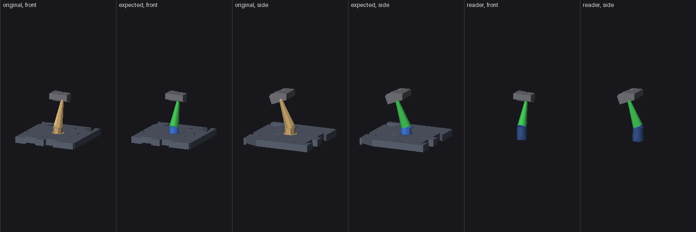

**Situation.** trunk web raft (a whole structure).

**Source.** DM Stash, model `354e5d8b-8648-4a38-a742-ba7a9ffbdedd` (`DM Stash/Dragonborn Pugilist - Kuthrak'Va/Supported/STL/75_Supported_KuthrakVa_Base.stl`), Lychee 5.4.3; Lychee supports s32464.

**Holds.** 1 trunk; 1 tip; with the raft under it; model cut to 1 box (1.5 mm round each contact); 93 KB of mesh.

**Result.** validate pass, 1 tips pass, 1 tip shape pass, 2 routes pass, 2 shafts pass, 2 braces pass, 2 joints pass, 4a clips (nominal) pass, 4b loops (nominal) pass.

#### t02_trunk_wall_raft

An upright trunk on a walled raft (Lychee's vector wall foundation).

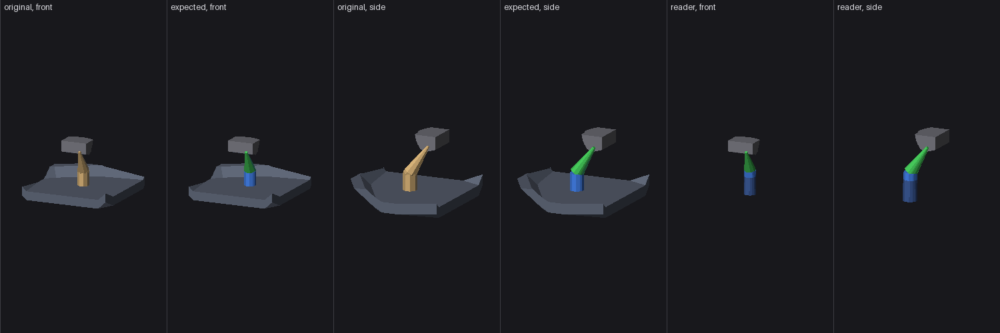

**Situation.** trunk wall raft (a whole structure).

**Source.** Station Forge, model `6b37ef0f-b6f3-4db8-bc91-0d37dfff85f8` (`Station Forge/Diorama Stands/Church 1/SUPPORTED_Angel R (repaired).stl`), Lychee 5.4.3; Lychee supports s7.

**Holds.** 1 trunk; 1 tip; with the raft under it; model cut to 1 box (1.5 mm round each contact); 133 KB of mesh.

**Result.** validate pass, 1 tips pass, 1 tip shape pass, 2 routes pass, 2 shafts pass, 2 braces pass, 2 joints pass, 4a clips (nominal) pass, 4b loops (nominal) pass.

#### t03_trunk_no_raft

An upright trunk on its own square foot, no raft.

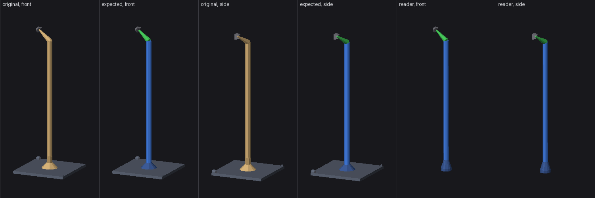

**Situation.** trunk no raft (a whole structure).

**Source.** Loot Studios, model `03587c94-3ab9-4869-bfd7-01fddc6cf418` (`Loot Studios/Sci-Fi/Neon Shadows (March 2024)/All_32mm_NeonShadows/All_32mm_NeonShadows_LoopholesLowlifes/NeonShadows_LoopholesLowlifes_32mm_Supported_Solid/FirespitterRockerboy_32mm_Supported_Solid/FirespitterRockerboy_32mm_Base_Supported.stl`), Lychee 5.2.0; Lychee supports s6050.

**Holds.** 1 trunk; 1 tip; with the raft under it; model cut to 1 box (0.5 mm round each contact); 221 KB of mesh.

Note: over the 200 KB mesh budget at the smallest cut.

Note: the model is cut round the contacts only: the supports also come within 0.35 mm of it elsewhere.

**Result.** validate pass, 1 tips pass, 1 tip shape pass, 2 routes pass, 2 shafts pass, 2 braces pass, 2 joints pass, 4a clips (nominal) pass, 4b loops (nominal) pass.

#### t04_trunk_pixel_raft

An upright trunk on a pixelated raft.

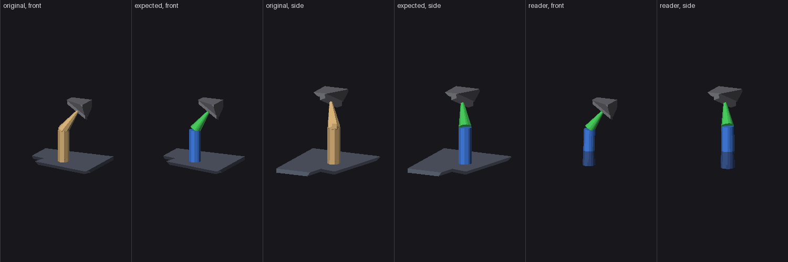

**Situation.** trunk pixel raft (a whole structure).

**Source.** PiperMakes, model `f5e287db-c10b-44c2-a8ee-ef4036c48c5d` (`PiperMakes/Gravtank Fullpack/Extracted/SupportedSTLs/MissileShield/ShieldLoose_Supported.stl`), Lychee 3.4.0; Lychee supports s139.

**Holds.** 1 trunk; 1 tip; with the raft under it; model cut to 1 box (1.5 mm round each contact); 148 KB of mesh.

**Result.** validate pass, 1 tips pass, 1 tip shape pass, 2 routes pass, 2 shafts pass, 2 braces pass, 2 joints pass, 4a clips (nominal) pass, 4b loops (nominal) pass.

#### t05_trunk_cone_foot

An upright trunk on a cone foot.

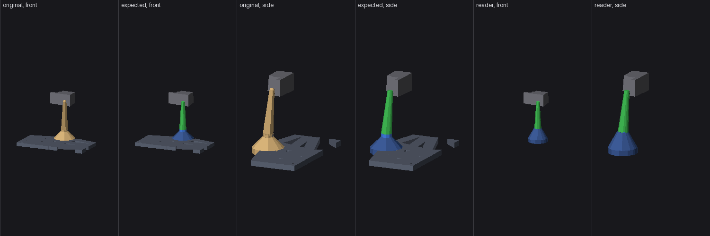

**Situation.** trunk cone foot (a whole structure).

**Source.** Heroes Infinite, model `17279825-1578-43b7-9909-05e73da443e1` (`Heroes Infinite/Overlord Sisters of Eternal Mercy - Unending Pilgrimage (December 2025)/Terrain/STL_Modular_Parts_Supported/STL_Railing-pilar_Supported.stl`), Lychee 7.5.0; Lychee supports s12411.

**Holds.** 1 trunk; 1 tip; with the raft under it; model cut to 1 box (1.5 mm round each contact); 74 KB of mesh.

**Result.** validate pass, 1 tips pass, 1 tip shape pass, 2 routes pass, 2 shafts pass, 2 braces pass, 2 joints pass, 4a clips (nominal) pass, 4b loops (nominal) pass.

#### t06_trunk_octagon_foot

A trunk on an octagon foot.

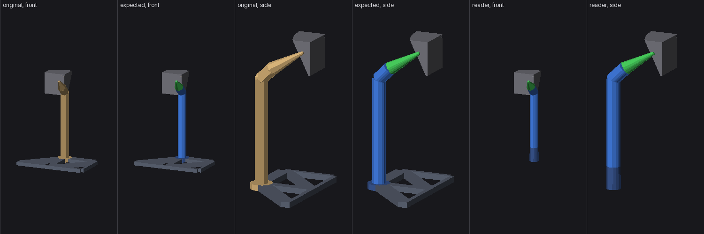

**Situation.** trunk octagon foot (a whole structure).

**Source.** Creature Caster, model `9bcbf50d-10b7-46e9-80f9-24170cf9604b` (`Creature Caster/The Great Hunger/The Great Maw/Grail Thrall F/Supported/STL/Thrall F_Base32mm-sup.stl`), Lychee 7.5.0; Lychee supports s2482.

**Holds.** 1 trunk; 1 tip; with the raft under it; model cut to 1 box (1.5 mm round each contact); 70 KB of mesh.

**Result.** validate pass, 1 tips pass, 1 tip shape pass, 2 routes pass, 2 shafts pass, 2 braces pass, 2 joints pass, 4a clips (nominal) pass, 4b loops (nominal) pass.

#### t07_trunk_knee

A trunk with a knee: an upright pillar, then a leaning run to the tip.

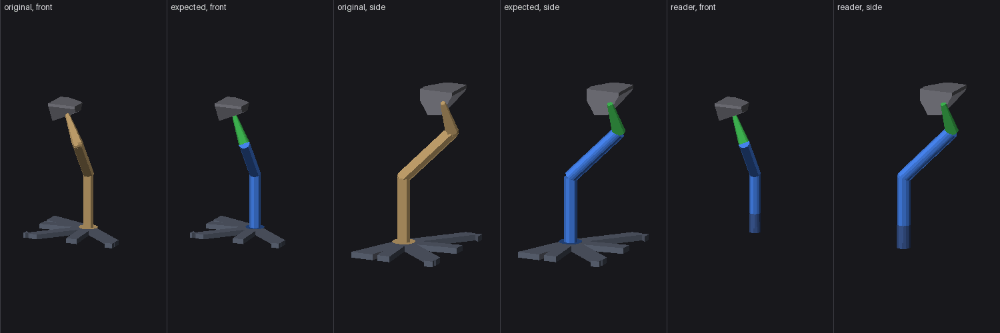

**Situation.** trunk knee (a whole structure).

**Source.** Flesh of Gods, model `3ccfb8c9-56c4-46cd-a8c4-7ed03b5b6ad9` (`Flesh of Gods/Necrotech Brute/75MM - Enemy - Necrotech Brute/STL_Necrotech-Brute_base_75MM_Supported.stl`), Lychee 6.0.2; Lychee supports s101.

**Holds.** 1 trunk; 1 tip; with the raft under it; model cut to 1 box (1.5 mm round each contact); 48 KB of mesh.

**Result.** validate pass, 1 tips pass, 1 tip shape pass, 2 routes pass, 2 shafts pass, 2 braces pass, 2 joints pass, 4a clips (nominal) pass, 4b loops (nominal) pass.

#### t08_trunk_long_lean

A trunk leaning more than 30 degrees for over 8 mm.

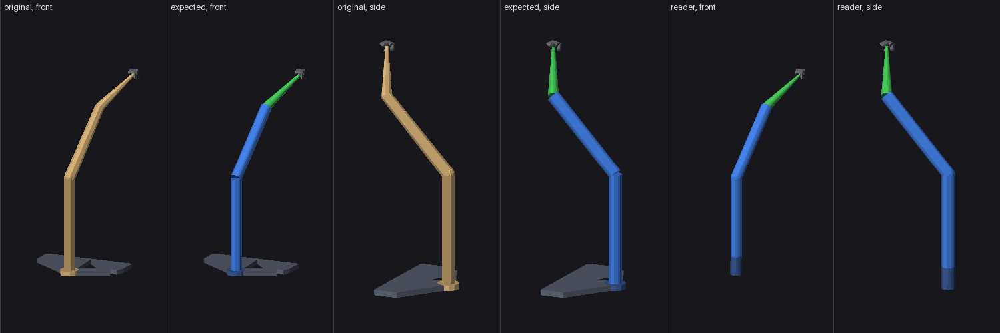

**Situation.** trunk long lean (a whole structure).

**Source.** Claymore Miniatures, model `6cd5c067-ec79-4edf-a8d5-fca78eaeec72` (`Claymore Miniatures/Drow Sorcerer - M/Supported/32mm/STL Supported/STL_DrowSorcerer_Base_32mm_SUP.stl`), Lychee 5.1.0; Lychee supports s29906.

**Holds.** 1 trunk; 1 tip; with the raft under it; model cut to 1 box (0.5 mm round each contact); 148 KB of mesh.

Note: the model is cut round the contacts only: the supports also come within 0.35 mm of it elsewhere.

**Result.** validate pass, 1 tips pass, 1 tip shape pass, 2 routes pass, 2 shafts pass, 2 braces pass, 2 joints pass, 4a clips (nominal) pass, 4b loops (nominal) pass.

#### t09_trunk_thick

A thick trunk (shaft over 1.5 mm).

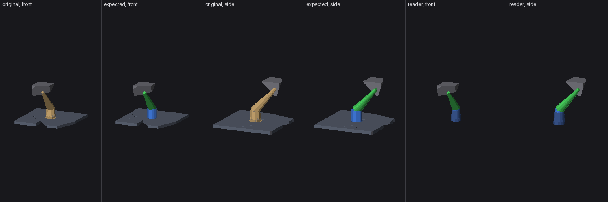

**Situation.** trunk thick (a whole structure).

**Source.** Claymore Miniatures, model `6cd5c067-ec79-4edf-a8d5-fca78eaeec72` (`Claymore Miniatures/Drow Sorcerer - M/Supported/32mm/STL Supported/STL_DrowSorcerer_Base_32mm_SUP.stl`), Lychee 5.1.0; Lychee supports s29868.

**Holds.** 1 trunk; 1 tip; with the raft under it; model cut to 1 box (1.5 mm round each contact); 77 KB of mesh.

**Result.** validate pass, 1 tips pass, 1 tip shape pass, 2 routes pass, 2 shafts pass, 2 braces pass, 2 joints pass, 4a clips (nominal) pass, 4b loops (nominal) pass.

#### t10_trunk_long_tip

A trunk with a tip cone over 5 mm long.

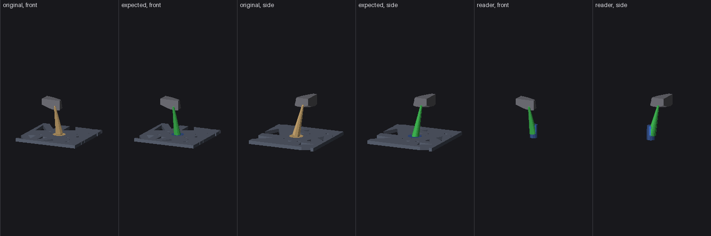

**Situation.** trunk long tip (a whole structure).

**Source.** Nerikson, model `ade48bd9-c673-47b1-a150-6f4e1a2c0b4b` (`Nerikson/NK_Alyara Bust/STL/Presupported/STL_head_supported.stl`), Lychee 5.4.3; Lychee supports s6020.

**Holds.** 1 trunk; 1 tip; with the raft under it; model cut to 1 box (1.5 mm round each contact); 108 KB of mesh.

**Result.** validate pass, 1 tips pass, 1 tip shape pass, 2 routes pass, 2 shafts pass, 2 braces pass, 2 joints pass, 4a clips (nominal) pass, 4b loops (nominal) pass.

#### t12_trunk_read_as_branch

A bare trunk with its two nearest neighbours (in its whole model the reader hangs it from one of them).

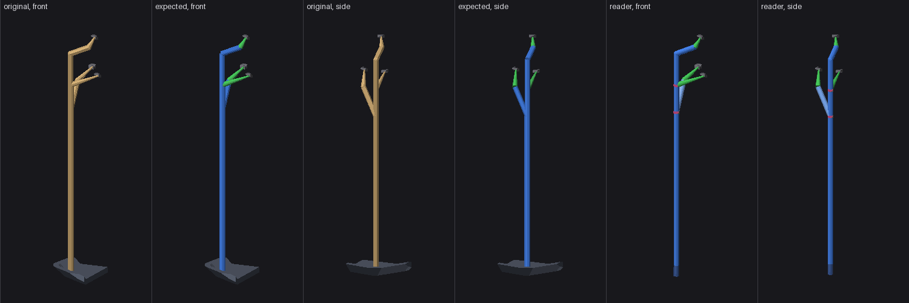

**Situation.** trunk read as branch (a section).

**Source.** GoonMaster, model `e1c9688c-63c1-4612-b3b2-b601dbcc94eb` (`GoonMaster/Extracted/Basing Bits 199 Pilea Cadierei/Models/Supported/Basing Bits 199 Pilea Cadierei 6_Supported.stl`), Lychee 5.4.3; Lychee supports s213, s214, s216.

**Holds.** 3 trunks; 3 tips; with the raft under it; model cut to 3 boxes (0.5 mm round each contact); 383 KB of mesh.

Note: over the 300 KB mesh budget at the smallest cut.

Note: the model is cut round the contacts only: the supports also come within 0.35 mm of it elsewhere.

**Result.** validate pass, 1 tips pass, 1 tip shape pass, 2 routes pass, 2 shafts pass, 2 braces pass, 2 joints pass, 4a clips (nominal) pass, 4b loops (nominal) pass.

#### t13_trunk_tip_missing

A trunk whose tip the reader misses.

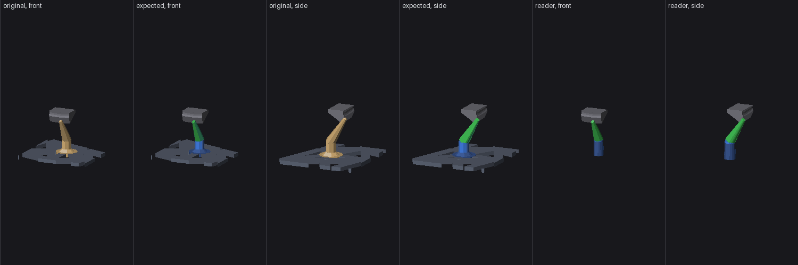

**Situation.** trunk tip missing (a whole structure).

**Source.** Dungeon Classics, model `c8758887-e609-47f1-b1a6-321ed4fe56b4` (`Dungeon Classics/Goblin Cook.png/Supported/STL_Yegg_Fat_Goblin_Chef_Base_v01_Supported.stl`), Lychee 6.2.0; Lychee supports s4320.

**Holds.** 1 trunk; 1 tip; with the raft under it; model cut to 1 box (1.5 mm round each contact); 79 KB of mesh.

**Result.** validate pass, 1 tips pass, 1 tip shape pass, 2 routes pass, 2 shafts pass, 2 braces pass, 2 joints pass, 4a clips (nominal) pass, 4b loops (nominal) pass.

#### t14_trunk_tip_in_raft_band

A trunk with its tip inside the raft band (contact under 3.5 mm).

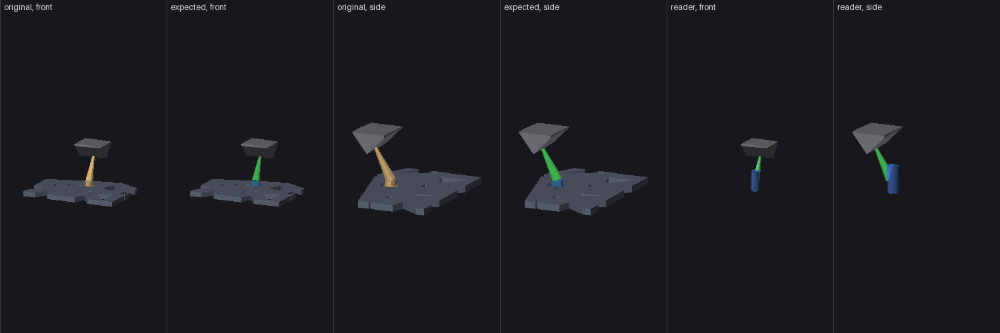

**Situation.** trunk tip in raft band (a whole structure).

**Source.** Creature Crusade, model `56461b4d-7394-433b-a945-e9d520fca2f0` (`Creature Crusade/Isma'il Al-Aziz/Supported/STL/TC-Arab_Pose_03_Base-sup.stl`), Lychee 7.4.2; Lychee supports s2506.

**Holds.** 1 trunk; 1 tip; with the raft under it; model cut to 1 box (1.5 mm round each contact); 106 KB of mesh.

**Result.** validate pass, 1 tips pass, 1 tip shape pass, 2 routes pass, 2 shafts pass, 2 braces pass, 2 joints pass, 4a clips (nominal) pass, 4b loops (nominal) pass.

#### t17_trunk_straight

A trunk set straight in Lychee (no knee, leaning from the foot).

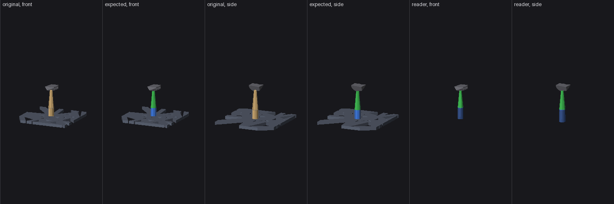

**Situation.** trunk straight (a whole structure).

**Source.** Death x Tiles, model `363c280a-d013-4882-a42d-c28a56f5f790` (`Death x Tiles/Collabs/Ghamak/898 Complete Black waste Orcs 4/898_Black_waste_orcs_Supported/OHS_M85_P02_05_ArmL Supported.stl`), Lychee 7.0.1; Lychee supports s557.

**Holds.** 1 trunk; 1 tip; with the raft under it; model cut to 1 box (1.0 mm round each contact); 148 KB of mesh.

**Result.** validate pass, 1 tips pass, 1 tip shape pass, 2 routes pass, 2 shafts pass, 2 braces pass, 2 joints pass, 4a clips (nominal) pass, 4b loops (nominal) pass.

### Tips

#### p01_tip_tiny

A tip with a contact of 0.2 mm or less.

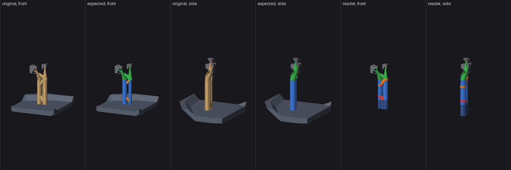

**Situation.** tip tiny (a whole structure).

**Source.** Station Forge, model `6b37ef0f-b6f3-4db8-bc91-0d37dfff85f8` (`Station Forge/Diorama Stands/Church 1/SUPPORTED_Angel R (repaired).stl`), Lychee 5.4.3; Lychee supports s51, s52, s14, s15, s16.

**Holds.** 3 trunks, 2 braces; 3 tips; with the raft under it; model cut to 2 boxes (0.5 mm round each contact); 277 KB of mesh.

Note: 2 supports welded to the case's shells were added.

Note: the model is cut round the contacts only: the supports also come within 0.35 mm of it elsewhere.

**Result.** validate pass, 1 tips pass, 1 tip shape pass, 2 routes pass, 2 shafts pass, 2 braces pass, 2 joints pass, 4a clips (nominal) pass, 4b loops (nominal) pass.

Accepted readings: 1 brace into the root zone read as a leg.

#### p02_tip_wide

A tip with a contact over 0.7 mm.

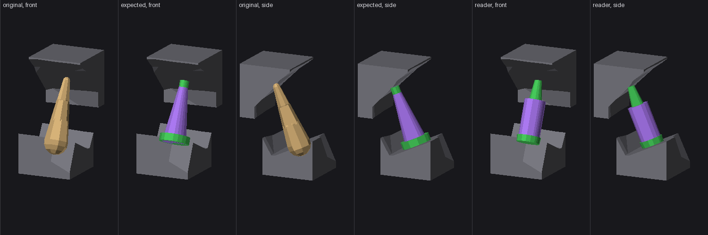

**Situation.** tip wide (a whole structure).

**Source.** Loot Studios, model `c9144c30-6aa2-4cbf-9b00-0ceedb63236c` (`Loot Studios/Sci-Fi/Horrors From Beyond (April 2024)/All_75mm_HorrorsFromBeyond/All_HorrorsFromBeyond_Adults_75mm/HorrorsFromBeyond_Adults_75mm_ReadyToSlice/OfficerChristopherSanders_75mm_ReadyToSlice/OfficerChristopherSanders_75mm_Base_Supported_Hollow.stl`), Lychee 5.2.2; Lychee supports s2393.

**Holds.** 1 support between two parts of the model; 2 tips (1 mini support with no cone); no raft; model cut to 2 boxes (1.5 mm round each contact); 26 KB of mesh.

**Result.** validate pass, 1 tips pass, 1 tip shape pass, 2 routes pass, 2 shafts pass, 2 braces pass, 2 joints pass, 4a clips (nominal) pass, 4b loops (nominal) pass.

#### p03_tip_sideways

A tip reaching the model sideways.

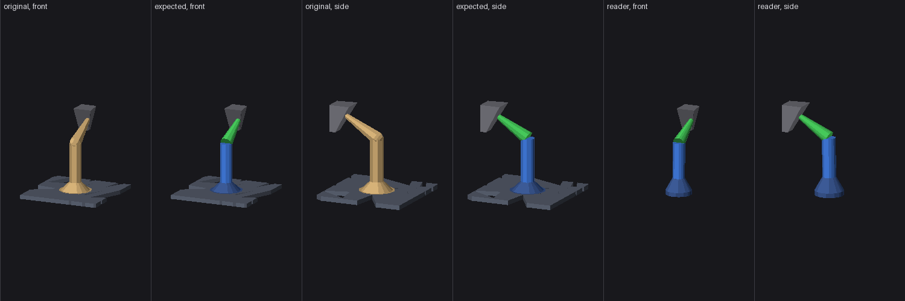

**Situation.** tip sideways (a whole structure).

**Source.** Cast n Play, model `56bf8cab-c157-4b58-8ca7-f18f80eeabde` (`Cast n Play/Terrain Essentials/Sewers/Sewers_Walls/Pre-Supported/Doors/STL_SW_Door_Main_Supported.stl`), Lychee 6.0.1-beta; Lychee supports s136.

**Holds.** 1 trunk; 1 tip; with the raft under it; model cut to 1 box (1.5 mm round each contact); 70 KB of mesh.

**Result.** validate pass, 1 tips pass, 1 tip shape pass, 2 routes pass, 2 shafts pass, 2 braces pass, 2 joints pass, 4a clips (nominal) pass, 4b loops (nominal) pass.

#### p05_tip_grazing

A tip meeting the surface at more than 60 degrees off its normal.

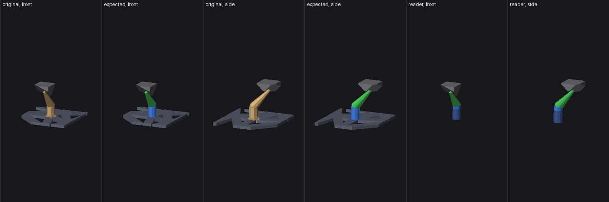

**Situation.** tip grazing (a whole structure).

**Source.** Heroes Infinite, model `a1978143-192d-436f-bddd-8da4cfaf7532` (`Heroes Infinite/Grim Darkness of the Expurgators Part I/Miniatures/Supported/STL_Evercursed_SUPPORTED/STL_Evercursed_A_base_FIX_Supported.stl`), Lychee 5.4.3; Lychee supports s3.

**Holds.** 1 trunk; 1 tip; with the raft under it; model cut to 1 box (1.5 mm round each contact); 47 KB of mesh.

**Result.** validate pass, 1 tips pass, 1 tip shape pass, 2 routes pass, 2 shafts pass, 2 braces pass, 2 joints pass, 4a clips (nominal) pass, 4b loops (nominal) pass.

#### p06_tip_grazing_missed

A grazing tip the reader misses.

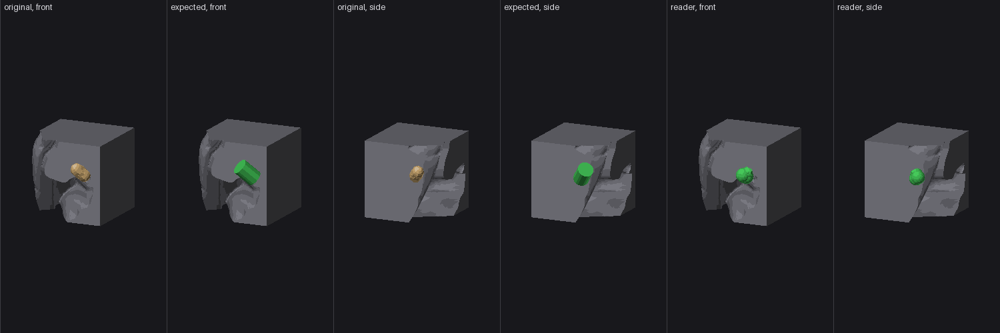

**Situation.** tip grazing missed (a section).

**Source.** MrModulork, model `02aee92b-db20-4695-8c5a-764261f995be` (`MrModulork/Extracted/Jetpack Orcs - Modular Kit A/Presupported/STL_SpeedkultRokkitBoyz_TorsoA_Supported.stl`), Lychee 4.2.0-beta; Lychee supports s47.

**Holds.** 1 support between two parts of the model; 2 tips (1 mini support with no cone); no raft; model cut to 1 box (1.0 mm round each contact); 234 KB of mesh.

**Result.** validate pass, 1 tips pass, 1 tip shape pass, 2 routes pass, 2 shafts pass, 2 braces pass, 2 joints pass, 4a clips (nominal) pass, 4b loops (nominal) pass.

#### p07_tip_thin_wall

A tip on a wall under 0.6 mm thick.

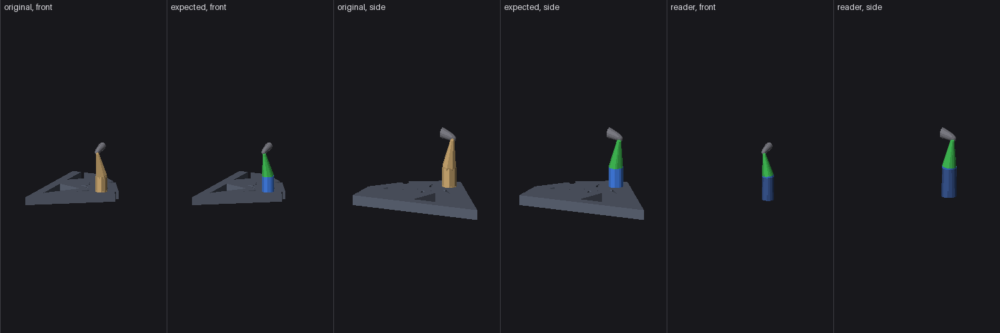

**Situation.** tip thin wall (a whole structure).

**Source.** Bulkamancer, model `5a520797-369c-404f-af11-e999659cc974` (`Bulkamancer/Jinx - Broken (Arcane)/broken_symbol_pre_supported_stl/option_2_grenade_effect.stl`), Lychee 7.1.3; Lychee supports s2202.

**Holds.** 1 trunk; 1 tip; with the raft under it; model cut to 1 box (0.8 mm round each contact); 182 KB of mesh.

**Result.** validate pass, 1 tips pass, 1 tip shape pass, 2 routes pass, 2 shafts pass, 2 braces pass, 2 joints pass, 4a clips (nominal) pass, 4b loops (nominal) pass.

#### p08_tip_thin_wall_size

A support between two parts of the model with a tip on a thin wall (sized wrongly in its whole model).

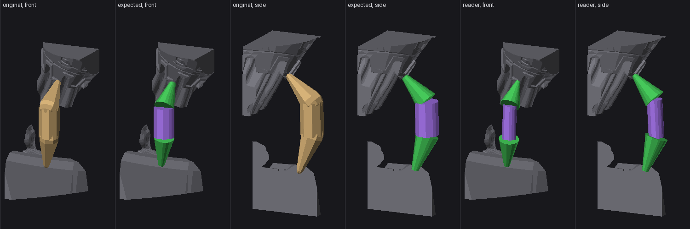

**Situation.** tip thin wall size (a section).

**Source.** Loot Studios, model `03587c94-3ab9-4869-bfd7-01fddc6cf418` (`Loot Studios/Sci-Fi/Neon Shadows (March 2024)/All_32mm_NeonShadows/All_32mm_NeonShadows_LoopholesLowlifes/NeonShadows_LoopholesLowlifes_32mm_Supported_Solid/FirespitterRockerboy_32mm_Supported_Solid/FirespitterRockerboy_32mm_Base_Supported.stl`), Lychee 5.2.0; Lychee supports s5850.

**Holds.** 1 support between two parts of the model; 2 tips; no raft; model cut to 2 boxes (1.5 mm round each contact); 158 KB of mesh.

**Result.** validate pass, 1 tips pass, 1 tip shape pass, 2 routes pass, 2 shafts pass, 2 braces pass, 2 joints pass, 4a clips (nominal) pass, 4b loops (nominal) pass.

#### p10_tip_on_edge_size

Tips on an edge or fine detail (one is sized wrongly in its whole model).

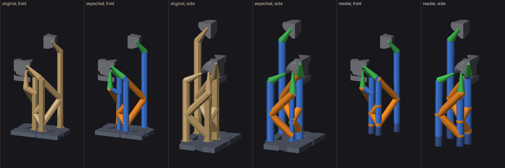

**Situation.** tip on edge size (a section).

**Source.** DM Stash, model `354e5d8b-8648-4a38-a742-ba7a9ffbdedd` (`DM Stash/Dragonborn Pugilist - Kuthrak'Va/Supported/STL/75_Supported_KuthrakVa_Base.stl`), Lychee 5.4.3; Lychee supports s32387, s32400, s32389, s32401, s32622, s32402, s32403, s32703, s32704, s33080, s33081, s32390.

**Holds.** 4 trunks, 8 braces; 4 tips; with the raft under it; model cut to 2 boxes (1.5 mm round each contact); 314 KB of mesh.

Note: 1 supports welded to the case's shells were added.

Note: 1 supports welded to the case's shells were added.

Note: 1 supports welded to the case's shells were added.

Note: 7 braces welded into the case's shells are kept by their lines.

**Result.** validate pass, 1 tips pass, 1 tip shape pass, 2 routes pass, 2 shafts pass, 2 braces **fail**, 2 joints pass, 4a clips (nominal) pass, 4b loops (nominal) pass.

- 2 braces: `brace s33080: the reader has braces along it, with other ends`
- 2 braces: `brace s33081: the reader has braces along it, with other ends`

#### p12_tips_close

Two tips less than 0.5 mm apart.

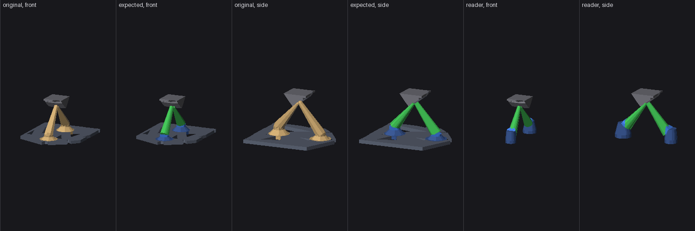

**Situation.** tips close (a section).

**Source.** Brotherwise Games, model `e461570f-3133-4cf7-b3d3-15852cf94ecf` (`Brotherwise Games/Flowing One/Flowing One/Supported/STL/32_Supported_FlowingOne_Base.stl`), Lychee 7.5.0; Lychee supports s736, s737.

**Holds.** 2 trunks; 2 tips; with the raft under it; model cut to 1 box (1.5 mm round each contact); 224 KB of mesh.

**Result.** validate pass, 1 tips pass, 1 tip shape pass, 2 routes pass, 2 shafts pass, 2 braces pass, 2 joints pass, 4a clips (nominal) pass, 4b loops (nominal) pass.

#### p13_tips_close_missed

Two tips less than 0.5 mm apart, one missed by the reader.

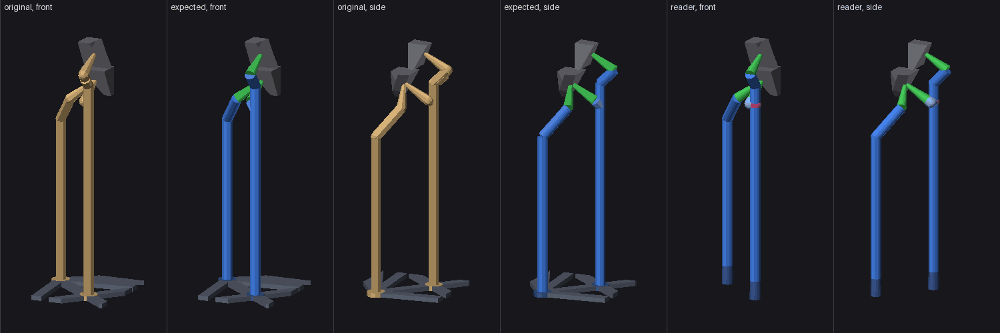

**Situation.** tips close missed (a section).

**Source.** Flesh of Gods, model `3ccfb8c9-56c4-46cd-a8c4-7ed03b5b6ad9` (`Flesh of Gods/Necrotech Brute/75MM - Enemy - Necrotech Brute/STL_Necrotech-Brute_base_75MM_Supported.stl`), Lychee 6.0.2; Lychee supports s139, s52, s141.

**Holds.** 2 trunks, 1 branch; 3 tips; with the raft under it; model cut to 2 boxes (1.5 mm round each contact); 95 KB of mesh.

Note: 2 shells along the kept supports' lines were added (they were given to neighbours outside the case).

Note: no mesh in the case for the braces s264.

**Result.** validate pass, 1 tips pass, 1 tip shape pass, 2 routes pass, 2 shafts pass, 2 braces pass, 2 joints **fail**, 4a clips (nominal) pass, 4b loops (nominal) pass.

- 2 joints: `support s139: 1 joints, Lychee 0`

#### p14_tip_direction

A cone tip whose direction the reader gets wrong.

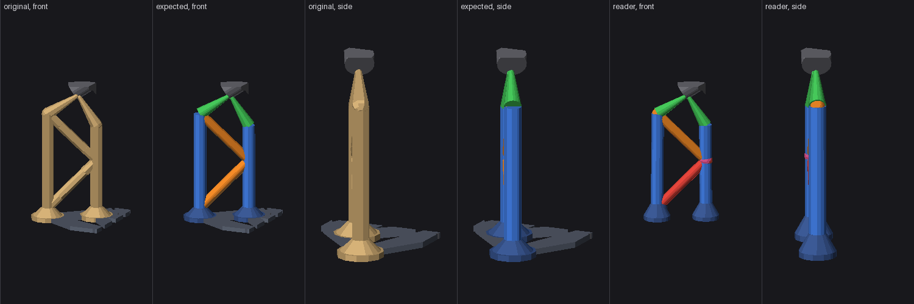

**Situation.** tip direction (a section).

**Source.** MrModulork, model `02aee92b-db20-4695-8c5a-764261f995be` (`MrModulork/Extracted/Jetpack Orcs - Modular Kit A/Presupported/STL_SpeedkultRokkitBoyz_TorsoA_Supported.stl`), Lychee 4.2.0-beta; Lychee supports s35, s36, s58, s59.

**Holds.** 2 trunks, 2 braces; 2 tips; with the raft under it; model cut to 1 box (1.5 mm round each contact); 131 KB of mesh.

Note: 1 supports welded to the case's shells were added.

**Result.** validate pass, 1 tips pass, 1 tip shape pass, 2 routes pass, 2 shafts pass, 2 braces pass, 2 joints pass, 4a clips (nominal) pass, 4b loops (nominal) pass.

Accepted readings: 1 brace into the root zone read as a leg.

### Branches and kickstands

#### b01_branch

A trunk with one or two branches.

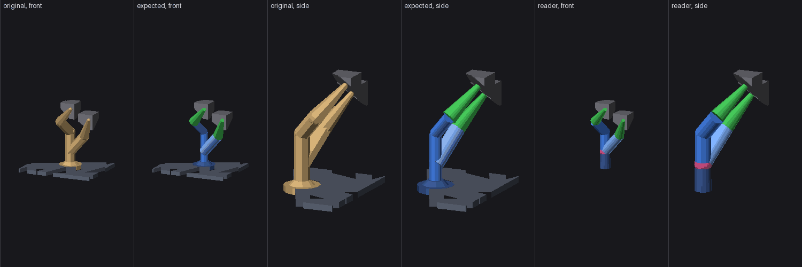

**Situation.** branch (a whole structure).

**Source.** Dungeon Classics, model `c8758887-e609-47f1-b1a6-321ed4fe56b4` (`Dungeon Classics/Goblin Cook.png/Supported/STL_Yegg_Fat_Goblin_Chef_Base_v01_Supported.stl`), Lychee 6.2.0; Lychee supports s4344, s4345.

**Holds.** 1 trunk, 1 branch; 2 tips; with the raft under it; model cut to 2 boxes (1.0 mm round each contact); 144 KB of mesh.

**Result.** validate pass, 1 tips pass, 1 tip shape pass, 2 routes pass, 2 shafts pass, 2 braces pass, 2 joints pass, 4a clips (nominal) pass, 4b loops (nominal) pass.

#### b02_branch_fan

A trunk with three or more branches.

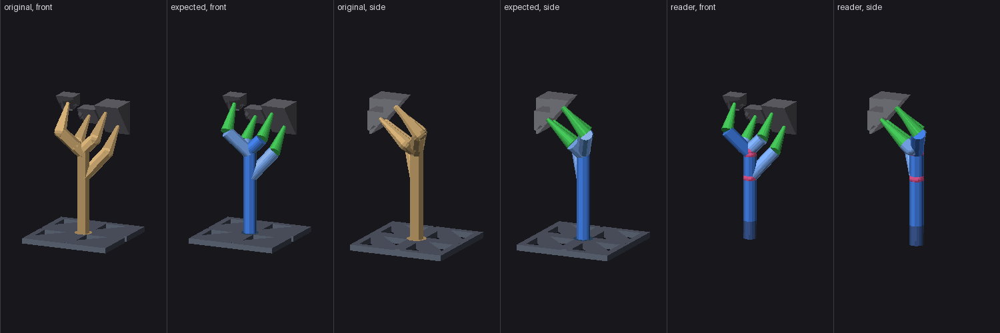

**Situation.** branch fan (a whole structure).

**Source.** Creature Crusade, model `71379318-1b61-4def-8b8f-422be6df4856` (`Creature Crusade/Al-Sayf al-Khafi, The Hidden Blade/Supported/STL/DuneAssasines_CH03_Base-sup.stl`), Lychee 7.4.2; Lychee supports s11368, s11369, s11384, s11343.

**Holds.** 1 trunk, 3 branches; 4 tips; with the raft under it; model cut to 3 boxes (1.0 mm round each contact); 233 KB of mesh.

**Result.** validate pass, 1 tips pass, 1 tip shape pass, 2 routes pass, 2 shafts pass, 2 braces pass, 2 joints **fail**, 4a clips (nominal) pass, 4b loops (nominal) pass.

- 2 joints: `support s11369: 1 joints, Lychee 0`
- 2 joints: `support s11384: 1 joints, Lychee 0`

#### b03_tree

A whole tree: a trunk with seven or more supports hanging from it.

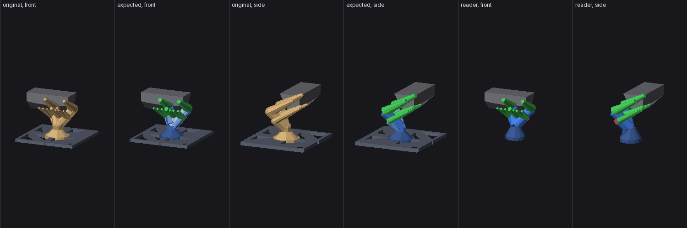

**Situation.** tree (a whole structure).

**Source.** Heroes Infinite, model `2d809f62-0ddd-4f98-b421-7be4cd037583` (`Heroes Infinite/Sisters of Eternal Mercy - Unending Pilgrimage REINFORCEMENTS/Bases/STL_Bases_SUPPORTED/STL_80x80-01_Supported.stl`), Lychee 7.5.2; Lychee supports s9143, s9144, s9145, s9146, s9147, s9148, s8710, s9117, s9118.

**Holds.** 1 trunk, 8 branches; 9 tips; with the raft under it; model cut to 1 box (1.5 mm round each contact); 232 KB of mesh.

**Result.** validate pass, 1 tips pass, 1 tip shape pass, 2 routes pass, 2 shafts pass, 2 braces pass, 2 joints **fail**, 4a clips (nominal) pass, 4b loops (nominal) pass.

Accepted readings: 3 branches from inside a trunk's foot read with feet of their own.

- 2 joints: `support s9144: 1 joints, Lychee 0`
- 2 joints: `support s8710: 1 joints, Lychee 0`

#### b04_branch_of_branch

A branch of a branch.

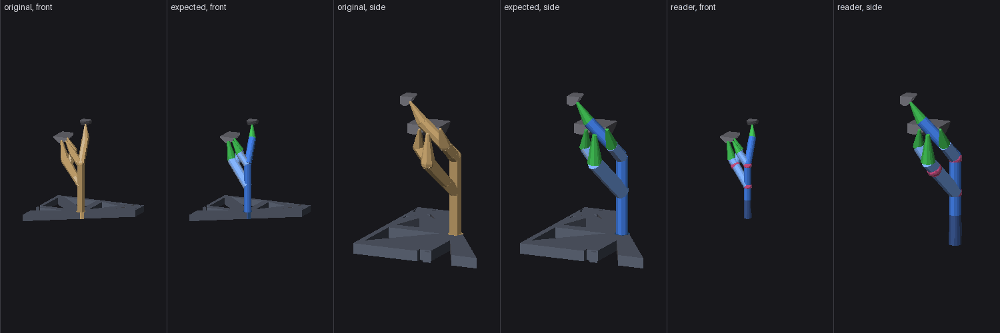

**Situation.** branch of branch (a whole structure).

**Source.** Bulkamancer, model `5a520797-369c-404f-af11-e999659cc974` (`Bulkamancer/Jinx - Broken (Arcane)/broken_symbol_pre_supported_stl/option_2_grenade_effect.stl`), Lychee 7.1.3; Lychee supports s2201, s2303, s2304, s2217.

**Holds.** 1 trunk, 3 branches; 4 tips; with the raft under it; model cut to 2 boxes (0.5 mm round each contact); 363 KB of mesh.

Note: over the 350 KB mesh budget at the smallest cut.

Note: the model is cut round the contacts only: the supports also come within 0.35 mm of it elsewhere.

**Result.** validate pass, 1 tips pass, 1 tip shape pass, 2 routes pass, 2 shafts pass, 2 braces pass, 2 joints pass, 4a clips (nominal) pass, 4b loops (nominal) pass.

#### b05_branch_depth3

Branches three deep.

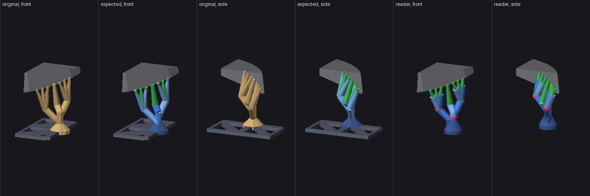

**Situation.** branch depth3 (a whole structure).

**Source.** Claymore Miniatures, model `7f6b8909-9290-454f-9ea5-08349def5652` (`Claymore Miniatures/Rat Infestation - S/32mm/Supported/STL Files/STL_RatInfestation_32mm_Supported.stl`), Lychee 7.3.0; Lychee supports s13, s14, s15, s16, s17, s18, s19.

**Holds.** 1 trunk, 6 branches; 7 tips (4 mini supports with no cone); with the raft under it; model cut to 1 box (1.5 mm round each contact); 121 KB of mesh.

**Result.** validate pass, 1 tips pass, 1 tip shape pass, 2 routes pass, 2 shafts pass, 2 braces pass, 2 joints **fail**, 4a clips (nominal) pass, 4b loops (nominal) pass.

- 2 joints: `support s15: 1 joints, Lychee 0`
- 2 joints: `support s19: 2 joints, Lychee 0`

#### b06_branch_short

A branch with a shaft under 1 mm (the cone almost on its host).

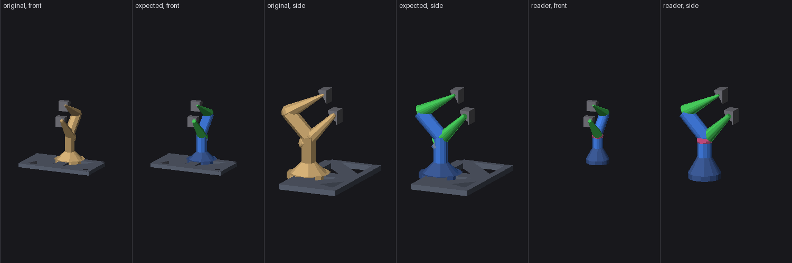

**Situation.** branch short (a section).

**Source.** DM Stash, model `7ada7b35-de84-43b5-b848-f6a9c5cef4a3` (`DM Stash/Black Dragonborn Barbarian - Skraa Dark-Eye/Supported/STL/32_Supported_Skraa_Base.stl`), Lychee 7.3.1; Lychee supports s60, s59.

**Holds.** 1 trunk, 1 branch; 2 tips; with the raft under it; model cut to 2 boxes (0.65 mm round each contact); 238 KB of mesh.

Note: the model is cut round the contacts only: the supports also come within 0.35 mm of it elsewhere.

**Result.** validate pass, 1 tips pass, 1 tip shape pass, 2 routes pass, 2 shafts pass, 2 braces pass, 2 joints pass, 4a clips (nominal) pass, 4b loops (nominal) pass.

#### b07_branch_level

A branch running nearly level.

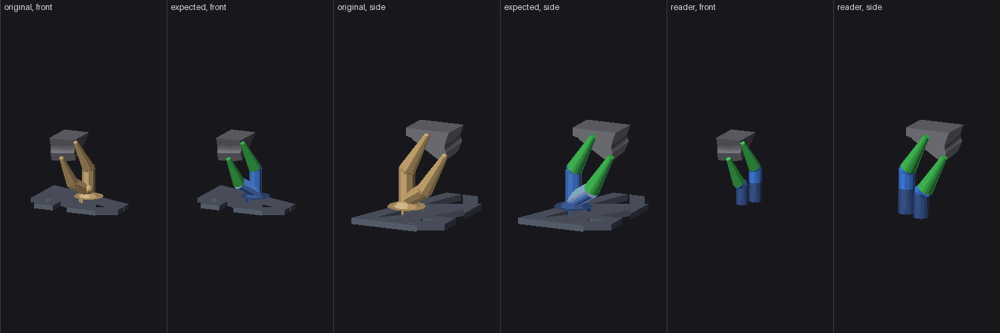

**Situation.** branch level (a section).

**Source.** Dungeon Classics, model `c8758887-e609-47f1-b1a6-321ed4fe56b4` (`Dungeon Classics/Goblin Cook.png/Supported/STL_Yegg_Fat_Goblin_Chef_Base_v01_Supported.stl`), Lychee 6.2.0; Lychee supports s4340, s4321.

**Holds.** 1 trunk, 1 branch; 2 tips; with the raft under it; model cut to 1 box (1.0 mm round each contact); 142 KB of mesh.

**Result.** validate pass, 1 tips pass, 1 tip shape pass, 2 routes pass, 2 shafts pass, 2 braces pass, 2 joints **fail**, 4a clips (nominal) pass, 4b loops (nominal) pass.

Accepted readings: 1 branch from inside a trunk's foot read with a foot of its own.

- 2 joints: `support s4340: 1 joints, Lychee 0`

#### b08_branch_read_as_trunk

A branch the reader stands on the plate.

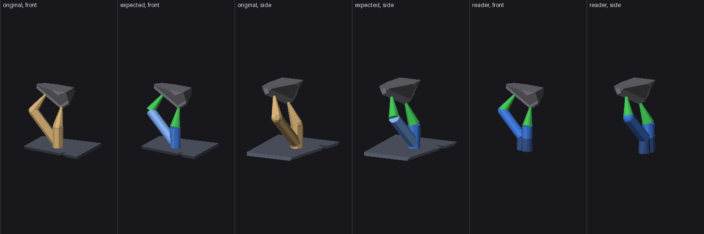

**Situation.** branch read as trunk (a section).

**Source.** PiperMakes, model `f5e287db-c10b-44c2-a8ee-ef4036c48c5d` (`PiperMakes/Gravtank Fullpack/Extracted/SupportedSTLs/MissileShield/ShieldLoose_Supported.stl`), Lychee 3.4.0; Lychee supports s138, s140.

**Holds.** 1 trunk, 1 branch; 2 tips; with the raft under it; model cut to 1 box (1.5 mm round each contact); 178 KB of mesh.

**Result.** validate pass, 1 tips pass, 1 tip shape pass, 2 routes pass, 2 shafts pass, 2 braces pass, 2 joints **fail**, 4a clips (nominal) pass, 4b loops (nominal) pass.

Accepted readings: 1 branch from inside a trunk's foot read with a foot of its own.

- 2 joints: `support s140: 1 joints, Lychee 0`

#### b09_branch_route

A branch on a trunk (routed wrongly in its whole model).

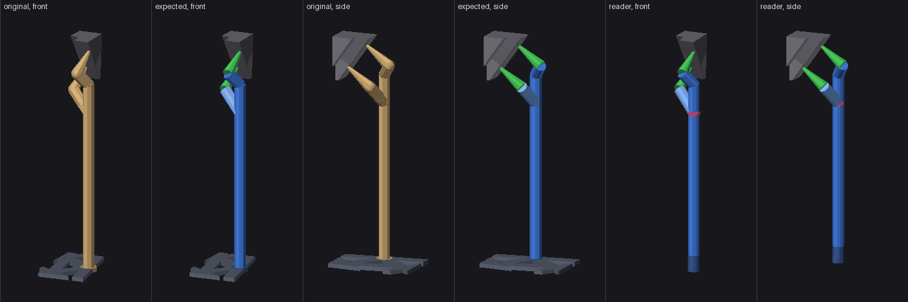

**Situation.** branch route (a section).

**Source.** Creature Caster, model `fa8dc038-d460-447e-b94c-457ed9a1314f` (`Creature Caster/The Great Hunger/The Fast and the Ferocious/Prowlers/Supported/STL/Prowlers_CH01_Base-sup.stl`), Lychee 7.4.2; Lychee supports s3120, s3122.

**Holds.** 1 trunk, 1 branch; 2 tips; with the raft under it; model cut to 1 box (1.5 mm round each contact); 207 KB of mesh.

**Result.** validate pass, 1 tips pass, 1 tip shape pass, 2 routes pass, 2 shafts pass, 2 braces pass, 2 joints pass, 4a clips (nominal) pass, 4b loops (nominal) pass.

#### b10_branch_braced

A branch with a brace on it.

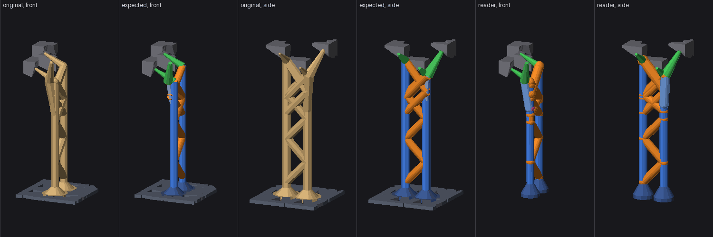

**Situation.** branch braced (a section).

**Source.** Cast n Play, model `56bf8cab-c157-4b58-8ca7-f18f80eeabde` (`Cast n Play/Terrain Essentials/Sewers/Sewers_Walls/Pre-Supported/Doors/STL_SW_Door_Main_Supported.stl`), Lychee 6.0.1-beta; Lychee supports s410, s522, s523, s524, s525, s526, s408, s409, s72, s20, s65.

**Holds.** 2 trunks, 1 branch, 8 braces; 3 tips; with the raft under it; model cut to 3 boxes (1.5 mm round each contact); 261 KB of mesh.

Note: 3 braces welded into the case's shells are kept by their lines.

**Result.** validate pass, 1 tips pass, 1 tip shape pass, 2 routes pass, 2 shafts pass, 2 braces **fail**, 2 joints **fail**, 4a clips (nominal) pass, 4b loops (nominal) pass.

- 2 braces: `brace s523: the reader has nothing there`
- 2 braces: `brace s408: the reader has nothing there`
- 2 braces: `extra brace near [-9.9, 27.0, 14.5]: Lychee has nothing there`
- 2 braces: `extra brace near [-9.9, 23.9, 17.6]: Lychee has a shaft there`
- 2 braces: and 2 more
- 2 joints: `support s20: 1 joints, Lychee 0`

#### b12_kickstand

A kickstand: a leg from the plate leaning on a support.

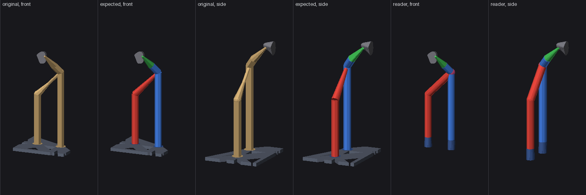

**Situation.** kickstand (a section).

**Source.** Creature Crusade, model `71379318-1b61-4def-8b8f-422be6df4856` (`Creature Crusade/Al-Sayf al-Khafi, The Hidden Blade/Supported/STL/DuneAssasines_CH03_Base-sup.stl`), Lychee 7.4.2; Lychee supports s11393, s11452.

**Holds.** 1 trunk, 1 kickstand; 1 tip; with the raft under it; model cut to 1 box (1.5 mm round each contact); 168 KB of mesh.

**Result.** validate pass, 1 tips pass, 1 tip shape pass, 2 routes pass, 2 shafts pass, 2 braces pass, 2 joints pass, 4a clips (nominal) pass, 4b loops (nominal) pass.

#### b13_branch_on_kickstand

A branch hanging from a kickstand.

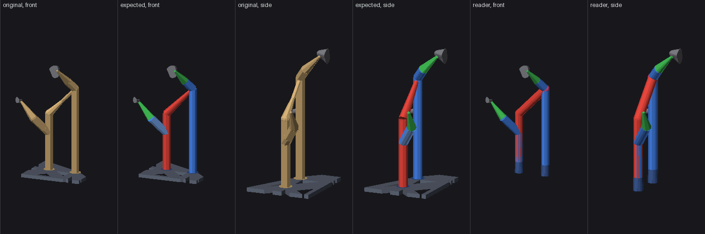

**Situation.** branch on kickstand (a section).

**Source.** Creature Crusade, model `71379318-1b61-4def-8b8f-422be6df4856` (`Creature Crusade/Al-Sayf al-Khafi, The Hidden Blade/Supported/STL/DuneAssasines_CH03_Base-sup.stl`), Lychee 7.4.2; Lychee supports s11389, s11393, s11452.

**Holds.** 1 trunk, 1 branch, 1 kickstand; 2 tips; with the raft under it; model cut to 2 boxes (1.25 mm round each contact); 223 KB of mesh.

**Result.** validate pass, 1 tips pass, 1 tip shape pass, 2 routes pass, 2 shafts pass, 2 braces pass, 2 joints pass, 4a clips (nominal) pass, 4b loops (nominal) pass.

Accepted readings: 1 branch on a kickstand read as a support up the kickstand's pillar.

#### b14_branch_on_strut

A branch hanging from a support between two parts of the model.

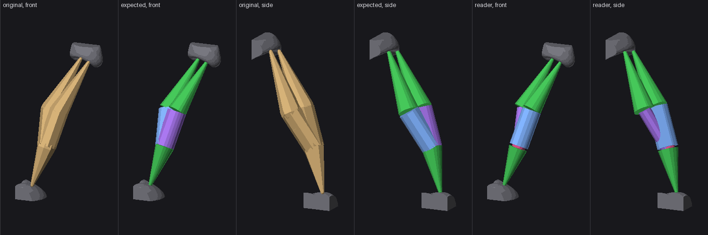

**Situation.** branch on strut (a section).

**Source.** Brotherwise Games, model `8342e4d2-080f-4cb1-8c57-e707f65b595a` (`Brotherwise Games/Windrunner/Supported/STL/32_Supported_Windrunner_BaseMagic.stl`), Lychee 7.5.0; Lychee supports s420, s423.

**Holds.** 1 branch, 1 support between two parts of the model; 3 tips; no raft; model cut to 2 boxes (1.0 mm round each contact); 246 KB of mesh.

Note: 1 shells along the kept supports' lines were added (they were given to neighbours outside the case).

**Result.** validate pass, 1 tips pass, 1 tip shape pass, 2 routes **fail**, 2 shafts pass, 2 braces pass, 2 joints pass, 4a clips (nominal) pass, 4b loops (nominal) pass.

- 2 routes: `tip s420: stands on the parent, Lychee on the model (77% of Lychee's line covered, 100% of the reader's)`
- 2 routes: `tip s420 (base end): route differs (41% of Lychee's line covered, 42% of the reader's)`
- 2 routes: `tip s423: stands on the model, Lychee on the parent (100% of Lychee's line covered, 76% of the reader's)`

### Mini supports on a host (Lychee leaves)

#### l01_leaf

A mini support (a tapered rod with no cone) on a trunk.

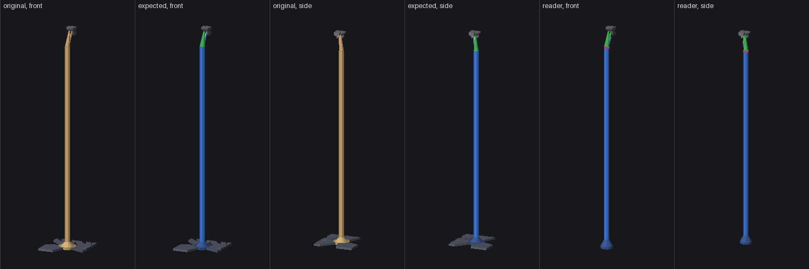

**Situation.** mini support on a host: leaf (a section).

**Source.** Cast n Play, model `56bf8cab-c157-4b58-8ca7-f18f80eeabde` (`Cast n Play/Terrain Essentials/Sewers/Sewers_Walls/Pre-Supported/Doors/STL_SW_Door_Main_Supported.stl`), Lychee 6.0.1-beta; Lychee supports s40, s45.

**Holds.** 1 trunk, 1 branch; 2 tips (1 mini support with no cone); with the raft under it; model cut to 1 box (0.8 mm round each contact); 223 KB of mesh.

**Result.** validate pass, 1 tips pass, 1 tip shape pass, 2 routes pass, 2 shafts pass, 2 braces pass, 2 joints pass, 4a clips (nominal) pass, 4b loops (nominal) pass.

#### l02_leaf_read_as_trunk

A mini support on a trunk (stood on the plate in its whole model).

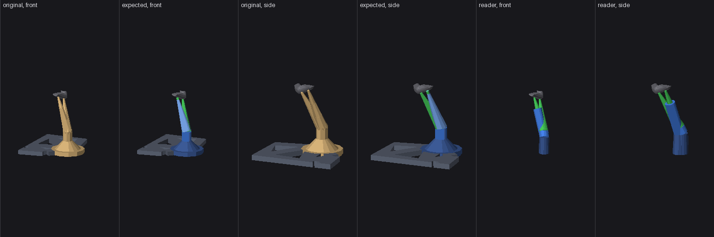

**Situation.** mini support on a host: leaf read as trunk (a section).

**Source.** MrModulork, model `fdba2709-3be5-4a33-9eab-fd18368d97c5` (`MrModulork/Extracted/Jetpack Orcs - Modular Kit A/Presupported/STL_SpeedkultRokkitBoyz_HeadA_01_Supported.stl`), Lychee 4.2.0-beta; Lychee supports s18, s19.

**Holds.** 1 trunk, 1 branch; 2 tips (1 mini support with no cone); with the raft under it; model cut to 1 box (0.5 mm round each contact); 211 KB of mesh.

Note: the model is cut round the contacts only: the supports also come within 0.35 mm of it elsewhere.

**Result.** validate pass, 1 tips pass, 1 tip shape pass, 2 routes pass, 2 shafts pass, 2 braces pass, 2 joints pass, 4a clips (nominal) pass, 4b loops (nominal) pass.

#### l03_leaf_on_branch

A mini support on a branch.

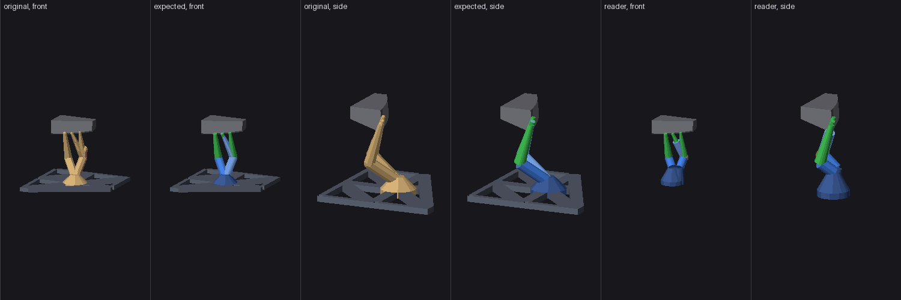

**Situation.** mini support on a host: leaf on branch (a section).

**Source.** Claymore Miniatures, model `7f6b8909-9290-454f-9ea5-08349def5652` (`Claymore Miniatures/Rat Infestation - S/32mm/Supported/STL Files/STL_RatInfestation_32mm_Supported.stl`), Lychee 7.3.0; Lychee supports s8, s9, s10.

**Holds.** 1 trunk, 2 branches; 3 tips (1 mini support with no cone); with the raft under it; model cut to 1 box (1.5 mm round each contact); 84 KB of mesh.

**Result.** validate pass, 1 tips pass, 1 tip shape pass, 2 routes pass, 2 shafts pass, 2 braces pass, 2 joints pass, 4a clips (nominal) pass, 4b loops (nominal) pass.

Accepted readings: 1 branch from inside a trunk's foot read with a foot of its own.

#### l04_leaf_on_strut

A mini support on a mini support between two parts of the model.

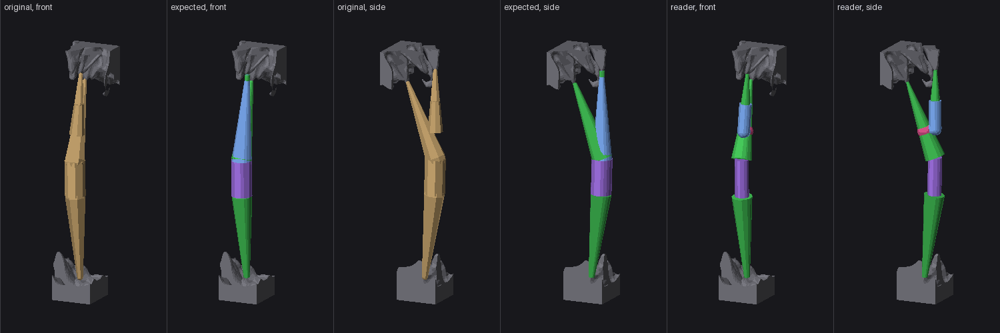

**Situation.** mini support on a host: leaf on strut (a section).

**Source.** Malediction, model `79744c8e-1516-4a26-bfb3-aba15c2ff13a` (`Malediction/Order/Husks/Husk_3/Husk3_42mm_ReadyToSLice/Husk3_42mm_Supported.stl`), Lychee 6.2.0; Lychee supports s146, s143.

**Holds.** 1 branch, 1 support between two parts of the model; 3 tips (1 mini support with no cone); no raft; model cut to 2 boxes (1.0 mm round each contact); 270 KB of mesh.

**Result.** validate pass, 1 tips pass, 1 tip shape pass, 2 routes pass, 2 shafts pass, 2 braces pass, 2 joints **fail**, 4a clips (nominal) pass, 4b loops (nominal) pass.

- 2 joints: `support s146: 1 joints, Lychee 0`

#### l05_leaf_on_leaf

A mini support on a mini support.

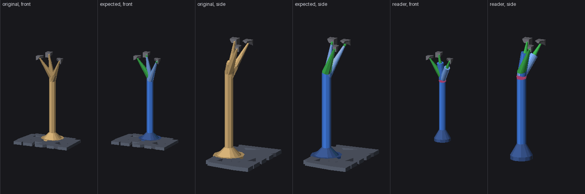

**Situation.** mini support on a host: leaf on leaf (a section).

**Source.** MrModulork, model `fdba2709-3be5-4a33-9eab-fd18368d97c5` (`MrModulork/Extracted/Jetpack Orcs - Modular Kit A/Presupported/STL_SpeedkultRokkitBoyz_HeadA_01_Supported.stl`), Lychee 4.2.0-beta; Lychee supports s32, s28, s29.

**Holds.** 1 trunk, 2 branches; 3 tips (2 mini supports with no cone); with the raft under it; model cut to 3 boxes (0.5 mm round each contact); 357 KB of mesh.

Note: over the 300 KB mesh budget at the smallest cut.

Note: the model is cut round the contacts only: the supports also come within 0.35 mm of it elsewhere.

**Result.** validate pass, 1 tips pass, 1 tip shape pass, 2 routes pass, 2 shafts pass, 2 braces pass, 2 joints **fail**, 4a clips (nominal) pass, 4b loops (nominal) pass.

- 2 joints: `support s32: 1 joints, Lychee 0`

#### l07_leaf_long

A mini support over 6 mm long.

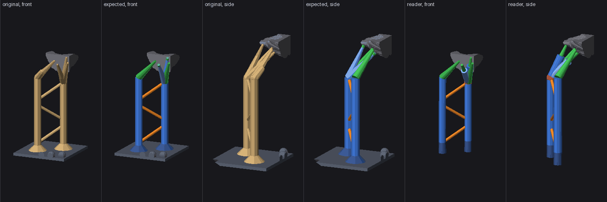

**Situation.** mini support on a host: leaf long (a section).

**Source.** Malediction, model `d2878b82-c53e-4c39-ba44-8739d80b427a` (`Malediction/Legion/Miniatures/DuskwoodProwler/DuskwoodProwler_Pose2/DuskwoodProwler_42mm_Pose2_ReadytoSlice/DuskwoodProwler_42mm_Pose2_Base_Supporte.stl`), Lychee 6.2.0; Lychee supports s414, s415, s416, s26, s27, s28, s29.

**Holds.** 2 trunks, 2 branches, 3 braces; 4 tips (2 mini supports with no cone); with the raft under it; model cut to 1 box (1.5 mm round each contact); 318 KB of mesh.

Note: 2 supports welded to the case's shells were added.

Note: 1 braces welded into the case's shells are kept by their lines.

**Result.** validate pass, 1 tips pass, 1 tip shape pass, 2 routes pass, 2 shafts pass, 2 braces pass, 2 joints **fail**, 4a clips (nominal) pass, 4b loops (nominal) pass.

- 2 joints: `support s28: 1 joints, Lychee 0`

### Supports between two parts of the model

#### m01_hair

A hair support between two parts of the model, under 1 mm long.

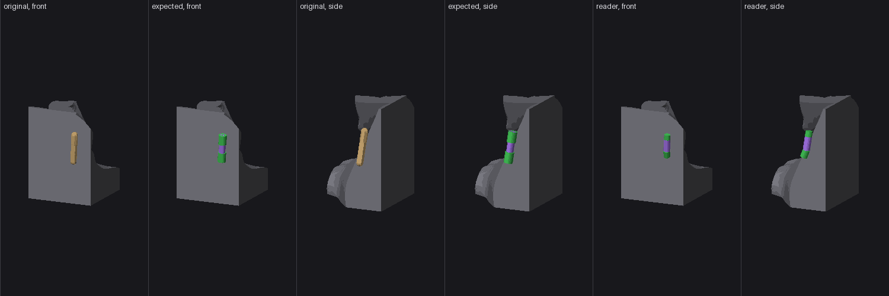

**Situation.** support between two parts of the model: hair (a whole structure).

**Source.** Kinsfolk Miniatures, model `70f1bf40-6268-4931-9559-e8916f1f8a27` (`Kinsfolk Miniatures/Woodland Hooble Goobles - Rascal Party/Supported/Hooble Goobles - Clobba 02 (Supported).stl`), Lychee 6.2.0; Lychee supports s3357.

**Holds.** 1 support between two parts of the model; 2 tips (1 mini support with no cone); no raft; model cut to 1 box (1.0 mm round each contact); 232 KB of mesh.

**Result.** validate pass, 1 tips pass, 1 tip shape pass, 2 routes pass, 2 shafts pass, 2 braces pass, 2 joints pass, 4a clips (nominal) pass, 4b loops (nominal) pass.

#### m02_hair_direction

A hair support between two parts of the model that the reader misses.

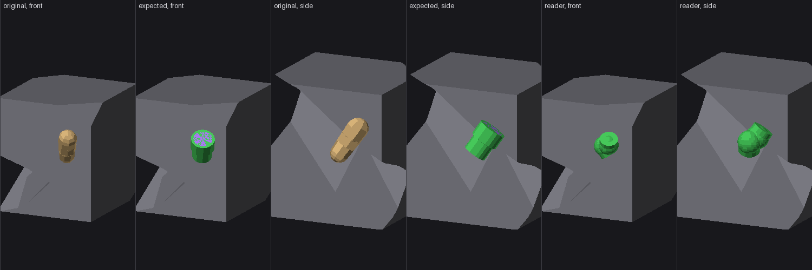

**Situation.** support between two parts of the model: hair direction (a whole structure).

**Source.** Nerikson, model `dde67a86-f36d-45d6-a591-a958467435c5` (`Nerikson/NK_ElfMage/STL/Presupported/STL/Presupported_Elf_Mage_Base.stl`), Lychee 5.0.1; Lychee supports s7.

**Holds.** 1 support between two parts of the model; 2 tips (1 mini support with no cone); no raft; model cut to 1 box (1.5 mm round each contact); 38 KB of mesh.

**Result.** validate pass, 1 tips pass, 1 tip shape pass, 2 routes pass, 2 shafts pass, 2 braces pass, 2 joints pass, 4a clips (nominal) pass, 4b loops (nominal) pass.

#### m03_micro

A mini support between two parts of the model, 1 to 5 mm long.

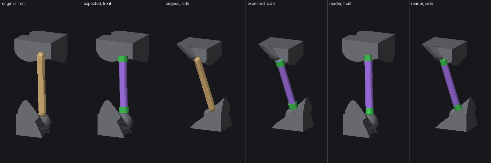

**Situation.** support between two parts of the model: micro (a whole structure).

**Source.** Death x Tiles, model `363c280a-d013-4882-a42d-c28a56f5f790` (`Death x Tiles/Collabs/Ghamak/898 Complete Black waste Orcs 4/898_Black_waste_orcs_Supported/OHS_M85_P02_05_ArmL Supported.stl`), Lychee 7.0.1; Lychee supports s564.

**Holds.** 1 support between two parts of the model; 2 tips (1 mini support with no cone); no raft; model cut to 2 boxes (1.25 mm round each contact); 176 KB of mesh.

**Result.** validate pass, 1 tips pass, 1 tip shape pass, 2 routes pass, 2 shafts pass, 2 braces pass, 2 joints pass, 4a clips (nominal) pass, 4b loops (nominal) pass.

#### m04_micro_extra_tip

A mini support between two parts of the model with an extra reader tip.

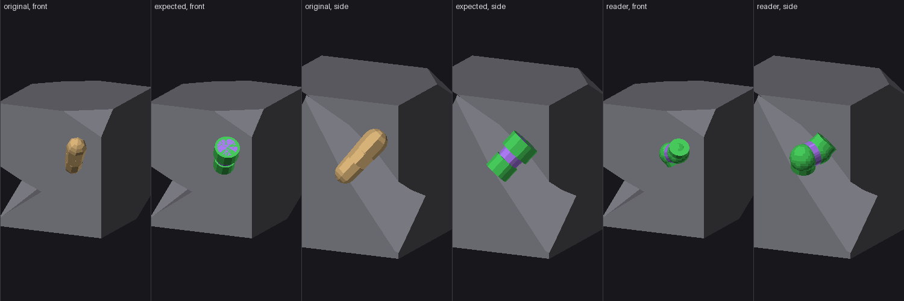

**Situation.** support between two parts of the model: micro extra tip (a whole structure).

**Source.** Nerikson, model `dde67a86-f36d-45d6-a591-a958467435c5` (`Nerikson/NK_ElfMage/STL/Presupported/STL/Presupported_Elf_Mage_Base.stl`), Lychee 5.0.1; Lychee supports s4.

**Holds.** 1 support between two parts of the model; 2 tips (1 mini support with no cone); no raft; model cut to 1 box (1.5 mm round each contact); 40 KB of mesh.

**Result.** validate pass, 1 tips pass, 1 tip shape pass, 2 routes pass, 2 shafts pass, 2 braces pass, 2 joints pass, 4a clips (nominal) pass, 4b loops (nominal) pass.

#### m05_micro_long

A mini support between two parts of the model, over 5 mm long.

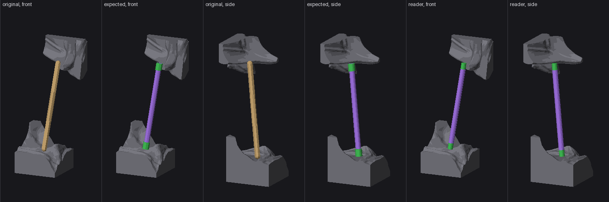

**Situation.** support between two parts of the model: micro long (a whole structure).

**Source.** Malediction, model `79744c8e-1516-4a26-bfb3-aba15c2ff13a` (`Malediction/Order/Husks/Husk_3/Husk3_42mm_ReadyToSLice/Husk3_42mm_Supported.stl`), Lychee 6.2.0; Lychee supports s151.

**Holds.** 1 support between two parts of the model; 2 tips (1 mini support with no cone); no raft; model cut to 2 boxes (1.25 mm round each contact); 215 KB of mesh.

**Result.** validate pass, 1 tips pass, 1 tip shape pass, 2 routes pass, 2 shafts pass, 2 braces pass, 2 joints pass, 4a clips (nominal) pass, 4b loops (nominal) pass.

#### m06_strut

A cone-ended support between two parts of the model.

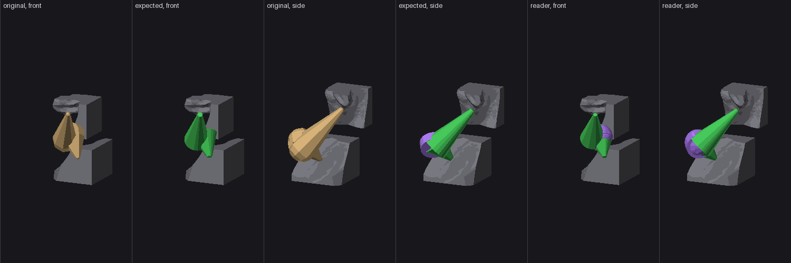

**Situation.** support between two parts of the model: strut (a whole structure).

**Source.** Kinsfolk Miniatures, model `35ba31e3-85a1-4354-8086-7d5697d2a92c` (`Kinsfolk Miniatures/Woodland Hooble Goobles - Rascal Party/Supported/Hooble Goobles - Big Clobba 02 (Supported).stl`), Lychee 6.2.0; Lychee supports s1471.

**Holds.** 1 support between two parts of the model; 2 tips; no raft; model cut to 2 boxes (0.65 mm round each contact); 227 KB of mesh.

**Result.** validate pass, 1 tips pass, 1 tip shape pass, 2 routes pass, 2 shafts pass, 2 braces pass, 2 joints **fail**, 4a clips (nominal) pass, 4b loops (nominal) pass.

- 2 joints: `support s1471: 1 joints, Lychee 0`

#### m07_strut_wrong

A cone-ended support between two parts of the model the reader gets wrong.

**Situation.** support between two parts of the model: strut wrong (a whole structure).

**Source.** Nerikson, model `dde67a86-f36d-45d6-a591-a958467435c5` (`Nerikson/NK_ElfMage/STL/Presupported/STL/Presupported_Elf_Mage_Base.stl`), Lychee 5.0.1; Lychee supports s666.

**Holds.** 1 support between two parts of the model; 2 tips; no raft; model cut to 1 box (1.5 mm round each contact); 40 KB of mesh.

**Result.** validate pass, 1 tips pass, 1 tip shape pass, 2 routes pass, 2 shafts pass, 2 braces pass, 2 joints **fail**, 4a clips (nominal) pass, 4b loops (nominal) pass.

- 2 joints: `support s666: 1 joints, Lychee 0`

#### m08_micro_missed

A mini support between two parts of the model (a tip is missed in its whole model).

**Situation.** support between two parts of the model: micro missed (a whole structure).

**Source.** Death x Tiles, model `363c280a-d013-4882-a42d-c28a56f5f790` (`Death x Tiles/Collabs/Ghamak/898 Complete Black waste Orcs 4/898_Black_waste_orcs_Supported/OHS_M85_P02_05_ArmL Supported.stl`), Lychee 7.0.1; Lychee supports s544.

**Holds.** 1 support between two parts of the model; 2 tips (1 mini support with no cone); no raft; model cut to 1 box (1.0 mm round each contact); 230 KB of mesh.

**Result.** validate pass, 1 tips pass, 1 tip shape pass, 2 routes pass, 2 shafts pass, 2 braces pass, 2 joints pass, 4a clips (nominal) pass, 4b loops (nominal) **fail**.

- 4b loops (nominal): `tip s544: loop 0.20 mm, the original's is 0.22`

#### m09_micro_as_branch

A mini support between two parts of the model that the reader misses.

**Situation.** support between two parts of the model: micro as branch (a whole structure).

**Source.** Heroes Infinite, model `56ea9e5a-b1da-4042-9ce5-eb02c475d44b` (`Heroes Infinite/Overlord Sisters of Eternal Mercy - Unending Pilgrimage (December 2025)/Minis/Supported/STL_Penitent_Monk_Supported/STL_Penitent_Monk_Banner_Supported.stl`), Lychee 7.5.0; Lychee supports s55.

**Holds.** 1 support between two parts of the model; 2 tips (1 mini support with no cone); no raft; model cut to 1 box (1.25 mm round each contact); 202 KB of mesh.

**Result.** validate pass, 1 tips pass, 1 tip shape pass, 2 routes pass, 2 shafts pass, 2 braces pass, 2 joints pass, 4a clips (nominal) pass, 4b loops (nominal) pass.

### Braces

#### x01_brace

Two trunks joined by one diagonal brace.

**Situation.** brace (a section).

**Source.** Dungeon Classics, model `e93b0704-47a3-42d5-b547-ee8dba29ae53` (`Dungeon Classics/Drow Male/Supported/STL_Drow_Male_base_Supported.stl`), Lychee 6.2.0; Lychee supports s2442, s2602, s2419.

**Holds.** 2 trunks, 1 brace; 2 tips; with the raft under it; model cut to 2 boxes (1.5 mm round each contact); 152 KB of mesh.

**Result.** validate pass, 1 tips pass, 1 tip shape pass, 2 routes pass, 2 shafts pass, 2 braces pass, 2 joints pass, 4a clips (nominal) pass, 4b loops (nominal) pass.

#### x03_brace_x

Two trunks joined by crossed braces (an X).

**Situation.** brace x (a section).

**Source.** Station Forge, model `6b37ef0f-b6f3-4db8-bc91-0d37dfff85f8` (`Station Forge/Diorama Stands/Church 1/SUPPORTED_Angel R (repaired).stl`), Lychee 5.4.3; Lychee supports s3, s4, s61, s62.

**Holds.** 2 trunks, 2 braces; 2 tips; with the raft under it; model cut to 1 box (0.8 mm round each contact); 237 KB of mesh.

**Result.** validate pass, 1 tips pass, 1 tip shape pass, 2 routes pass, 2 shafts pass, 2 braces pass, 2 joints pass, 4a clips (nominal) pass, 4b loops (nominal) pass.

#### x04_brace_x_ends

Crossed braces the reader reads differently: one as a shaft, others where Lychee has none.

**Situation.** brace x ends (a section).

**Source.** Station Forge, model `6b37ef0f-b6f3-4db8-bc91-0d37dfff85f8` (`Station Forge/Diorama Stands/Church 1/SUPPORTED_Angel R (repaired).stl`), Lychee 5.4.3; Lychee supports s4, s5, s60, s57, s58, s59, s2.

**Holds.** 3 trunks, 4 braces; 3 tips; with the raft under it; model cut to 2 boxes (0.65 mm round each contact); 283 KB of mesh.

Note: 1 supports were added as the far hosts of braces welded into the case's shells.

Note: 3 braces welded into the case's shells are kept by their lines.

**Result.** validate pass, 1 tips pass, 1 tip shape pass, 2 routes pass, 2 shafts pass, 2 braces **fail**, 2 joints pass, 4a clips (nominal) pass, 4b loops (nominal) pass.

Accepted readings: 1 brace into the root zone read as a leg.

- 2 braces: `brace s60: the reader has braces along it, with other ends`
- 2 braces: `extra brace near [-1.5, -6.2, 1.4]: Lychee has braces along it, with other ends`
- 2 braces: `extra brace near [-2.5, -5.4, 2.8]: Lychee has braces along it, with other ends`

#### x05_brace_zigzag

Two trunks joined by a zigzag of braces.

**Situation.** brace zigzag (a section).

**Source.** Nerikson, model `b49fa848-13f2-46f1-a39e-ff8d868baa6e` (`Nerikson/NK_HalflingRogue/STL/Presupported/STL/STL_Halfling_Rogue_Base_Presupported.stl`), Lychee 5.4.3; Lychee supports s410, s399, s411, s400, s412, s401, s413, s402, s403, s404, s405, s406 and 6 more.

**Holds.** 2 trunks, 16 braces; 2 tips; with the raft under it; model cut to 1 box (1.5 mm round each contact); 103 KB of mesh.

Note: 1 braces welded into the case's shells are kept by their lines.

**Result.** validate pass, 1 tips pass, 1 tip shape pass, 2 routes pass, 2 shafts pass, 2 braces pass, 2 joints pass, 4a clips (nominal) pass, 4b loops (nominal) pass.

#### x06_brace_zigzag_lost

A zigzag of braces with a brace the reader loses.

**Situation.** brace zigzag lost (a section).

**Source.** Creature Caster, model `541a9684-44e4-4d80-b092-3ddb2a564937` (`Creature Caster/Individual Models/The Procurement Guild/Scavengers/Supported/STL/Scavenger 8 Base Supported.stl`), Lychee 5.0.0; Lychee supports s4670, s4671, s4672, s4673, s4664, s4665, s4666, s4667, s4668, s4669, s4648, s4649 and 1 more.

**Holds.** 3 trunks, 10 braces; 3 tips; with the raft under it; model cut to 3 boxes (1.25 mm round each contact); 285 KB of mesh.

Note: 1 supports welded to the case's shells were added.

**Result.** validate pass, 1 tips pass, 1 tip shape pass, 2 routes pass, 2 shafts pass, 2 braces **fail**, 2 joints pass, 4a clips (nominal) pass, 4b loops (nominal) pass.

- 2 braces: `brace s4670: the reader has nothing there`
- 2 braces: `extra brace near [11.2, -2.2, 3.6]: Lychee has braces along it, with other ends`
- 2 braces: `extra brace near [9.0, -1.2, 6.0]: Lychee has braces along it, with other ends`
- 2 braces: `extra brace near [11.2, -2.2, 8.4]: Lychee has braces along it, with other ends`
- 2 braces: and 3 more

#### x07_brace_ladder

Two trunks joined by parallel braces (a ladder).

**Situation.** brace ladder (a section).

**Source.** Station Forge, model `6b37ef0f-b6f3-4db8-bc91-0d37dfff85f8` (`Station Forge/Diorama Stands/Church 1/SUPPORTED_Angel R (repaired).stl`), Lychee 5.4.3; Lychee supports s50, s15, s49, s17.

**Holds.** 2 trunks, 2 braces; 2 tips; with the raft under it; model cut to 2 boxes (0.5 mm round each contact); 192 KB of mesh.

Note: the model is cut round the contacts only: the supports also come within 0.35 mm of it elsewhere.

**Result.** validate pass, 1 tips pass, 1 tip shape pass, 2 routes pass, 2 shafts pass, 2 braces pass, 2 joints pass, 4a clips (nominal) pass, 4b loops (nominal) pass.

#### x09_brace_foot

A brace with its lower end in the root zone (under 2 mm), read as a shaft.

**Situation.** brace foot (a section).

**Source.** Heroes Infinite, model `a1978143-192d-436f-bddd-8da4cfaf7532` (`Heroes Infinite/Grim Darkness of the Expurgators Part I/Miniatures/Supported/STL_Evercursed_SUPPORTED/STL_Evercursed_A_base_FIX_Supported.stl`), Lychee 5.4.3; Lychee supports s102, s103, s104, s105, s97, s98, s99, s24, s27, s100, s101.

**Holds.** 2 trunks, 9 braces; 2 tips; with the raft under it; model cut to 1 box (1.5 mm round each contact); 100 KB of mesh.

Note: 8 braces welded into the case's shells are kept by their lines.

**Result.** validate pass, 1 tips pass, 1 tip shape pass, 2 routes pass, 2 shafts pass, 2 braces pass, 2 joints pass, 4a clips (nominal) pass, 4b loops (nominal) pass.

Accepted readings: 1 brace into the root zone read as a leg.

#### x11_brace_in_root_zone

A brace wholly in the root zone (both ends under 2 mm), beside one with its lower end there.

**Situation.** brace in root zone (a section).

**Source.** Malediction, model `07f6f4b2-6a9e-4ab2-9991-e04ac8a441f2` (`Malediction/Primal/Miniatures/BoneclawRaider/BoneclawRaider_42mm_Pose1/BoneclawRaider_42mm_Pose1_ReadyToSlice/BoneclawRaider_42mm_Pose1_Base_Supported.stl`), Lychee 6.0.2; Lychee supports s940, s798, s941, s920, s921, s855, s857, s939, s919.

**Holds.** 3 trunks, 6 braces; 3 tips; with the raft under it; model cut to 1 box (1.5 mm round each contact); 279 KB of mesh.

Note: 1 supports were added as the far hosts of braces welded into the case's shells.

Note: 1 braces welded into the case's shells are kept by their lines.

**Result.** validate pass, 1 tips pass, 1 tip shape pass, 2 routes pass, 2 shafts pass, 2 braces pass, 2 joints pass, 4a clips (nominal) pass, 4b loops (nominal) pass.

Accepted readings: 1 brace wholly under 2 mm left out.

#### x12_brace_steep

A steep brace.

**Situation.** brace steep (a section).

**Source.** DM Stash, model `354e5d8b-8648-4a38-a742-ba7a9ffbdedd` (`DM Stash/Dragonborn Pugilist - Kuthrak'Va/Supported/STL/75_Supported_KuthrakVa_Base.stl`), Lychee 5.4.3; Lychee supports s32662, s32663, s32633, s32479, s33029, s32634, s33030, s33031, s32660, s32661.

**Holds.** 3 trunks, 7 braces; 3 tips; with the raft under it; model cut to 3 boxes (1.5 mm round each contact); 196 KB of mesh.

Note: 1 supports welded to the case's shells were added.

Note: 6 braces welded into the case's shells are kept by their lines.

**Result.** validate pass, 1 tips pass, 1 tip shape pass, 2 routes pass, 2 shafts pass, 2 braces pass, 2 joints pass, 4a clips (nominal) pass, 4b loops (nominal) pass.

#### x13_brace_long

A brace over 10 mm long.

**Situation.** brace long (a section).

**Source.** PiperMakes, model `f5e287db-c10b-44c2-a8ee-ef4036c48c5d` (`PiperMakes/Gravtank Fullpack/Extracted/SupportedSTLs/MissileShield/ShieldLoose_Supported.stl`), Lychee 3.4.0; Lychee supports s212, s256, s289, s257, s258, s259, s128, s160, s260, s163, s284, s285 and 6 more.

**Holds.** 4 trunks, 1 branch, 13 braces; 5 tips; with the raft under it; model cut to 4 boxes (0.5 mm round each contact); 460 KB of mesh.

Note: 2 supports welded to the case's shells were added.

Note: over the 400 KB mesh budget at the smallest cut.

Note: the model is cut round the contacts only: the supports also come within 0.35 mm of it elsewhere.

**Result.** validate pass, 1 tips pass, 1 tip shape pass, 2 routes pass, 2 shafts pass, 2 braces pass, 2 joints **fail**, 4a clips (nominal) pass, 4b loops (nominal) pass.

- 2 joints: `support s163: 1 joints, Lychee 0`
- 2 joints: `support s132: 1 joints, Lychee 0`

#### x14_brace_short

A brace under 1.5 mm long.

**Situation.** brace short (a section).

**Source.** Death x Tiles, model `363c280a-d013-4882-a42d-c28a56f5f790` (`Death x Tiles/Collabs/Ghamak/898 Complete Black waste Orcs 4/898_Black_waste_orcs_Supported/OHS_M85_P02_05_ArmL Supported.stl`), Lychee 7.0.1; Lychee supports s553, s566, s610, s567, s600, s611, s512, s601, s612, s602, s613, s603 and 9 more.

**Holds.** 3 trunks, 1 branch, 17 braces; 4 tips; with the raft under it; model cut to 3 boxes (1.0 mm round each contact); 340 KB of mesh.

Note: 1 supports welded to the case's shells were added.

Note: 14 braces welded into the case's shells are kept by their lines.

**Result.** validate pass, 1 tips pass, 1 tip shape pass, 2 routes pass, 2 shafts pass, 2 braces **fail**, 2 joints **fail**, 4a clips (nominal) pass, 4b loops (nominal) pass.

Accepted readings: 3 braces into the root zone read as legs.

- 2 braces: `brace s610: the reader has nothing there`
- 2 braces: `brace s600: the reader has braces along it, with other ends`
- 2 braces: `brace s611: the reader has nothing there`
- 2 braces: `brace s612: the reader has nothing there`
- 2 braces: and 21 more
- 2 joints: `support s566: 2 joints, Lychee 0`

#### x16_brace_branch

A brace between a branch and a trunk.

**Situation.** brace branch (a section).

**Source.** PiperMakes, model `f5e287db-c10b-44c2-a8ee-ef4036c48c5d` (`PiperMakes/Gravtank Fullpack/Extracted/SupportedSTLs/MissileShield/ShieldLoose_Supported.stl`), Lychee 3.4.0; Lychee supports s300, s301, s302, s216, s293, s294, s152, s143, s144.

**Holds.** 2 trunks, 1 branch, 6 braces; 3 tips; with the raft under it; model cut to 1 box (1.5 mm round each contact); 248 KB of mesh.

**Result.** validate pass, 1 tips pass, 1 tip shape pass, 2 routes pass, 2 shafts pass, 2 braces **fail**, 2 joints **fail**, 4a clips (nominal) pass, 4b loops (nominal) pass.

Accepted readings: 1 brace into the root zone read as a leg.

- 2 braces: `brace s216: the reader has braces along it, with other ends`
- 2 braces: `brace s293: the reader has nothing there`
- 2 braces: `extra brace near [-26.8, -9.4, 6.0]: Lychee has braces along it, with other ends`
- 2 braces: `extra brace near [-29.8, -7.5, 8.8]: Lychee has nothing there`
- 2 braces: and 1 more
- 2 joints: `support s143: 1 joints, Lychee 0`
- 2 joints: `support s144: 1 joints, Lychee 0`

#### x17_brace_kickstand

A brace between a kickstand and a trunk.

**Situation.** brace kickstand (a section).

**Source.** DM Stash, model `c3367585-9e09-4fce-a752-f76a558c34c3` (`DM Stash/Eldritch Abomination Vessel - Ark of the Enlightened/Supported/STL/32_Supported_Ark_Tentacle6.stl`), Lychee 6.0.2; Lychee supports s34323, s34334, s34324, s34325, s34326, s34327, s34328, s34329, s34319, s34262, s34330, s34320 and 5 more.

**Holds.** 1 trunk, 2 kickstands, 14 braces; 1 tip; with the raft under it; model cut to 1 box (1.5 mm round each contact); 175 KB of mesh.

Note: 1 supports welded to the case's shells were added.

Note: 14 braces welded into the case's shells are kept by their lines.

Note: s34327: kickstand drawn as an upright pillar and a 45 degree run (fitted to the mesh).

Note: s34319: kickstand drawn as an upright pillar and a 45 degree run (fitted to the mesh).

**Result.** validate pass, 1 tips pass, 1 tip shape pass, 2 routes pass, 2 shafts pass, 2 braces pass, 2 joints pass, 4a clips (nominal) pass, 4b loops (nominal) pass.

#### x18_brace_struts

A brace between two supports that stand on the model.

**Situation.** brace struts (a section).

**Source.** Claymore Miniatures, model `203d8125-eec2-4f2e-a427-32cdd9b085fc` (`Claymore Miniatures/Al'Fanor, High Mage - M/75mm/Supported/STL Files/AlFanor_base_75_SUP.stl`), Lychee 7.3.2; Lychee supports s730, s721, s743, s744, s723, s745, s724, s746, s727, s738, s739, s708.

**Holds.** 2 branches, 4 supports between two parts of the model, 6 braces; 10 tips; no raft; model cut to 5 boxes (1.5 mm round each contact); 182 KB of mesh.

Note: 3 supports welded to the case's shells were added.

Note: 1 supports welded to the case's shells were added.

Note: 4 braces welded into the case's shells are kept by their lines.

**Result.** validate pass, 1 tips pass, 1 tip shape pass, 2 routes **fail**, 2 shafts **fail**, 2 braces **fail**, 2 joints **fail**, 4a clips (nominal) pass, 4b loops (nominal) pass.

Accepted readings: 1 shaft and brace swapped at a socket.

- 2 routes: `tip s721: route differs (41% of Lychee's line covered, 53% of the reader's)`
- 2 shafts: `72% of Lychee's shaft length has a reader shaft`
- 2 braces: `brace s745: the reader has nothing there`
- 2 braces: `brace s746: the reader has nothing there`
- 2 braces: `brace s738: the reader reads a shaft there`
- 2 braces: `extra brace near [-7.2, 10.3, 27.6]: Lychee has nothing there`
- 2 braces: and 7 more
- 2 joints: `support s730: 1 joints, Lychee 0`
- 2 joints: `support s723: 1 joints, Lychee 0`
- 2 joints: `support s727: 1 joints, Lychee 0`
- 2 joints: `support s708: 1 joints, Lychee 0`

#### x19_brace_branch_strut

A brace between a branch and a support standing on the model.

**Situation.** brace branch strut (a section).

**Source.** Claymore Miniatures, model `203d8125-eec2-4f2e-a427-32cdd9b085fc` (`Claymore Miniatures/Al'Fanor, High Mage - M/75mm/Supported/STL Files/AlFanor_base_75_SUP.stl`), Lychee 7.3.2; Lychee supports s740, s700, s702, s704.

**Holds.** 1 branch, 2 supports between two parts of the model, 1 brace; 5 tips; no raft; model cut to 3 boxes (1.5 mm round each contact); 92 KB of mesh.

**Result.** validate pass, 1 tips pass, 1 tip shape pass, 2 routes pass, 2 shafts pass, 2 braces pass, 2 joints **fail**, 4a clips (nominal) pass, 4b loops (nominal) pass.

- 2 joints: `support s700: 1 joints, Lychee 0`
- 2 joints: `support s704: 1 joints, Lychee 0`

#### x20_cage_a

Three or more trunks tied by braces.

**Situation.** cage (a section).

**Source.** Flesh of Gods, model `3ccfb8c9-56c4-46cd-a8c4-7ed03b5b6ad9` (`Flesh of Gods/Necrotech Brute/75MM - Enemy - Necrotech Brute/STL_Necrotech-Brute_base_75MM_Supported.stl`), Lychee 6.0.2; Lychee supports s169, s137, s52, s141.

**Holds.** 4 trunks; 4 tips; with the raft under it; model cut to 4 boxes (1.5 mm round each contact); 164 KB of mesh.

Note: 2 shells along the kept supports' lines were added (they were given to neighbours outside the case).

Note: no mesh in the case for the braces s245, s267, s264, s244.

**Result.** validate pass, 1 tips pass, 1 tip shape pass, 2 routes pass, 2 shafts pass, 2 braces pass, 2 joints pass, 4a clips (nominal) pass, 4b loops (nominal) pass.

#### x20_cage_b

Three or more trunks tied by braces.

**Situation.** cage (a section).

**Source.** Loot Studios, model `2cff42b0-b6f2-45c2-b043-8bef4f0b2a37` (`Loot Studios/Arkham Horror/Crawling Chaos/All_CrawlingChaos_42mm/All_CrawlingChaos_Monster_42mm/CrawlingChaos_Monster_42mm_ReadyToSlice/GreatRaceOfYith_42mm_ReadytoSlice/GreatRaceOfYith_42mm_Base_Supported.stl`), Lychee 6.0.2; Lychee supports s8083, s8084, s8085, s8046, s8047, s7950, s7934, s7935, s7949.

**Holds.** 4 trunks, 5 braces; 4 tips; with the raft under it; model cut to 4 boxes (1.5 mm round each contact); 234 KB of mesh.

Note: 2 braces welded into the case's shells are kept by their lines.

**Result.** validate pass, 1 tips pass, 1 tip shape pass, 2 routes pass, 2 shafts pass, 2 braces pass, 2 joints pass, 4a clips (nominal) pass, 4b loops (nominal) pass.

### Supports inside hollows and deep recesses

#### h01_hollow_strut

A support between two inner faces of a hollow or deep recess.

**Situation.** inside a hollow or deep recess: strut (a whole structure).

**Source.** Loot Studios, model `c9144c30-6aa2-4cbf-9b00-0ceedb63236c` (`Loot Studios/Sci-Fi/Horrors From Beyond (April 2024)/All_75mm_HorrorsFromBeyond/All_HorrorsFromBeyond_Adults_75mm/HorrorsFromBeyond_Adults_75mm_ReadyToSlice/OfficerChristopherSanders_75mm_ReadyToSlice/OfficerChristopherSanders_75mm_Base_Supported_Hollow.stl`), Lychee 5.2.2; Lychee supports s2390.

**Holds.** 1 support between two parts of the model; 2 tips (1 mini support with no cone); no raft; model cut to 2 boxes (1.5 mm round each contact); 33 KB of mesh.

**Result.** validate pass, 1 tips pass, 1 tip shape pass, 2 routes pass, 2 shafts pass, 2 braces pass, 2 joints pass, 4a clips (nominal) pass, 4b loops (nominal) **fail**.

- 4b loops (nominal): `tip s2390 (base end): loop 1.45 mm, the original's is 1.26`

#### h02_hollow_trunk

A trunk standing inside a hollow or deep recess.

**Situation.** inside a hollow or deep recess: trunk (a section).

**Source.** Nerikson, model `dde67a86-f36d-45d6-a591-a958467435c5` (`Nerikson/NK_ElfMage/STL/Presupported/STL/Presupported_Elf_Mage_Base.stl`), Lychee 5.0.1; Lychee supports s996, s2590, s2591, s2592, s2593, s2550, s2594, s2551, s2552, s2233, s2553, s2234 and 8 more.

**Holds.** 3 trunks, 1 branch, 16 braces; 4 tips; with the raft under it; model cut to 2 boxes (1.5 mm round each contact); 298 KB of mesh.

Note: 2 supports welded to the case's shells were added.

Note: 1 supports welded to the case's shells were added.

**Result.** validate pass, 1 tips pass, 1 tip shape pass, 2 routes pass, 2 shafts pass, 2 braces **fail**, 2 joints pass, 4a clips (nominal) pass, 4b loops (nominal) pass.

Accepted readings: 1 brace through a pillar read in stretches.

- 2 braces: `extra brace near [-10.5, 1.4, 21.8]: Lychee has braces along it, with other ends`
- 2 braces: `extra brace near [-10.5, 1.4, 3.6]: Lychee has braces along it, with other ends`
- 2 braces: `extra brace near [-10.5, 1.4, 7.1]: Lychee has braces along it, with other ends`
- 2 braces: `extra brace near [-9.9, -0.3, 8.9]: Lychee has braces along it, with other ends`
- 2 braces: and 5 more

#### h03_hollow_branch

A branch inside a hollow or deep recess.

**Situation.** inside a hollow or deep recess: branch (a section).

**Source.** Claymore Miniatures, model `203d8125-eec2-4f2e-a427-32cdd9b085fc` (`Claymore Miniatures/Al'Fanor, High Mage - M/75mm/Supported/STL Files/AlFanor_base_75_SUP.stl`), Lychee 7.3.2; Lychee supports s687, s694.

**Holds.** 1 branch, 1 support between two parts of the model; 3 tips; no raft; model cut to 3 boxes (1.5 mm round each contact); 46 KB of mesh.

**Result.** validate pass, 1 tips pass, 1 tip shape pass, 2 routes pass, 2 shafts pass, 2 braces pass, 2 joints **fail**, 4a clips (nominal) pass, 4b loops (nominal) pass.

- 2 joints: `support s687: 1 joints, Lychee 0`

### Shells

#### w01_welded

A structure from a file whose supports are welded into few shells.

**Situation.** shells: welded (a whole structure).

**Source.** Heroes Infinite, model `2d809f62-0ddd-4f98-b421-7be4cd037583` (`Heroes Infinite/Sisters of Eternal Mercy - Unending Pilgrimage REINFORCEMENTS/Bases/STL_Bases_SUPPORTED/STL_80x80-01_Supported.stl`), Lychee 7.5.2; Lychee supports s9140, s9128.

**Holds.** 1 trunk, 1 branch; 2 tips; with the raft under it; model cut to 1 box (1.5 mm round each contact); 121 KB of mesh.

**Result.** validate pass, 1 tips pass, 1 tip shape pass, 2 routes pass, 2 shafts pass, 2 braces pass, 2 joints pass, 4a clips (nominal) pass, 4b loops (nominal) pass.

Accepted readings: 1 branch from inside a trunk's foot read with a foot of its own.

#### w02_welded_braces

Braced trunks from a file whose supports are welded into few shells.

**Situation.** shells: welded braces (a section).

**Source.** Nerikson, model `b49fa848-13f2-46f1-a39e-ff8d868baa6e` (`Nerikson/NK_HalflingRogue/STL/Presupported/STL/STL_Halfling_Rogue_Base_Presupported.stl`), Lychee 5.4.3; Lychee supports s531, s532, s533, s534, s535, s536, s537, s538, s109, s527, s528, s529 and 2 more.

**Holds.** 2 trunks, 12 braces; 2 tips; with the raft under it; model cut to 2 boxes (1.5 mm round each contact); 85 KB of mesh.

Note: 4 braces welded into the case's shells are kept by their lines.

**Result.** validate pass, 1 tips pass, 1 tip shape pass, 2 routes pass, 2 shafts pass, 2 braces pass, 2 joints pass, 4a clips (nominal) pass, 4b loops (nominal) pass.

#### w03_many_shells

A structure from a file with many shells per support.

**Situation.** shells: many shells (a whole structure).

**Source.** PiperMakes, model `f5e287db-c10b-44c2-a8ee-ef4036c48c5d` (`PiperMakes/Gravtank Fullpack/Extracted/SupportedSTLs/MissileShield/ShieldLoose_Supported.stl`), Lychee 3.4.0; Lychee supports s110.

**Holds.** 1 trunk; 1 tip; with the raft under it; model cut to 1 box (1.5 mm round each contact); 165 KB of mesh.

**Result.** validate pass, 1 tips pass, 1 tip shape pass, 2 routes pass, 2 shafts pass, 2 braces pass, 2 joints pass, 4a clips (nominal) pass, 4b loops (nominal) pass.

### Nerikson's Elf Mage

#### e01_elf_kickstand

Elf Mage: a kickstand.

**Situation.** Nerikson's Elf Mage: kickstand (a section).

**Source.** Nerikson, model `01a23637-6151-4ee3-b593-dd5bb1856706` (`Nerikson/NK_ElfMage/STL/Presupported/STL/Presupported_Elf_Mage_Body.stl`), Lychee 5.0.1; Lychee supports s2166, s7710, s7711, s7712, s7713, s7714, s7715, s2315, s7705, s7716, s7706, s7717 and 5 more.

**Holds.** 1 trunk, 1 kickstand, 15 braces; 1 tip; with the raft under it; model cut to 1 box (0.5 mm round each contact); 183 KB of mesh.

Note: 2 stubs of supports outside the case, welded into the kept shells, were cut off (s5636, s8287, s8288, s8834, s909).

Note: the model is cut round the contacts only: the supports also come within 0.35 mm of it elsewhere.

Note: s2315: kickstand drawn as an upright pillar and a 45 degree run (fitted to the mesh).

**Result.** validate pass, 1 tips pass, 1 tip shape pass, 2 routes pass, 2 shafts pass, 2 braces pass, 2 joints pass, 4a clips (nominal) pass, 4b loops (nominal) pass.

#### e02_elf_branches

Elf Mage: a trunk with branches.

**Situation.** Nerikson's Elf Mage: branches (a whole structure).

**Source.** Nerikson, model `01a23637-6151-4ee3-b593-dd5bb1856706` (`Nerikson/NK_ElfMage/STL/Presupported/STL/Presupported_Elf_Mage_Body.stl`), Lychee 5.0.1; Lychee supports s665, s678, s5528.

**Holds.** 1 trunk, 2 branches; 3 tips; with the raft under it; model cut to 3 boxes (1.5 mm round each contact); 230 KB of mesh.

Note: 1 braces to supports outside the case dangle in the case's welded shells (their far hosts would bring too many supports into the case).

**Result.** validate pass, 1 tips pass, 1 tip shape pass, 2 routes pass, 2 shafts pass, 2 braces pass, 2 joints pass, 4a clips (nominal) pass, 4b loops (nominal) pass.

#### e03_elf_braces

Elf Mage: two braced trunks.

**Situation.** Nerikson's Elf Mage: braces (a section).

**Source.** Nerikson, model `01a23637-6151-4ee3-b593-dd5bb1856706` (`Nerikson/NK_ElfMage/STL/Presupported/STL/Presupported_Elf_Mage_Body.stl`), Lychee 5.0.1; Lychee supports s10420, s10421, s10422, s10423, s10424, s10425, s10426, s515, s10427, s10428, s10418, s10429 and 3 more.

**Holds.** 2 trunks, 13 braces; 2 tips; with the raft under it; model cut to 2 boxes (1.0 mm round each contact); 240 KB of mesh.

Note: the model is cut round the contacts only: the supports also come within 0.35 mm of it elsewhere.

**Result.** validate pass, 1 tips pass, 1 tip shape **fail**, 2 routes pass, 2 shafts pass, 2 braces pass, 2 joints pass, 4a clips (nominal) pass, 4b loops (nominal) pass.

Accepted readings: 1 brace into the root zone read as a leg.

- 1 tip shape: `tip s2159: contact 0.20 mm, Lychee 0.30 (ratio 0.65)`

#### e04_elf_strut

Elf Mage: a support between two parts of the model.

**Situation.** Nerikson's Elf Mage: strut (a whole structure).

**Source.** Nerikson, model `01a23637-6151-4ee3-b593-dd5bb1856706` (`Nerikson/NK_ElfMage/STL/Presupported/STL/Presupported_Elf_Mage_Body.stl`), Lychee 5.0.1; Lychee supports s179.

**Holds.** 1 support between two parts of the model; 2 tips (1 mini support with no cone); no raft; model cut to 1 box (1.5 mm round each contact); 82 KB of mesh.

**Result.** validate pass, 1 tips pass, 1 tip shape pass, 2 routes pass, 2 shafts pass, 2 braces pass, 2 joints pass, 4a clips (nominal) pass, 4b loops (nominal) pass.

### Other creators

#### n1a_factory_fortress_tree

Factory Fortress: a trunk with what hangs from it.

**Situation.** other creators: factory fortress tree (a whole structure).

**Source.** Factory Fortress, model `e369e88f-61f1-4233-b4dc-78ca91066033` (`Trench Crusade/_PIRATED_/Black Grail/TCDM6004 Corpse Guard/Supported/STL_TCDM6004 Corpse Guard_01_arm_L_Supported.stl`), Lychee 7.1.3; Lychee supports s1890, s1891, s1886, s1888, s1889.

**Holds.** 1 trunk, 4 branches; 5 tips (2 mini supports with no cone); with the raft under it; model cut to 4 boxes (0.5 mm round each contact); 429 KB of mesh.

Note: over the 400 KB mesh budget at the smallest cut.

Note: the model is cut round the contacts only: the supports also come within 0.35 mm of it elsewhere.

**Result.** validate pass, 1 tips pass, 1 tip shape pass, 2 routes pass, 2 shafts pass, 2 braces pass, 2 joints **fail**, 4a clips (nominal) pass, 4b loops (nominal) pass.

Accepted readings: 1 branch from inside a trunk's foot read with a foot of its own.

- 2 joints: `support s1890: 2 joints, Lychee 0`

#### n2a_solgood_creations_tree

SolGood Creations: a trunk with what hangs from it.

**Situation.** other creators: solgood creations tree (a whole structure).

**Source.** SolGood Creations, model `891abe26-6182-445b-9a0e-991777cf696f` (`SolGood Creations/ALL Grimdark Terrain-02/15/Pre-Supported/2 hollowed.stl`), Lychee 7.1.0; Lychee supports s43297, s43298.

**Holds.** 1 trunk, 1 branch; 2 tips; with the raft under it; model cut to 1 box (1.5 mm round each contact); 96 KB of mesh.

**Result.** validate pass, 1 tips pass, 1 tip shape pass, 2 routes pass, 2 shafts pass, 2 braces pass, 2 joints pass, 4a clips (nominal) pass, 4b loops (nominal) pass.

#### n3a_the_witchguild_tree

The Witchguild: a trunk with what hangs from it.

**Situation.** other creators: the witchguild tree (a whole structure).

**Source.** The Witchguild, model `d669494a-e8ba-4360-85de-7aa0bbc00c39` (`The Witchguild/Extracted/Pumpkin Witch Figurine/STL - CUT + SUPPORTED/STL_Head_Supported.stl`), Lychee 5.3.1-beta; Lychee supports s173, s174.

**Holds.** 1 trunk, 1 branch; 2 tips; with the raft under it; model cut to 2 boxes (1.5 mm round each contact); 107 KB of mesh.

**Result.** validate pass, 1 tips pass, 1 tip shape pass, 2 routes pass, 2 shafts pass, 2 braces pass, 2 joints pass, 4a clips (nominal) pass, 4b loops (nominal) pass.

#### n3b_the_witchguild_braces

The Witchguild: two braced trunks.

**Situation.** other creators: the witchguild braces (a section).

**Source.** The Witchguild, model `d669494a-e8ba-4360-85de-7aa0bbc00c39` (`The Witchguild/Extracted/Pumpkin Witch Figurine/STL - CUT + SUPPORTED/STL_Head_Supported.stl`), Lychee 5.3.1-beta; Lychee supports s652, s653, s104, s105, s106, s648, s649, s650, s651.

**Holds.** 2 trunks, 1 branch, 6 braces; 3 tips; with the raft under it; model cut to 1 box (1.5 mm round each contact); 134 KB of mesh.

Note: 1 supports welded to the case's shells were added.

Note: 1 braces welded into the case's shells are kept by their lines.

**Result.** validate pass, 1 tips pass, 1 tip shape pass, 2 routes pass, 2 shafts pass, 2 braces **fail**, 2 joints pass, 4a clips (nominal) pass, 4b loops (nominal) pass.

Accepted readings: 1 brace into the root zone read as a leg.

- 2 braces: `brace s651: the reader has nothing there`
- 2 braces: `extra brace near [-20.1, -4.8, 7.9]: Lychee has braces along it, with other ends`
- 2 braces: `extra brace near [-21.2, -2.5, 9.8]: Lychee has nothing there`

#### n4a_bite_the_bullet_tree

Bite the Bullet: a trunk with what hangs from it.

**Situation.** other creators: bite the bullet tree (a whole structure).

**Source.** Bite the Bullet, model `7e2dd4ca-62d5-4cee-9fb5-f5a5bef3adfc` (`Bite The Bullet/Extracted/40_23-10 BULLET HELL HEROES PT.2/_Crossovers/Crossover (CrippledGodFoundry)/Pre-Supported/2310_co_abberant_hybrid_b_ps.stl`), Lychee 5.2.2; Lychee supports s20430.

**Holds.** 1 trunk; 1 tip; with the raft under it; model cut to 1 box (1.5 mm round each contact); 25 KB of mesh.

**Result.** validate pass, 1 tips pass, 1 tip shape pass, 2 routes pass, 2 shafts pass, 2 braces pass, 2 joints pass, 4a clips (nominal) pass, 4b loops (nominal) pass.

#### n5a_dragon_trappers_lodge_tree

Dragon Trappers Lodge: a trunk with what hangs from it.

**Situation.** other creators: dragon trappers lodge tree (a whole structure).

**Source.** Dragon Trappers Lodge, model `7f133a72-7a53-4474-ba38-bc094efbffe9` (`Dragon Trappers Lodge/Champions of the Critterfolk Pt. 1/Sparrow Riders/Supported/D/STL_SparrowRider_D_Stand_v01_Supported.stl`), Lychee 6.0.2; Lychee supports s4541, s4538.

**Holds.** 1 trunk, 1 branch; 2 tips; with the raft under it; model cut to 2 boxes (0.5 mm round each contact); 241 KB of mesh.

Note: the model is cut round the contacts only: the supports also come within 0.35 mm of it elsewhere.

**Result.** validate pass, 1 tips pass, 1 tip shape pass, 2 routes pass, 2 shafts pass, 2 braces pass, 2 joints pass, 4a clips (nominal) pass, 4b loops (nominal) pass.

#### n5b_dragon_trappers_lodge_braces

Dragon Trappers Lodge: two braced trunks.

**Situation.** other creators: dragon trappers lodge braces (a section).

**Source.** Dragon Trappers Lodge, model `7f133a72-7a53-4474-ba38-bc094efbffe9` (`Dragon Trappers Lodge/Champions of the Critterfolk Pt. 1/Sparrow Riders/Supported/D/STL_SparrowRider_D_Stand_v01_Supported.stl`), Lychee 6.0.2; Lychee supports s4546, s4547, s4548.

**Holds.** 2 trunks, 1 brace; 2 tips; with the raft under it; model cut to 2 boxes (0.5 mm round each contact); 186 KB of mesh.

Note: the model is cut round the contacts only: the supports also come within 0.35 mm of it elsewhere.

**Result.** validate pass, 1 tips pass, 1 tip shape pass, 2 routes pass, 2 shafts pass, 2 braces pass, 2 joints pass, 4a clips (nominal) pass, 4b loops (nominal) pass.

#### n6a_mezgike_tree

Mezgike: a trunk with what hangs from it.

**Situation.** other creators: mezgike tree (a whole structure).

**Source.** Mezgike, model `303eca99-9b4d-4977-a137-2be153e947a2` (`Mezgike/Dredge/Dredgies/Supported/SUPPORTED-Dredgie-01-base-detail-MEZGIKE.stl`), Lychee 6.0.2; Lychee supports s60, s50.

**Holds.** 1 trunk, 1 branch; 2 tips; with the raft under it; model cut to 2 boxes (1.5 mm round each contact); 236 KB of mesh.

**Result.** validate pass, 1 tips pass, 1 tip shape pass, 2 routes pass, 2 shafts pass, 2 braces pass, 2 joints pass, 4a clips (nominal) pass, 4b loops (nominal) pass.

Accepted readings: 1 branch from inside a trunk's foot read with a foot of its own.

#### n7a_one_page_rules_tree

One Page Rules: a trunk with what hangs from it.

**Situation.** other creators: one page rules tree (a whole structure).

**Source.** One Page Rules, model `b6d41f14-c0d5-47e1-af8b-9a6aafcff2fe` (`One Page Rules/Extracted/HEF - Bases/Supported STL/STL_HEF_Base_Square_100mm_50mm_suppported.stl`), Lychee 5.4.3; Lychee supports s29891, s29876.

**Holds.** 1 trunk, 1 branch; 2 tips; with the raft under it; model cut to 2 boxes (1.5 mm round each contact); 107 KB of mesh.

**Result.** validate pass, 1 tips pass, 1 tip shape pass, 2 routes pass, 2 shafts pass, 2 braces pass, 2 joints pass, 4a clips (nominal) pass, 4b loops (nominal) pass.

#### n7b_one_page_rules_braces

One Page Rules: two braced trunks.

**Situation.** other creators: one page rules braces (a section).

**Source.** One Page Rules, model `b6d41f14-c0d5-47e1-af8b-9a6aafcff2fe` (`One Page Rules/Extracted/HEF - Bases/Supported STL/STL_HEF_Base_Square_100mm_50mm_suppported.stl`), Lychee 5.4.3; Lychee supports s30990, s30330, s31012, s30991, s30331, s31013, s30992, s31014, s30993, s31004, s31015, s30983 and 21 more.

**Holds.** 3 trunks, 30 braces; 3 tips; with the raft under it; model cut to 2 boxes (1.5 mm round each contact); 171 KB of mesh.

Note: 1 supports welded to the case's shells were added.

Note: 10 braces welded into the case's shells are kept by their lines.

Note: no mesh in the case for the braces s31001, s31002, s31003, s31018, s31019, s30999, s31020, s31021, s31000, s31022.

**Result.** validate pass, 1 tips pass, 1 tip shape pass, 2 routes pass, 2 shafts pass, 2 braces pass, 2 joints pass, 4a clips (nominal) pass, 4b loops (nominal) pass.

#### n8a_h3ll_creator_tree

h3LL Creator: a trunk with what hangs from it.

**Situation.** other creators: h3ll creator tree (a whole structure).

**Source.** h3LL Creator, model `63208481-8532-4c0a-9fb3-1f0d628f6f4e` (`h3LL creator/2025 08 August/Momo Ayase/PRE Supported/PRE_Momo_Bonus_Cat.stl`), Lychee 7.3.2; Lychee supports s12, s14, s133.

**Holds.** 1 trunk, 2 branches; 3 tips; no raft; model cut to 1 box (1.5 mm round each contact); 107 KB of mesh.

**Result.** validate pass, 1 tips pass, 1 tip shape pass, 2 routes pass, 2 shafts pass, 2 braces pass, 2 joints **fail**, 4a clips (nominal) pass, 4b loops (nominal) pass.

Accepted readings: 1 branch from inside a trunk's foot read with a foot of its own.

- 2 joints: `support s14: 2 joints, Lychee 1`

#### n9a_kickstand_opr

One Page Rules: a kickstand.

**Situation.** other creators: kickstand opr (a section).

**Source.** One Page Rules, model `b6d41f14-c0d5-47e1-af8b-9a6aafcff2fe` (`One Page Rules/Extracted/HEF - Bases/Supported STL/STL_HEF_Base_Square_100mm_50mm_suppported.stl`), Lychee 5.4.3; Lychee supports s30792, s30583, s30385, s30396, s30793, s30584, s30386, s30397, s30420, s30794, s30585, s30354 and 47 more.

**Holds.** 6 trunks, 2 kickstands, 51 braces; 6 tips; with the raft under it; model cut to 6 boxes (1.5 mm round each contact); 350 KB of mesh.

Note: 1 supports welded to the case's shells were added.

Note: 1 supports welded to the case's shells were added.

Note: 4 supports were added as the far hosts of braces welded into the case's shells.

Note: 36 braces welded into the case's shells are kept by their lines.

Note: s30792: kickstand drawn as an upright pillar and a 45 degree run (fitted to the mesh).

Note: s30578: kickstand drawn as an upright pillar and a 45 degree run (fitted to the mesh).

**Result.** validate pass, 1 tips pass, 1 tip shape pass, 2 routes pass, 2 shafts pass, 2 braces **fail**, 2 joints pass, 4a clips (nominal) pass, 4b loops (nominal) pass.

Accepted readings: 41 braces through pillars read in stretches.

- 2 braces: `brace s30584: the reader has braces along it, with other ends`
- 2 braces: `brace s30397: the reader has braces along it, with other ends`
- 2 braces: `brace s30400: the reader reads a shaft there`
- 2 braces: `brace s30587: the reader has braces along it, with other ends`
- 2 braces: and 40 more
