# Support reader test cases

<!-- Written by scripts/synthetic-catalogue.py; edit the script, not this page. -->

Every case of the synthetic support suite (`backend/tests/support_synthetic`), with a picture of its base variant, what it generates, what it checks and how the [support reader](support-reader.md) does on it. Each case is a small generated scene with one thing under test; its truth (the parts, tips and layout it was built from) is known exactly.

Regenerate this page and its images with `python3 scripts/synthetic-catalogue.py` (it runs the suite with `SYNTHETIC_DUMP`, renders the images and rewrites this page). `--roundtrip FILE` fills the DragonFruit columns from a JSON file of round-trip results, `{"<variant id>": {"3 build": true, "4a clips": true, "4b loops": true}}`.

## Reading the results

- **Variants.** A case runs in up to 11 variants: 8, 12, 16 and 32 sides; the scene turned 17, 45 and 30 degrees about z; and, where the case allows, joined shells (rods split where another part's end lands on them, so end caps weld) and welded shells (every support but raft and roots unioned into one shell), at 8 and 16 sides. The base variant is `n8_r0_sep` (8 sides, no rotation, separate shells).
- **Cargo stages** (`cargo test -p findamodel --test support_synthetic`): V validate (the truth against its own mesh), 1 reader labels, 2 layout, 4a clips and 4b loops on the nominal build. The nominal build (`support_synthetic/nominal.rs`) meshes the layout roughly as DragonFruit builds what the VOXL writer writes (tips placed by the writer's own placement, twigs with their contact disks), clips at tip offset 0 and loops at DragonFruit's 0.05 mm as on DragonFruit's builds; it is an approximation (no socket joints, rounder knots), but its 4a and 4b agree with DragonFruit's own build on nearly every variant.
- **DragonFruit stages** (3 build recall and precision, 4a clips and 4b loops on DragonFruit's own build) come from the round trip in `backend/tools/support-reader`; on this page they are empty (no round-trip results were given).
- **Images.** Left to right: the original supports from the front, the reader's nominal build from the front, then both from the side. The model is cut away: only its far faces are drawn, and always under the supports.

| Colour | Part |
| --- | --- |
|  | model (cut away: only its far faces are drawn, under the supports) |
|  | original supports |
|  | rebuilt tip cones |
|  | trunks (shaft and joints of a support standing on the plate) |
|  | branches (a support hanging from another) |
|  | struts and micro supports (model to model) |
|  | posts |
|  | legs (DragonFruit kickstands) |
|  | braces and their end knots |
|  | roots |
|  | knots where a branch or leg meets its host |

## Summary

122 cases, 1075 variants. All cargo stages pass on 1030 of 1075 variants, on 116 of 122 base variants, and on every variant of 114 cases.

| Stage | Variants passing |
| --- | --- |
| validate | 1075 of 1075 |
| 1 reader labels | 1056 of 1075 |
| 2 layout | 1041 of 1075 |
| 4a clips (nominal) | 1047 of 1075 |
| 4b loops (nominal) | 1073 of 1075 |

Base variant per stage (V, 1, 2, 4a, 4b on the nominal build; DragonFruit 3, 4a, 4b), and how many of the case's variants pass every cargo stage.

| Case | Title | V | 1 | 2 | 4a | 4b | DF 3 | DF 4a | DF 4b | Variants |
| --- | --- | --- | --- | --- | --- | --- | --- | --- | --- | --- |
| [b01_bend25](#b01_bend25) | Shaft bending 25 degrees round part of the model | pass | pass | pass | pass | pass | - | - | - | 11 of 11 |
| [b02_bend25b](#b02_bend25b) | The same with a joint ball at the bend | pass | pass | pass | pass | pass | - | - | - | 9 of 9 |
| [b03_bend45](#b03_bend45) | Shaft bending 45 degrees round part of the model | pass | pass | pass | pass | pass | - | - | - | 11 of 11 |
| [c01_sharpturn](#c01_sharpturn) | Shaft turning 60 degrees over a lower part of the model | pass | pass | pass | pass | pass | - | - | - | 9 of 9 |
| [c02_grazing](#c02_grazing) | Tip meeting the surface at a shallow angle (about 28 degrees) | pass | pass | pass | pass | pass | - | - | - | 7 of 7 |
| [c03_shorttip](#c03_shorttip) | Tip only 0.4 mm long on a 1 mm shaft: the joint sits close to the model | pass | pass | pass | pass | pass | - | - | - | 7 of 7 |
| [c04_jointclose](#c04_jointclose) | A bend 0.045 mm clear of the model | pass | pass | pass | pass | pass | - | - | - | 7 of 7 |
| [c05_shallowbend](#c05_shallowbend) | A 0.2 mm dodge round part of the model | pass | pass | pass | pass | pass | - | - | - | 7 of 7 |
| [c06_lowtip](#c06_lowtip) | Tip with its socket below the root's top (contact at z = 4) | pass | pass | pass | pass | pass | - | - | - | 7 of 7 |
| [c07_lowtip2](#c07_lowtip2) | Tip with its shaft all inside the raft band (contact at z = 6) | pass | pass | pass | pass | pass | - | - | - | 7 of 7 |
| [c08_shortshaft](#c08_shortshaft) | A branch with a shaft only 0.8 mm long | pass | pass | pass | pass | pass | - | - | - | 7 of 7 |
| [c09_flatwall](#c09_flatwall) | 3 mm polygon shaft with a flat 0.05 mm from a model wall | pass | pass | pass | pass | pass | - | - | - | 4 of 4 |
| [c10_downtip](#c10_downtip) | Tip pointing down onto a ledge, shaft off a trunk | pass | pass | pass | pass | pass | - | - | - | 9 of 9 |
| [c11_downcone](#c11_downcone) | Tip pointing down onto a ledge, cone straight off a trunk | pass | pass | pass | pass | pass | - | - | - | 9 of 9 |
| [c12_widthchange](#c12_widthchange) | A thin shaft carrying on from a thick post, past a wall | pass | **fail** | **fail** | **fail** | pass | - | - | - | 0 of 9 |
| [f01_hub](#f01_hub) | Fan of tip cones into one hub on a post | pass | pass | pass | pass | pass | - | - | - | 9 of 9 |
| [f02_overlap](#f02_overlap) | Fan with the cones overlapping, no hub | pass | pass | pass | pass | pass | - | - | - | 9 of 9 |
| [f03_two](#f03_two) | Two tips sharing one shaft | pass | pass | pass | pass | pass | - | - | - | 11 of 11 |
| [f04_branch](#f04_branch) | A branch off a trunk | pass | pass | pass | pass | pass | - | - | - | 11 of 11 |
| [f05_branch2](#f05_branch2) | Branches of a branch | pass | pass | pass | pass | pass | - | - | - | 10 of 11 |
| [h01_strut](#h01_strut) | Hollow-model strut between two faces | pass | pass | pass | pass | pass | - | - | - | 11 of 11 |
| [h02_rungs](#h02_rungs) | Hollow-model struts tied by rungs | pass | pass | pass | pass | pass | - | - | - | 11 of 11 |
| [h03_vee](#h03_vee) | Hollow-model struts in a pair meeting at one contact | pass | pass | pass | pass | pass | - | - | - | 7 of 7 |
| [h04_short](#h04_short) | Short hollow-model strut, 4 mm | pass | pass | pass | pass | pass | - | - | - | 7 of 7 |
| [k01_cage](#k01_cage) | Composite: 3 by 3 cage of X braces with branches and a kickstand | pass | pass | pass | pass | pass | - | - | - | 7 of 7 |
| [k02_zigzag](#k02_zigzag) | Composite: wall of posts tied by chained diagonals, with a fan | pass | pass | pass | pass | pass | - | - | - | 7 of 7 |
| [k03_modeltree](#k03_modeltree) | A fan of rods from a hub inside the model, no post below | pass | pass | **fail** | **fail** | pass | - | - | - | 0 of 9 |
| [l01_lean_shaft](#l01_lean_shaft) | Leaning shaft and tip on a post, a brace carrying on in line | pass | pass | pass | pass | pass | - | - | - | 9 of 11 |
| [l02_lean_cone](#l02_lean_cone) | Leaning tip landing straight on a post, a brace carrying on in line | pass | pass | pass | pass | pass | - | - | - | 11 of 11 |
| [l03_lean_ball](#l03_lean_ball) | Leaning shaft, joint ball on the post, a brace carrying on in line | pass | pass | pass | pass | pass | - | - | - | 11 of 11 |
| [m01_mm03](#m01_mm03) | Micro support, model to model, 0.3 mm wide, 8 mm long | pass | pass | pass | pass | pass | - | - | - | 7 of 7 |
| [m01_mm05](#m01_mm05) | Micro support, model to model, 0.5 mm wide, 8 mm long | pass | pass | pass | pass | pass | - | - | - | 7 of 7 |
| [m02_mms03](#m02_mms03) | Micro support, model to model, 0.3 mm wide, 3 mm long | pass | pass | pass | pass | pass | - | - | - | 7 of 7 |
| [m02_mms05](#m02_mms05) | Micro support, model to model, 0.5 mm wide, 3 mm long | pass | pass | pass | pass | pass | - | - | - | 7 of 7 |
| [m03_pm03](#m03_pm03) | Micro support, pillar to model, 0.3 mm wide | pass | pass | pass | pass | pass | - | - | - | 11 of 11 |
| [m03_pm05](#m03_pm05) | Micro support, pillar to model, 0.5 mm wide | pass | pass | pass | pass | pass | - | - | - | 11 of 11 |
| [n01_endin](#n01_endin) | A non-tip rod ending in the model | pass | pass | pass | pass | pass | - | - | - | 7 of 7 |
| [n02_endin_open](#n02_endin_open) | A rod ending in an open body (top face missing) | pass | pass | pass | pass | pass | - | - | - | 7 of 7 |
| [n03_endin_nonman](#n03_endin_nonman) | A rod ending in a non-manifold body | pass | pass | **fail** | pass | pass | - | - | - | 1 of 7 |
| [n04_buried](#n04_buried) | A part wholly inside the model, not to be exported | pass | pass | pass | pass | pass | - | - | - | 7 of 7 |
| [n05_through](#n05_through) | A shaft passing through a wall, then a tip on the body beyond | pass | pass | pass | pass | pass | - | - | - | 7 of 7 |
| [n06_through_open](#n06_through_open) | The same with the wall's body open | pass | pass | pass | pass | pass | - | - | - | 7 of 7 |
| [n07_cavity](#n07_cavity) | A rod crossing a shell and ending in the cavity | pass | pass | **fail** | **fail** | pass | - | - | - | 0 of 7 |
| [n08_close](#n08_close) | Two tips 0.4 mm apart | pass | pass | pass | pass | pass | - | - | - | 7 of 7 |
| [n09_tilted](#n09_tilted) | A tilted model: leaning trunks square to its underside, with a brace | pass | pass | pass | pass | pass | - | - | - | 7 of 7 |
| [p01_flat](#p01_flat) | Tip: flat cap | pass | pass | pass | pass | pass | - | - | - | 11 of 11 |
| [p02_dome](#p02_dome) | Tip: dome | pass | pass | pass | pass | pass | - | - | - | 11 of 11 |
| [p03_ball](#p03_ball) | Tip: separate ball shell | pass | pass | pass | pass | pass | - | - | - | 7 of 7 |
| [p04_weldball](#p04_weldball) | Tip: welded ball | pass | **fail** | pass | pass | pass | - | - | - | 3 of 7 |
| [p05_bent30](#p05_bent30) | Tip bent 30 degrees, joined through a mitre ring (regular to within the ring tolerance) | pass | pass | pass | pass | pass | - | - | - | 7 of 7 |
| [p05_bent60](#p05_bent60) | Tip bent 60 degrees, joined through an irregular ring | pass | pass | pass | pass | pass | - | - | - | 7 of 7 |
| [p06_rodend](#p06_rodend) | Tip: plain rod end with no cone | pass | pass | pass | pass | pass | - | - | - | 11 of 11 |
| [p07_bury01](#p07_bury01) | Tip buried 0.1 mm | pass | pass | pass | pass | pass | - | - | - | 11 of 11 |
| [p07_bury05](#p07_bury05) | Tip buried 0.5 mm | pass | pass | pass | pass | pass | - | - | - | 11 of 11 |
| [p07_bury0](#p07_bury0) | Tip buried 0.0 mm | pass | pass | pass | pass | pass | - | - | - | 11 of 11 |
| [p07_bury2](#p07_bury2) | Tip buried 2.0 mm | pass | pass | pass | pass | pass | - | - | - | 11 of 11 |
| [p08_thin](#p08_thin) | Tip through a thin wall (0.6 mm) | pass | pass | pass | pass | pass | - | - | - | 11 of 11 |
| [p09_slant30](#p09_slant30) | Upright tip on a 30 degree slanted surface | pass | pass | pass | pass | pass | - | - | - | 11 of 11 |
| [p10_slant50](#p10_slant50) | Upright tip on a 50 degree slanted surface | pass | pass | pass | pass | pass | - | - | - | 11 of 11 |
| [p11_slantn](#p11_slantn) | Tip normal to a 40 degree surface, bent at a ball | pass | pass | pass | pass | pass | - | - | - | 9 of 9 |
| [p12_sphere](#p12_sphere) | Tip on a sphere | pass | pass | pass | pass | pass | - | - | - | 11 of 11 |
| [p13_coarse](#p13_coarse) | Tip on a coarse box (12 triangles) | pass | pass | pass | pass | pass | - | - | - | 7 of 7 |
| [p14_open](#p14_open) | Tip on an open model (top and side faces missing) | pass | pass | pass | pass | pass | - | - | - | 7 of 7 |
| [p15_nonman](#p15_nonman) | Tip on a non-manifold model (internal sheet on a shared edge) | pass | pass | pass | pass | pass | - | - | - | 7 of 7 |
| [p17_mildtaper](#p17_mildtaper) | Tip with a mild taper, 0.4 to 0.5 mm, on a 0.5 mm shaft | pass | pass | pass | pass | pass | - | - | - | 11 of 11 |
| [p18_contactball](#p18_contactball) | Tip with a 1 mm ball centred on the contact, wider than the cone's end | pass | pass | pass | **fail** | pass | - | - | - | 0 of 7 |
| [r01_discs](#r01_discs) | Raft: discs | pass | pass | pass | pass | pass | - | - | - | 7 of 7 |
| [r01_rim](#r01_rim) | Raft: a slab with a rim | pass | pass | pass | pass | pass | - | - | - | 7 of 7 |
| [r01_thick](#r01_thick) | Raft: tiles above the raft band (3.6 mm) | pass | pass | pass | pass | pass | - | - | - | 7 of 7 |
| [r01_tiles](#r01_tiles) | Raft: square tiles | pass | pass | pass | pass | pass | - | - | - | 7 of 7 |
| [r01_web](#r01_web) | Raft: a line web | pass | pass | pass | pass | pass | - | - | - | 7 of 7 |
| [r02_pad](#r02_pad) | Large raft pad as its own shell | pass | pass | pass | pass | pass | - | - | - | 7 of 7 |
| [r03_padshell](#r03_padshell) | Large raft pad in one shell with its post | pass | pass | pass | pass | pass | - | - | - | 7 of 7 |
| [r04_padbrace](#r04_padbrace) | Large raft pad with a rod near it that passes close by | pass | pass | pass | pass | pass | - | - | - | 7 of 7 |
| [r05_padfoot](#r05_padfoot) | Large raft pad with a slanted brace whose low end lands on it | pass | pass | pass | pass | pass | - | - | - | 7 of 7 |
| [s01_post](#s01_post) | Post with no tip, braced to a trunk | pass | pass | pass | pass | pass | - | - | - | 11 of 11 |
| [s02_kick](#s02_kick) | Kickstand on a root | pass | pass | pass | pass | pass | - | - | - | 11 of 11 |
| [s03_leg](#s03_leg) | Leg off a post | pass | pass | pass | pass | pass | - | - | - | 11 of 11 |
| [s05_touch_face](#s05_touch_face) | Side-by-side rods touching along a wall | pass | pass | pass | pass | pass | - | - | - | 7 of 7 |
| [s06_touch_edge](#s06_touch_edge) | Side-by-side rods sharing a wall edge (welds) | pass | pass | pass | pass | pass | - | - | - | 7 of 7 |
| [s07_touch_lap](#s07_touch_lap) | Side-by-side rods overlapping by 0.1 mm | pass | pass | pass | pass | pass | - | - | - | 7 of 7 |
| [s08_touch_near](#s08_touch_near) | Near-coincident rods, 0.1 mm centre to centre | pass | pass | pass | pass | pass | - | - | - | 7 of 7 |
| [s09_parallel07](#s09_parallel07) | Parallel thin shafts with a 0.1 mm gap between them | pass | pass | pass | pass | pass | - | - | - | 7 of 7 |
| [s10_parallel06](#s10_parallel06) | Parallel thin shafts 0.05 mm apart, 0.4 mm wide | pass | pass | pass | pass | pass | - | - | - | 7 of 7 |
| [s11_parbrace](#s11_parbrace) | Two parallel braces 0.8 mm apart (0.2 mm gap) | pass | pass | pass | pass | pass | - | - | - | 7 of 7 |
| [t01_trunk](#t01_trunk) | Straight trunk on a root | pass | pass | pass | pass | pass | - | - | - | 11 of 11 |
| [t02_tilt10](#t02_tilt10) | Tilted trunk, 10 degrees | pass | pass | pass | pass | pass | - | - | - | 11 of 11 |
| [t03_tilt25](#t03_tilt25) | Tilted trunk, 25 degrees | pass | pass | pass | pass | pass | - | - | - | 11 of 11 |
| [t04_rings_abut](#t04_rings_abut) | Shaft cut into 0.6 mm sections, ends exactly meeting (their caps weld) | pass | pass | pass | pass | pass | - | - | - | 7 of 7 |
| [t04_rings_short](#t04_rings_short) | Shaft cut into 0.6 mm sections, separate shells overlapping 0.05 mm | pass | pass | pass | pass | pass | - | - | - | 7 of 7 |
| [t05_rings_long](#t05_rings_long) | Shaft cut into 2 mm sections, separate shells overlapping 0.05 mm | pass | pass | pass | pass | pass | - | - | - | 7 of 7 |
| [t06_rings_shared](#t06_rings_shared) | Shaft with many rings in one shell | pass | pass | pass | pass | pass | - | - | - | 7 of 7 |
| [t07_taper_strong](#t07_taper_strong) | Tapered shaft, 1.6 to 0.8 mm (2:1, three width steps) | pass | pass | pass | pass | pass | - | - | - | 11 of 11 |
| [t08_taper_mild](#t08_taper_mild) | Tapered shaft, 1.1 to 0.9 mm (reads as a rod, one width) | pass | pass | pass | pass | pass | - | - | - | 11 of 11 |
| [t09_chamfer](#t09_chamfer) | Rod with chamfered ends | pass | pass | pass | pass | pass | - | - | - | 7 of 7 |
| [x01_sep](#x01_sep) | X brace: separate rods | pass | pass | pass | pass | pass | - | - | - | 11 of 11 |
| [x03_cut](#x03_cut) | X brace: cut into two halves at the crossing | pass | pass | pass | pass | pass | - | - | - | 9 of 9 |
| [x04_samewidth](#x04_samewidth) | X brace: same width as the posts | pass | pass | pass | pass | pass | - | - | - | 11 of 11 |
| [x05_thin](#x05_thin) | X brace: thinner than the posts | pass | pass | pass | pass | pass | - | - | - | 11 of 11 |
| [x06_close15](#x06_close15) | X brace: posts 1.5 mm apart | pass | pass | pass | pass | pass | - | - | - | 11 of 11 |
| [x06_close20](#x06_close20) | X brace: posts 2.0 mm apart | pass | pass | pass | pass | pass | - | - | - | 11 of 11 |
| [x06_close30](#x06_close30) | X brace: posts 3.0 mm apart | pass | pass | pass | pass | pass | - | - | - | 11 of 11 |
| [z01_chain](#z01_chain) | Zigzag chain sharing ends | pass | pass | pass | pass | pass | - | - | - | 11 of 11 |
| [z02_rungs](#z02_rungs) | Level rungs | pass | pass | pass | pass | pass | - | - | - | 11 of 11 |
| [z03_ballend](#z03_ballend) | Brace ending at a joint ball | pass | pass | pass | pass | pass | - | - | - | 7 of 7 |
| [z05_band25](#z05_band25) | Brace ending low in the raft band (z = 2.5) | pass | pass | pass | pass | pass | - | - | - | 11 of 11 |
| [z05_band32](#z05_band32) | Brace ending low in the raft band (z = 3.2) | pass | pass | pass | pass | pass | - | - | - | 11 of 11 |
| [z06_brief10](#z06_brief10) | Short brace, 1.0 mm axis to axis | pass | pass | pass | pass | pass | - | - | - | 11 of 11 |
| [z06_brief14](#z06_brief14) | Short brace, 1.4 mm axis to axis | pass | pass | pass | pass | pass | - | - | - | 11 of 11 |
| [z06_brief18](#z06_brief18) | Short brace, 1.8 mm axis to axis | pass | pass | pass | pass | pass | - | - | - | 11 of 11 |
| [z07_brief18w](#z07_brief18w) | Short brace, 1.8 mm, 1.3 mm wide | pass | pass | pass | pass | pass | - | - | - | 11 of 11 |
| [t10_taper_over](#t10_taper_over) | Trunk tapering 1.55 to 1.0 mm over its lowest 7 mm (just over the step threshold: two widths) | pass | pass | pass | pass | pass | - | - | - | 11 of 11 |
| [t11_taper_under](#t11_taper_under) | Trunk tapering 1.4 to 1.0 mm over its lowest 7 mm (just under the step threshold: one width) | pass | pass | pass | pass | pass | - | - | - | 11 of 11 |
| [t12_taper_long](#t12_taper_long) | Long strong taper, 2.6 to 1.3 mm over about 60 mm (as fd7a5cf0: three widths) | pass | pass | pass | pass | pass | - | - | - | 11 of 11 |
| [t13_taper_post](#t13_taper_post) | Tapered post with no tip, 2.0 to 1.0 mm, braced at its top to a trunk (three widths) | pass | pass | pass | pass | pass | - | - | - | 11 of 11 |
| [t14_taper_knot](#t14_taper_knot) | Tapered trunk, 1.8 to 0.9 mm, with a branch partway: a step reuses the branch's knot | pass | pass | pass | pass | pass | - | - | - | 11 of 11 |
| [t15_taper_kick](#t15_taper_kick) | Tapered kickstand, 1.6 to 0.8 mm up to its knot (three width steps) | pass | pass | pass | pass | pass | - | - | - | 7 of 7 |
| [s12_sleeve](#s12_sleeve) | A branch's shaft doubled inside its trunk's column down to the plate | pass | pass | pass | pass | pass | - | - | - | 7 of 7 |
| [s13_sleeve_part](#s13_sleeve_part) | A doubled rod 0.12 mm off its trunk's line, about 85% shared (as e1c9688c) | pass | pass | pass | pass | pass | - | - | - | 7 of 7 |
| [s14_sleeve_twin](#s14_sleeve_twin) | Two doubled rods in one column, up to two different branches (as a4278c33) | pass | pass | pass | pass | pass | - | - | - | 7 of 7 |
| [s15_sleeve_thin](#s15_sleeve_thin) | A 1.0 mm doubled rod inside a 1.5 mm trunk (as e1c9688c's piece 75) | pass | pass | pass | pass | pass | - | - | - | 7 of 7 |
| [h05_flat_strut](#h05_flat_strut) | Short flat-ended strut, 4 mm, 1 mm wide, rod ends square on both faces (a twig) | pass | pass | pass | pass | pass | - | - | - | 7 of 7 |

## Cases

### b01_bend25

Shaft bending 25 degrees round part of the model.

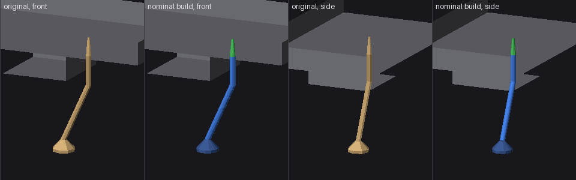

**Generates.** Model: a 40 x 24 x 4 mm block from z 20 mm; a 11.8 x 12 x 6 mm block from z 14 mm. Supports: 1 trunk; 1 contact. Styles: separate shells, joined (shells welded at shared cap centres), welded (one unioned shell); side counts 8, 12, 16, 32 and the scene turned 17, 45 and 30 degrees.

Note: The straight line from foot to socket clips the block.

**Checks.**

- 1 reader labels: 2 shaft, 1 tip part(s) read with the right axis, width and label.
- 2 layout: 1 trunk, with each tip's contact, socket and width, each shaft's width, foot or parent and line, and each brace's ends.
- 4a clips and 4b loops on the nominal build: nothing but tips inside the model, and 1 contact loop(s) at the truth's place and size.

**Result.** Base variant `b01_bend25__n8_r0_sep`: validate pass, 1 reader labels pass, 2 layout pass, 4a clips (nominal) pass, 4b loops (nominal) pass. Every cargo stage passes on 11 of 11 variants.

### b02_bend25b

The same with a joint ball at the bend.

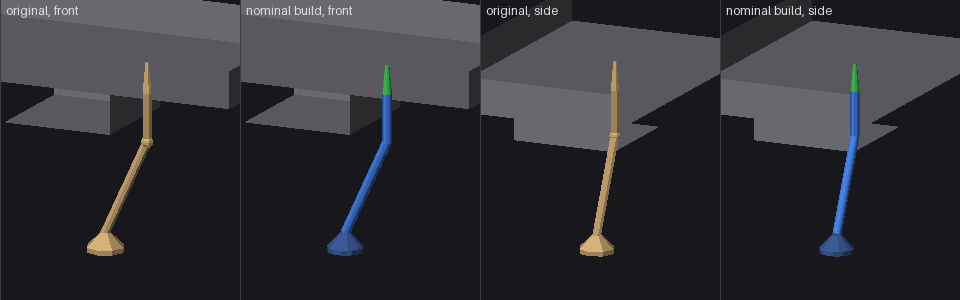

**Generates.** Model: a 40 x 24 x 4 mm block from z 20 mm; a 11.8 x 12 x 6 mm block from z 14 mm. Supports: 1 trunk; 1 contact. Styles: separate shells, joined (shells welded at shared cap centres); side counts 8, 12, 16, 32 and the scene turned 17, 45 and 30 degrees.

Note: The straight line from foot to socket clips the block.

**Checks.**

- 1 reader labels: 2 shaft, 1 tip part(s) read with the right axis, width and label.
- 2 layout: 1 trunk, with each tip's contact, socket and width, each shaft's width, foot or parent and line, and each brace's ends.
- 4a clips and 4b loops on the nominal build: nothing but tips inside the model, and 1 contact loop(s) at the truth's place and size.

**Result.** Base variant `b02_bend25b__n8_r0_sep`: validate pass, 1 reader labels pass, 2 layout pass, 4a clips (nominal) pass, 4b loops (nominal) pass. Every cargo stage passes on 9 of 9 variants.

### b03_bend45

Shaft bending 45 degrees round part of the model.

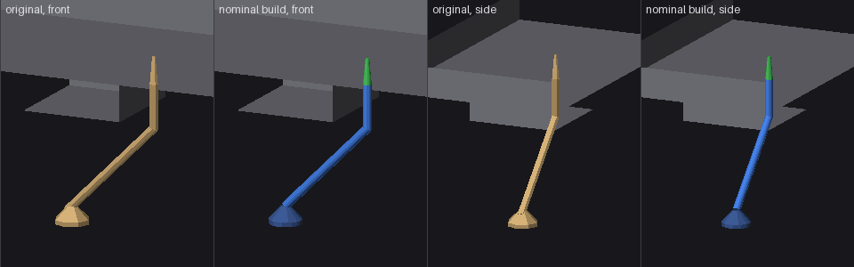

**Generates.** Model: a 40 x 24 x 4 mm block from z 20 mm; a 11.8 x 12 x 6 mm block from z 14 mm. Supports: 1 trunk; 1 contact. Styles: separate shells, joined (shells welded at shared cap centres), welded (one unioned shell); side counts 8, 12, 16, 32 and the scene turned 17, 45 and 30 degrees.

Note: The straight line from foot to socket clips the block.

**Checks.**

- 1 reader labels: 2 shaft, 1 tip part(s) read with the right axis, width and label.
- 2 layout: 1 trunk, with each tip's contact, socket and width, each shaft's width, foot or parent and line, and each brace's ends.
- 4a clips and 4b loops on the nominal build: nothing but tips inside the model, and 1 contact loop(s) at the truth's place and size.

**Result.** Base variant `b03_bend45__n8_r0_sep`: validate pass, 1 reader labels pass, 2 layout pass, 4a clips (nominal) pass, 4b loops (nominal) pass. Every cargo stage passes on 11 of 11 variants.

### c01_sharpturn

Shaft turning 60 degrees over a lower part of the model.

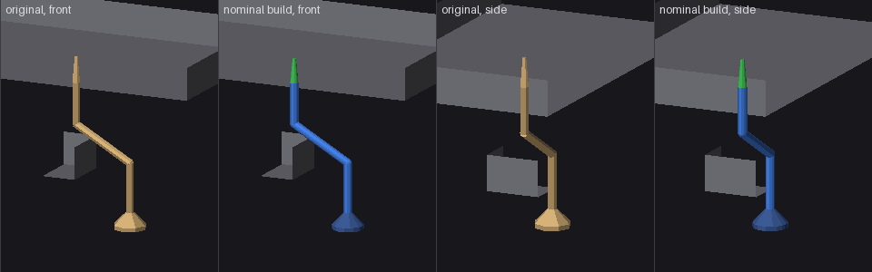

**Generates.** Model: a 40 x 24 x 4 mm block from z 20 mm; a 4.2 x 6 x 4 mm block from z 6 mm. Supports: 1 trunk; 1 contact. Styles: separate shells, joined (shells welded at shared cap centres); side counts 8, 12, 16, 32 and the scene turned 17, 45 and 30 degrees.

Note: Turns of 60 degrees: part of the model lies under the top of the shaft, so running it straight down clips it.

**Checks.**

- 1 reader labels: 3 shaft, 1 tip part(s) read with the right axis, width and label.
- 2 layout: 1 trunk, with each tip's contact, socket and width, each shaft's width, foot or parent and line, and each brace's ends.
- 4a clips and 4b loops on the nominal build: nothing but tips inside the model, and 1 contact loop(s) at the truth's place and size.

**Result.** Base variant `c01_sharpturn__n8_r0_sep`: validate pass, 1 reader labels pass, 2 layout pass, 4a clips (nominal) pass, 4b loops (nominal) pass. Every cargo stage passes on 9 of 9 variants.

### c02_grazing

Tip meeting the surface at a shallow angle (about 28 degrees).

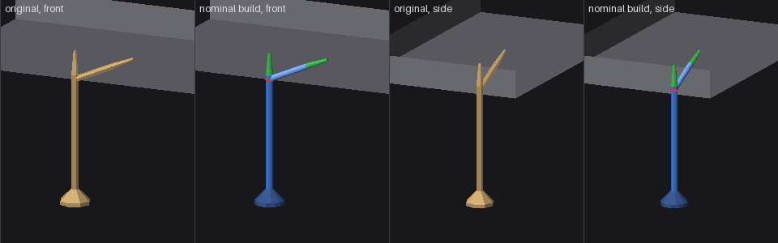

**Generates.** Model: a 40 x 24 x 4 mm block from z 20 mm. Supports: 1 trunk, 1 branch; 2 contacts. Styles: separate shells; side counts 8, 12, 16, 32 and the scene turned 17, 45 and 30 degrees.

**Checks.**

- 1 reader labels: 2 shaft, 2 tip part(s) read with the right axis, width and label.
- 2 layout: 1 trunk, 1 branch, with each tip's contact, socket and width, each shaft's width, foot or parent and line, and each brace's ends.
- 4a clips and 4b loops on the nominal build: nothing but tips inside the model, and 2 contact loop(s) at the truth's place and size.

**Result.** Base variant `c02_grazing__n8_r0_sep`: validate pass, 1 reader labels pass, 2 layout pass, 4a clips (nominal) pass, 4b loops (nominal) pass. Every cargo stage passes on 7 of 7 variants.

### c03_shorttip

Tip only 0.4 mm long on a 1 mm shaft: the joint sits close to the model.

**Generates.** Model: a 40 x 24 x 4 mm block from z 20 mm. Supports: 1 trunk; 1 contact. Styles: separate shells; side counts 8, 12, 16, 32 and the scene turned 17, 45 and 30 degrees.

**Checks.**

- 1 reader labels: 1 shaft, 1 tip part(s) read with the right axis, width and label.
- 2 layout: 1 trunk, with each tip's contact, socket and width, each shaft's width, foot or parent and line, and each brace's ends.
- 4a clips and 4b loops on the nominal build: nothing but tips inside the model, and 1 contact loop(s) at the truth's place and size.

**Result.** Base variant `c03_shorttip__n8_r0_sep`: validate pass, 1 reader labels pass, 2 layout pass, 4a clips (nominal) pass, 4b loops (nominal) pass. Every cargo stage passes on 7 of 7 variants.

### c04_jointclose

A bend 0.045 mm clear of the model.

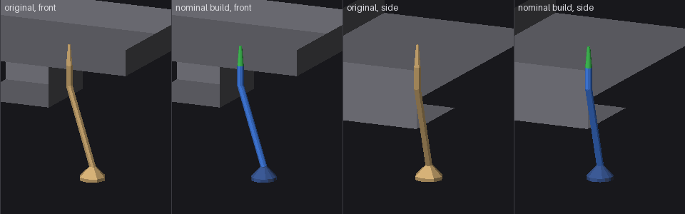

**Generates.** Model: a 40 x 24 x 4 mm block from z 20 mm; a 12.655 x 12 x 8 mm block from z 12 mm. Supports: 1 trunk; 1 contact. Styles: separate shells; side counts 8, 12, 16, 32 and the scene turned 17, 45 and 30 degrees.

Note: The bend clears the model's face by 0.045 mm; DragonFruit's joint sphere is 0.1 mm wider than its shaft.

**Checks.**

- 1 reader labels: 2 shaft, 1 tip part(s) read with the right axis, width and label.
- 2 layout: 1 trunk, with each tip's contact, socket and width, each shaft's width, foot or parent and line, and each brace's ends.
- 4a clips and 4b loops on the nominal build: nothing but tips inside the model, and 1 contact loop(s) at the truth's place and size.

**Result.** Base variant `c04_jointclose__n8_r0_sep`: validate pass, 1 reader labels pass, 2 layout pass, 4a clips (nominal) pass, 4b loops (nominal) pass. Every cargo stage passes on 7 of 7 variants.

### c05_shallowbend

A 0.2 mm dodge round part of the model.

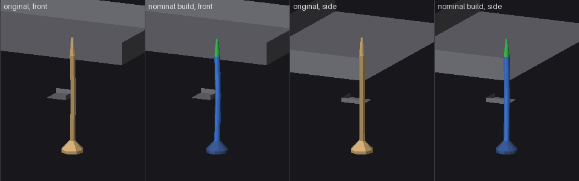

**Generates.** Model: a 40 x 24 x 4 mm block from z 20 mm; a 3.67 x 4 x 0.8 mm block from z 9.6 mm. Supports: 1 trunk; 1 contact. Styles: separate shells; side counts 8, 12, 16, 32 and the scene turned 17, 45 and 30 degrees.

Note: A 0.2 mm dodge round a model part; straightening the line clips it by 0.17 mm.

**Checks.**

- 1 reader labels: 2 shaft, 1 tip part(s) read with the right axis, width and label.
- 2 layout: 1 trunk, with each tip's contact, socket and width, each shaft's width, foot or parent and line, and each brace's ends.
- 4a clips and 4b loops on the nominal build: nothing but tips inside the model, and 1 contact loop(s) at the truth's place and size.

**Result.** Base variant `c05_shallowbend__n8_r0_sep`: validate pass, 1 reader labels pass, 2 layout pass, 4a clips (nominal) pass, 4b loops (nominal) pass. Every cargo stage passes on 7 of 7 variants.

### c06_lowtip

Tip with its socket below the root's top (contact at z = 4).

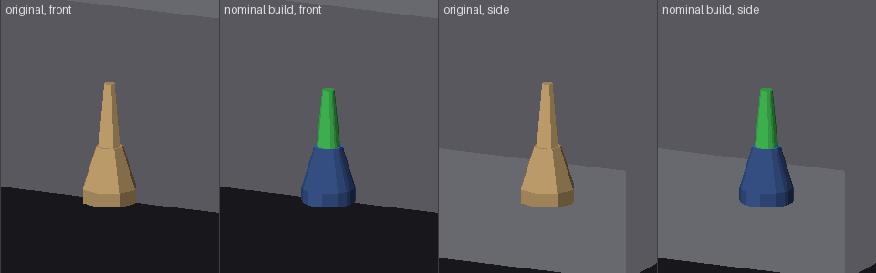

**Generates.** Model: a 40 x 24 x 4 mm block from z 4 mm. Supports: 1 trunk; 1 contact. Styles: separate shells; side counts 8, 12, 16, 32 and the scene turned 17, 45 and 30 degrees.

**Checks.**

- 1 reader labels: 1 shaft, 1 tip part(s) read with the right axis, width and label.
- 2 layout: 1 trunk, with each tip's contact, socket and width, each shaft's width, foot or parent and line, and each brace's ends.
- 4a clips and 4b loops on the nominal build: nothing but tips inside the model, and 1 contact loop(s) at the truth's place and size.

**Result.** Base variant `c06_lowtip__n8_r0_sep`: validate pass, 1 reader labels pass, 2 layout pass, 4a clips (nominal) pass, 4b loops (nominal) pass. Every cargo stage passes on 7 of 7 variants.

### c07_lowtip2

Tip with its shaft all inside the raft band (contact at z = 6).

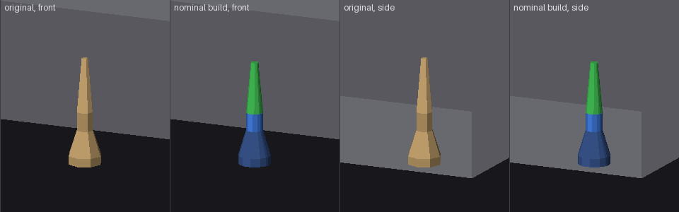

**Generates.** Model: a 40 x 24 x 4 mm block from z 6 mm. Supports: 1 trunk; 1 contact. Styles: separate shells; side counts 8, 12, 16, 32 and the scene turned 17, 45 and 30 degrees.

**Checks.**

- 1 reader labels: 1 shaft, 1 tip part(s) read with the right axis, width and label.
- 2 layout: 1 trunk, with each tip's contact, socket and width, each shaft's width, foot or parent and line, and each brace's ends.
- 4a clips and 4b loops on the nominal build: nothing but tips inside the model, and 1 contact loop(s) at the truth's place and size.

**Result.** Base variant `c07_lowtip2__n8_r0_sep`: validate pass, 1 reader labels pass, 2 layout pass, 4a clips (nominal) pass, 4b loops (nominal) pass. Every cargo stage passes on 7 of 7 variants.

### c08_shortshaft

A branch with a shaft only 0.8 mm long.

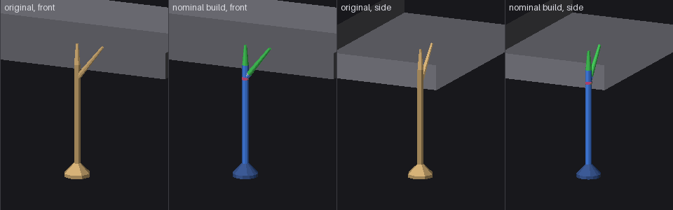

**Generates.** Model: a 40 x 24 x 4 mm block from z 20 mm. Supports: 1 trunk, 1 branch; 2 contacts. Styles: separate shells; side counts 8, 12, 16, 32 and the scene turned 17, 45 and 30 degrees.

**Checks.**

- 1 reader labels: 2 shaft, 2 tip part(s) read with the right axis, width and label.
- 2 layout: 1 trunk, 1 branch, with each tip's contact, socket and width, each shaft's width, foot or parent and line, and each brace's ends.
- 4a clips and 4b loops on the nominal build: nothing but tips inside the model, and 2 contact loop(s) at the truth's place and size.

**Result.** Base variant `c08_shortshaft__n8_r0_sep`: validate pass, 1 reader labels pass, 2 layout pass, 4a clips (nominal) pass, 4b loops (nominal) pass. Every cargo stage passes on 7 of 7 variants.

### c09_flatwall

3 mm polygon shaft with a flat 0.05 mm from a model wall.

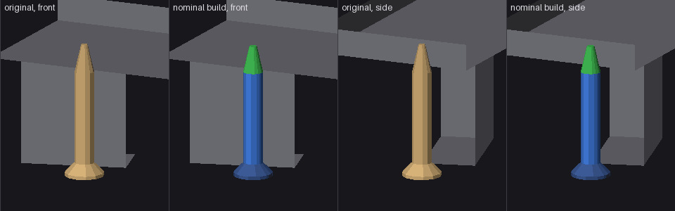

Seen in real model ff110379.

**Generates.** Model: a 40 x 24 x 4 mm block from z 20 mm; a turned 8 x 16 x 16 mm block centred at z 12 mm. Supports: 1 trunk; 1 contact. Styles: separate shells; side counts 8, 12, 16, 32 and the scene turned 17, 45 and 30 degrees.

Note: A flat of the shaft clears the wall by 0.05 mm (owner, merge round 4: was 0.03 mm, the touch rule's flush gap, which made the truth count a flush contact). Read at its corners, a round shaft is wider by the polygon's sagitta (0.051 mm at 12 sides, 0.029 at 16, 0.007 at 32); 8 sides (0.114 mm) is not generated for this case.

**Checks.**

- 1 reader labels: 1 shaft, 1 tip part(s) read with the right axis, width and label.
- 2 layout: 1 trunk, with each tip's contact, socket and width, each shaft's width, foot or parent and line, and each brace's ends.
- 4a clips and 4b loops on the nominal build: nothing but tips inside the model, and 1 contact loop(s) at the truth's place and size.

**Result.** Base variant `c09_flatwall__n12_r0_sep`: validate pass, 1 reader labels pass, 2 layout pass, 4a clips (nominal) pass, 4b loops (nominal) pass. Every cargo stage passes on 4 of 4 variants.

### c10_downtip

Tip pointing down onto a ledge, shaft off a trunk.

Seen in real model ff110379.

**Generates.** Model: a 40 x 24 x 4 mm block from z 20 mm; a 11 x 12 x 4 mm block from z 4 mm. Supports: 1 trunk, 1 branch; 2 contacts. Styles: separate shells, joined (shells welded at shared cap centres); side counts 8, 12, 16, 32 and the scene turned 17, 45 and 30 degrees.

Note: A tip pointing down onto an upward face of the model, off a trunk that carries on below it.

**Checks.**

- 1 reader labels: 2 shaft, 2 tip part(s) read with the right axis, width and label.
- 2 layout: 1 trunk, 1 branch, with each tip's contact, socket and width, each shaft's width, foot or parent and line, and each brace's ends.
- 4a clips and 4b loops on the nominal build: nothing but tips inside the model, and 2 contact loop(s) at the truth's place and size.

**Result.** Base variant `c10_downtip__n8_r0_sep`: validate pass, 1 reader labels pass, 2 layout pass, 4a clips (nominal) pass, 4b loops (nominal) pass. Every cargo stage passes on 9 of 9 variants.

### c11_downcone

Tip pointing down onto a ledge, cone straight off a trunk.

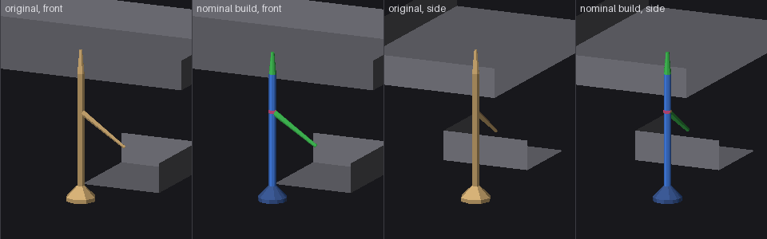

Seen in real model ff110379.

**Generates.** Model: a 40 x 24 x 4 mm block from z 20 mm; a 11 x 12 x 4 mm block from z 4 mm. Supports: 1 trunk, 1 branch; 2 contacts. Styles: separate shells, joined (shells welded at shared cap centres); side counts 8, 12, 16, 32 and the scene turned 17, 45 and 30 degrees.

Note: A tip pointing down onto an upward face of the model, off a trunk that carries on below it.

**Checks.**

- 1 reader labels: 1 shaft, 2 tip part(s) read with the right axis, width and label.
- 2 layout: 1 trunk, 1 branch, with each tip's contact, socket and width, each shaft's width, foot or parent and line, and each brace's ends.
- 4a clips and 4b loops on the nominal build: nothing but tips inside the model, and 2 contact loop(s) at the truth's place and size.

**Result.** Base variant `c11_downcone__n8_r0_sep`: validate pass, 1 reader labels pass, 2 layout pass, 4a clips (nominal) pass, 4b loops (nominal) pass. Every cargo stage passes on 9 of 9 variants.

### c12_widthchange

A thin shaft carrying on from a thick post, past a wall.

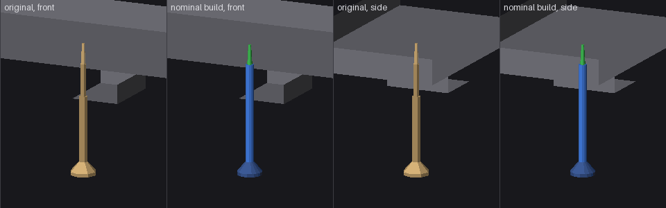

Seen in real model ff110379.

**Generates.** Model: a 40 x 24 x 4 mm block from z 20 mm; a 7.5 x 10 x 3 mm block from z 13 mm. Supports: 1 branch, 1 post; 1 contact. Styles: separate shells, joined (shells welded at shared cap centres); side counts 8, 12, 16, 32 and the scene turned 17, 45 and 30 degrees.

Note: Written as one support it takes one width. Truth needs both (a post and a branch); the wall clears the thin part by 0.1 mm.

**Checks.**

- 1 reader labels: 1 post, 1 shaft, 1 tip part(s) read with the right axis, width and label.
- 2 layout: 1 branch, 1 post, with each tip's contact, socket and width, each shaft's width, foot or parent and line, and each brace's ends.
- 4a clips and 4b loops on the nominal build: nothing but tips inside the model, and 1 contact loop(s) at the truth's place and size.

**Result.** Base variant `c12_widthchange__n8_r0_sep`: validate pass, 1 reader labels **fail**, 2 layout **fail**, 4a clips (nominal) **fail**, 4b loops (nominal) pass. Every cargo stage passes on 0 of 9 variants.

- `1: p-post read as shaft, is post`
- `2: counts trunks 1/0 branches 0/1 posts 0/1`
- `2: b shaft 1.30 mm, is 0.80`

Failing variants: `n12_r0_sep` (1, 2, 4a); `n16_r0_joined` (1, 2, 4a); `n16_r0_sep` (1, 2, 4a); `n16_r30_sep` (1, 2, 4a); `n32_r0_sep` (1, 2, 4a); `n8_r0_joined` (1, 2, 4a); `n8_r0_sep` (1, 2, 4a); `n8_r17_sep` (1, 2, 4a); `n8_r45_sep` (1, 2, 4a).

### f01_hub

Fan of tip cones into one hub on a post.

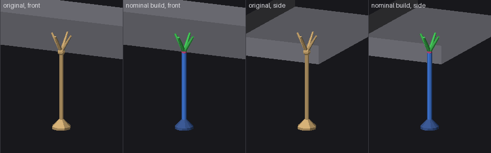

**Generates.** Model: a 40 x 24 x 4 mm block from z 20 mm. Supports: 4 branches, 1 post; 4 contacts. Styles: separate shells, joined (shells welded at shared cap centres); side counts 8, 12, 16, 32 and the scene turned 17, 45 and 30 degrees.

**Checks.**

- 1 reader labels: 1 post, 1 shaft, 4 tip part(s) read with the right axis, width and label.
- 2 layout: 4 branches, 1 post, with each tip's contact, socket and width, each shaft's width, foot or parent and line, and each brace's ends.
- Also accepted counts: 1 trunk, 3 branches (then widths and lines are not checked).
- 4a clips and 4b loops on the nominal build: nothing but tips inside the model, and 4 contact loop(s) at the truth's place and size.

**Result.** Base variant `f01_hub__n8_r0_sep`: validate pass, 1 reader labels pass, 2 layout pass, 4a clips (nominal) pass, 4b loops (nominal) pass. Every cargo stage passes on 9 of 9 variants.

### f02_overlap

Fan with the cones overlapping, no hub.

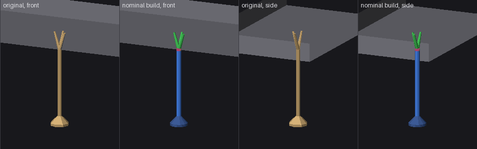

**Generates.** Model: a 40 x 24 x 4 mm block from z 20 mm. Supports: 3 branches, 1 post; 3 contacts. Styles: separate shells, joined (shells welded at shared cap centres); side counts 8, 12, 16, 32 and the scene turned 17, 45 and 30 degrees.

**Checks.**

- 1 reader labels: 1 post, 1 shaft, 3 tip part(s) read with the right axis, width and label.
- 2 layout: 3 branches, 1 post, with each tip's contact, socket and width, each shaft's width, foot or parent and line, and each brace's ends.
- Also accepted counts: 1 trunk, 2 branches (then widths and lines are not checked).
- 4a clips and 4b loops on the nominal build: nothing but tips inside the model, and 3 contact loop(s) at the truth's place and size.

**Result.** Base variant `f02_overlap__n8_r0_sep`: validate pass, 1 reader labels pass, 2 layout pass, 4a clips (nominal) pass, 4b loops (nominal) pass. Every cargo stage passes on 9 of 9 variants.

### f03_two

Two tips sharing one shaft.

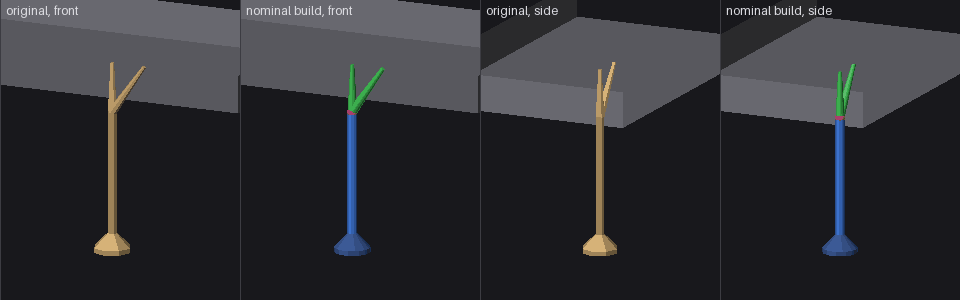

**Generates.** Model: a 40 x 24 x 4 mm block from z 20 mm. Supports: 1 trunk, 1 branch; 2 contacts. Styles: separate shells, joined (shells welded at shared cap centres), welded (one unioned shell); side counts 8, 12, 16, 32 and the scene turned 17, 45 and 30 degrees.

**Checks.**

- 1 reader labels: 1 shaft, 2 tip part(s) read with the right axis, width and label.
- 2 layout: 1 trunk, 1 branch, with each tip's contact, socket and width, each shaft's width, foot or parent and line, and each brace's ends.
- Also accepted counts: 2 branches, 1 post (then widths and lines are not checked).
- Tree free: the counts are checked but not which support stands where (widths and lines are not checked).
- 4a clips and 4b loops on the nominal build: nothing but tips inside the model, and 2 contact loop(s) at the truth's place and size.

**Result.** Base variant `f03_two__n8_r0_sep`: validate pass, 1 reader labels pass, 2 layout pass, 4a clips (nominal) pass, 4b loops (nominal) pass. Every cargo stage passes on 11 of 11 variants.

### f04_branch

A branch off a trunk.

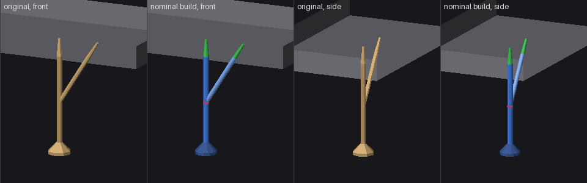

**Generates.** Model: a 40 x 24 x 4 mm block from z 20 mm. Supports: 1 trunk, 1 branch; 2 contacts. Styles: separate shells, joined (shells welded at shared cap centres), welded (one unioned shell); side counts 8, 12, 16, 32 and the scene turned 17, 45 and 30 degrees.

**Checks.**

- 1 reader labels: 2 shaft, 2 tip part(s) read with the right axis, width and label.
- 2 layout: 1 trunk, 1 branch, with each tip's contact, socket and width, each shaft's width, foot or parent and line, and each brace's ends.
- 4a clips and 4b loops on the nominal build: nothing but tips inside the model, and 2 contact loop(s) at the truth's place and size.

**Result.** Base variant `f04_branch__n8_r0_sep`: validate pass, 1 reader labels pass, 2 layout pass, 4a clips (nominal) pass, 4b loops (nominal) pass. Every cargo stage passes on 11 of 11 variants.

### f05_branch2

Branches of a branch.

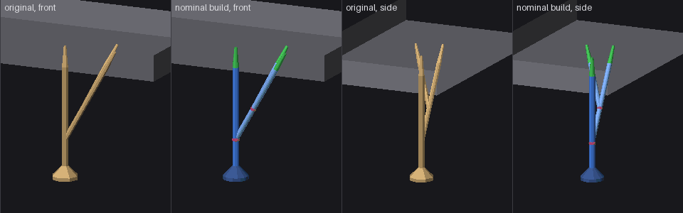

**Generates.** Model: a 40 x 24 x 4 mm block from z 20 mm. Supports: 1 trunk, 2 branches; 3 contacts. Styles: separate shells, joined (shells welded at shared cap centres), welded (one unioned shell); side counts 8, 12, 16, 32 and the scene turned 17, 45 and 30 degrees.

**Checks.**

- 1 reader labels: 3 shaft, 3 tip part(s) read with the right axis, width and label.
- 2 layout: 1 trunk, 2 branches, with each tip's contact, socket and width, each shaft's width, foot or parent and line, and each brace's ends.
- 4a clips and 4b loops on the nominal build: nothing but tips inside the model, and 3 contact loop(s) at the truth's place and size.

**Result.** Base variant `f05_branch2__n8_r0_sep`: validate pass, 1 reader labels pass, 2 layout pass, 4a clips (nominal) pass, 4b loops (nominal) pass. Every cargo stage passes on 10 of 11 variants.

Failing variants: `n8_r0_joined` (2).

### h01_strut

Hollow-model strut between two faces.

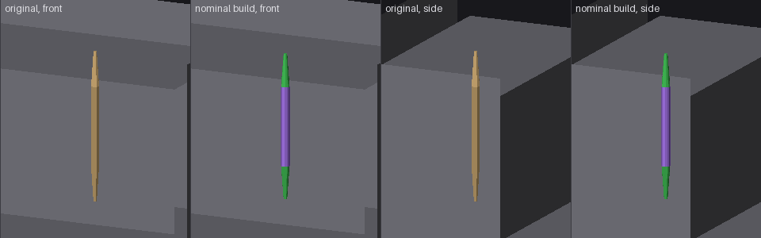

**Generates.** Model: a hollow 40 x 24 x 24 mm shell (cavity from z 3 to 20 mm). Supports: 1 strut; 2 contacts. Styles: separate shells, joined (shells welded at shared cap centres), welded (one unioned shell); side counts 8, 12, 16, 32 and the scene turned 17, 45 and 30 degrees.

**Checks.**

- 1 reader labels: 1 shaft, 2 tip part(s) read with the right axis, width and label.
- 2 layout: 1 strut, with each tip's contact, socket and width, each shaft's width, foot or parent and line, and each brace's ends.
- 4a clips and 4b loops on the nominal build: nothing but tips inside the model, and 2 contact loop(s) at the truth's place and size.

**Result.** Base variant `h01_strut__n8_r0_sep`: validate pass, 1 reader labels pass, 2 layout pass, 4a clips (nominal) pass, 4b loops (nominal) pass. Every cargo stage passes on 11 of 11 variants.

### h02_rungs

Hollow-model struts tied by rungs.

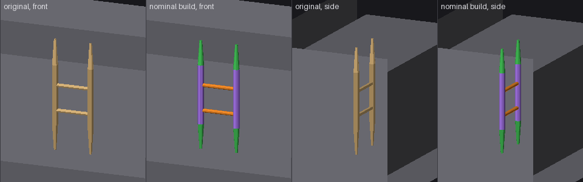

**Generates.** Model: a hollow 40 x 24 x 24 mm shell (cavity from z 3 to 20 mm). Supports: 2 struts, 2 braces; 4 contacts. Styles: separate shells, joined (shells welded at shared cap centres), welded (one unioned shell); side counts 8, 12, 16, 32 and the scene turned 17, 45 and 30 degrees.

**Checks.**

- 1 reader labels: 2 brace, 2 shaft, 4 tip part(s) read with the right axis, width and label.
- 2 layout: 2 struts, 2 braces, with each tip's contact, socket and width, each shaft's width, foot or parent and line, and each brace's ends.
- 4a clips and 4b loops on the nominal build: nothing but tips inside the model, and 4 contact loop(s) at the truth's place and size.

**Result.** Base variant `h02_rungs__n8_r0_sep`: validate pass, 1 reader labels pass, 2 layout pass, 4a clips (nominal) pass, 4b loops (nominal) pass. Every cargo stage passes on 11 of 11 variants.

### h03_vee

Hollow-model struts in a pair meeting at one contact.

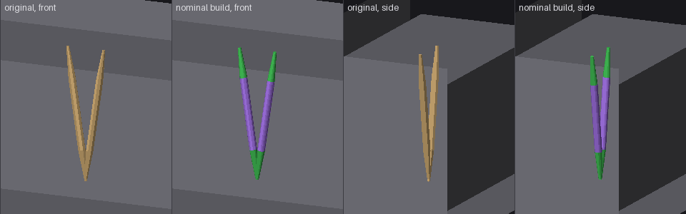

**Generates.** Model: a hollow 40 x 24 x 24 mm shell (cavity from z 3 to 20 mm). Supports: 2 struts; 4 contacts. Styles: separate shells; side counts 8, 12, 16, 32 and the scene turned 17, 45 and 30 degrees.

**Checks.**

- 1 reader labels: 2 shaft, 4 tip part(s) read with the right axis, width and label.
- 2 layout: 2 struts, with each tip's contact, socket and width, each shaft's width, foot or parent and line, and each brace's ends.
- 4a clips and 4b loops on the nominal build: nothing but tips inside the model, and 4 contact loop(s) at the truth's place and size.

**Result.** Base variant `h03_vee__n8_r0_sep`: validate pass, 1 reader labels pass, 2 layout pass, 4a clips (nominal) pass, 4b loops (nominal) pass. Every cargo stage passes on 7 of 7 variants.

### h04_short

Short hollow-model strut, 4 mm.

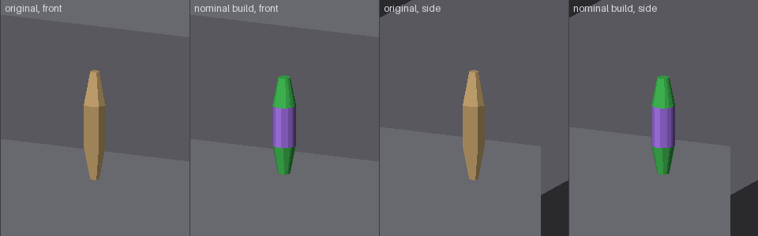

**Generates.** Model: a hollow 40 x 24 x 24 mm shell (cavity from z 3 to 20 mm); a 16 x 12 x 13 mm block from z 3 mm. Supports: 1 strut; 2 contacts. Styles: separate shells; side counts 8, 12, 16, 32 and the scene turned 17, 45 and 30 degrees.

**Checks.**

- 1 reader labels: 1 shaft, 2 tip part(s) read with the right axis, width and label.
- 2 layout: 1 strut, with each tip's contact, socket and width, each shaft's width, foot or parent and line, and each brace's ends.
- 4a clips and 4b loops on the nominal build: nothing but tips inside the model, and 2 contact loop(s) at the truth's place and size.

**Result.** Base variant `h04_short__n8_r0_sep`: validate pass, 1 reader labels pass, 2 layout pass, 4a clips (nominal) pass, 4b loops (nominal) pass. Every cargo stage passes on 7 of 7 variants.

### k01_cage

Composite: 3 by 3 cage of X braces with branches and a kickstand.

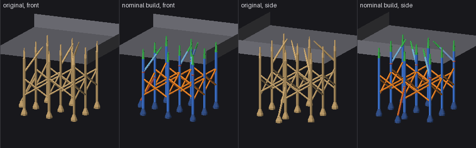

**Generates.** Model: a 32 x 32 x 4 mm block from z 20 mm. Supports: 9 trunks, 4 branches, 1 leg, 24 braces; 13 contacts. Styles: separate shells; side counts 8, 12, 16, 32 and the scene turned 17, 45 and 30 degrees.

**Checks.**

- 1 reader labels: 24 brace, 1 post, 13 shaft, 13 tip part(s) read with the right axis, width and label.
- 2 layout: 9 trunks, 4 branches, 1 leg, 24 braces, with each tip's contact, socket and width, each shaft's width, foot or parent and line, and each brace's ends.
- 4a clips and 4b loops on the nominal build: nothing but tips inside the model, and 13 contact loop(s) at the truth's place and size.

**Result.** Base variant `k01_cage__n8_r0_sep`: validate pass, 1 reader labels pass, 2 layout pass, 4a clips (nominal) pass, 4b loops (nominal) pass. Every cargo stage passes on 7 of 7 variants.

### k02_zigzag

Composite: wall of posts tied by chained diagonals, with a fan.

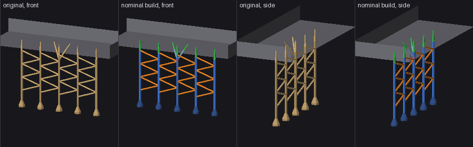

**Generates.** Model: a 40 x 16 x 4 mm block from z 20 mm. Supports: 5 trunks, 2 branches, 24 braces; 7 contacts. Styles: separate shells; side counts 8, 12, 16, 32 and the scene turned 17, 45 and 30 degrees.

**Checks.**

- 1 reader labels: 24 brace, 7 shaft, 7 tip part(s) read with the right axis, width and label.
- 2 layout: 5 trunks, 2 branches, 24 braces, with each tip's contact, socket and width, each shaft's width, foot or parent and line, and each brace's ends.
- 4a clips and 4b loops on the nominal build: nothing but tips inside the model, and 7 contact loop(s) at the truth's place and size.

**Result.** Base variant `k02_zigzag__n8_r0_sep`: validate pass, 1 reader labels pass, 2 layout pass, 4a clips (nominal) pass, 4b loops (nominal) pass. Every cargo stage passes on 7 of 7 variants.

### k03_modeltree

A fan of rods from a hub inside the model, no post below.

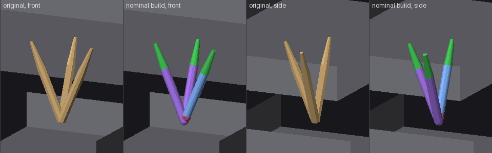

Seen in real model ff110379, cad11189.

**Generates.** Model: a 40 x 24 x 4 mm block from z 20 mm; a 16 x 16 x 4 mm block from z 8 mm. Supports: 2 branches, 1 strut; 4 contacts (1 blunt rod end (no cone)). Styles: separate shells, joined (shells welded at shared cap centres); side counts 8, 12, 16, 32 and the scene turned 17, 45 and 30 degrees.

Note: Nothing stands under the hub: set on the plate, the shaft passes right through the lower part of the model.

**Checks.**

- 1 reader labels: 3 shaft, 3 tip part(s) read with the right axis, width and label.
- 2 layout: 2 branches, 1 strut, with each tip's contact, socket and width, each shaft's width, foot or parent and line, and each brace's ends.
- Tree free: the counts are checked but not which support stands where (widths and lines are not checked).
- Passes through: the original itself runs through the model, so the truth's own clip is allowed in 4a.
- 4a clips and 4b loops on the nominal build: nothing but tips inside the model, and 4 contact loop(s) at the truth's place and size.

**Result.** Base variant `k03_modeltree__n8_r0_sep`: validate pass, 1 reader labels pass, 2 layout **fail**, 4a clips (nominal) **fail**, 4b loops (nominal) pass. Every cargo stage passes on 0 of 9 variants.

- `2: counts branches 1/2`
- `2: f0 has no lower tip`
- `2: tip f2 missing`

Failing variants: `n12_r0_sep` (2, 4a); `n16_r0_joined` (2, 4a); `n16_r0_sep` (2, 4a); `n16_r30_sep` (2, 4a); `n32_r0_sep` (1, 2); `n8_r0_joined` (1, 2); `n8_r0_sep` (2, 4a); `n8_r17_sep` (1, 2); `n8_r45_sep` (1, 2).

### l01_lean_shaft

Leaning shaft and tip on a post, a brace carrying on in line.

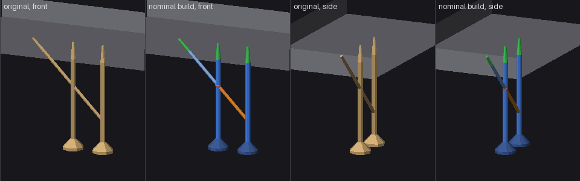

Seen in real model I2, I10.

**Generates.** Model: a 40 x 24 x 4 mm block from z 20 mm. Supports: 2 trunks, 1 branch, 1 brace; 3 contacts. Styles: separate shells, joined (shells welded at shared cap centres), welded (one unioned shell); side counts 8, 12, 16, 32 and the scene turned 17, 45 and 30 degrees.

**Checks.**

- 1 reader labels: 1 brace, 3 shaft, 3 tip part(s) read with the right axis, width and label.
- 2 layout: 2 trunks, 1 branch, 1 brace, with each tip's contact, socket and width, each shaft's width, foot or parent and line, and each brace's ends.
- 4a clips and 4b loops on the nominal build: nothing but tips inside the model, and 3 contact loop(s) at the truth's place and size.

**Result.** Base variant `l01_lean_shaft__n8_r0_sep`: validate pass, 1 reader labels pass, 2 layout pass, 4a clips (nominal) pass, 4b loops (nominal) pass. Every cargo stage passes on 9 of 11 variants.

Failing variants: `n16_r0_welded` (1, 2); `n8_r0_welded` (1, 2).

### l02_lean_cone

Leaning tip landing straight on a post, a brace carrying on in line.

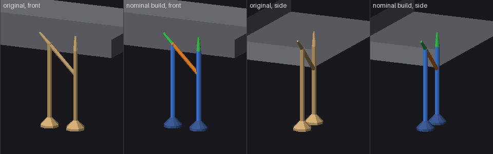

Seen in real model I2, I10.

**Generates.** Model: a 40 x 24 x 4 mm block from z 20 mm. Supports: 2 trunks, 1 brace; 2 contacts. Styles: separate shells, joined (shells welded at shared cap centres), welded (one unioned shell); side counts 8, 12, 16, 32 and the scene turned 17, 45 and 30 degrees.

**Checks.**

- 1 reader labels: 1 brace, 1 post, 2 shaft, 2 tip part(s) read with the right axis, width and label.
- 2 layout: 2 trunks, 1 brace, with each tip's contact, socket and width, each shaft's width, foot or parent and line, and each brace's ends.
- 4a clips and 4b loops on the nominal build: nothing but tips inside the model, and 2 contact loop(s) at the truth's place and size.

**Result.** Base variant `l02_lean_cone__n8_r0_sep`: validate pass, 1 reader labels pass, 2 layout pass, 4a clips (nominal) pass, 4b loops (nominal) pass. Every cargo stage passes on 11 of 11 variants.

### l03_lean_ball

Leaning shaft, joint ball on the post, a brace carrying on in line.

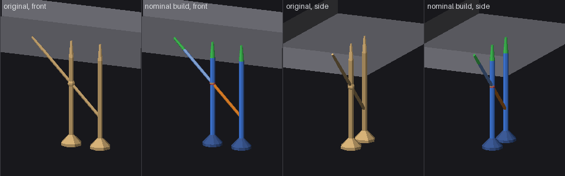

Seen in real model I2, I10.

**Generates.** Model: a 40 x 24 x 4 mm block from z 20 mm. Supports: 2 trunks, 1 branch, 1 brace; 3 contacts. Styles: separate shells, joined (shells welded at shared cap centres), welded (one unioned shell); side counts 8, 12, 16, 32 and the scene turned 17, 45 and 30 degrees.

**Checks.**

- 1 reader labels: 1 brace, 3 shaft, 3 tip part(s) read with the right axis, width and label.
- 2 layout: 2 trunks, 1 branch, 1 brace, with each tip's contact, socket and width, each shaft's width, foot or parent and line, and each brace's ends.
- 4a clips and 4b loops on the nominal build: nothing but tips inside the model, and 3 contact loop(s) at the truth's place and size.

**Result.** Base variant `l03_lean_ball__n8_r0_sep`: validate pass, 1 reader labels pass, 2 layout pass, 4a clips (nominal) pass, 4b loops (nominal) pass. Every cargo stage passes on 11 of 11 variants.

### m01_mm03

Micro support, model to model, 0.3 mm wide, 8 mm long.

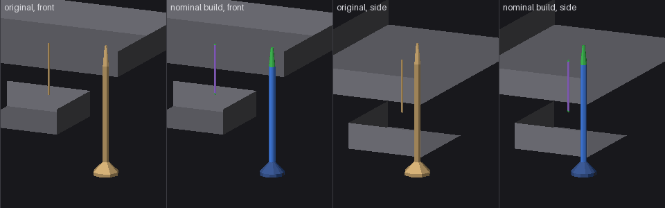

Seen in real model E2, E12.

**Generates.** Model: a 40 x 24 x 4 mm block from z 20 mm; a 14 x 12 x 4 mm block from z 8 mm. Supports: 1 trunk, 1 strut; 3 contacts (2 blunt rod end (no cone)). Styles: separate shells; side counts 8, 12, 16, 32 and the scene turned 17, 45 and 30 degrees.

**Checks.**

- 1 reader labels: 1 micro, 1 shaft, 1 tip part(s) read with the right axis, width and label.
- 2 layout: 1 trunk, 1 strut, with each tip's contact, socket and width, each shaft's width, foot or parent and line, and each brace's ends.
- 4a clips and 4b loops on the nominal build: nothing but tips inside the model, and 3 contact loop(s) at the truth's place and size.

**Result.** Base variant `m01_mm03__n8_r0_sep`: validate pass, 1 reader labels pass, 2 layout pass, 4a clips (nominal) pass, 4b loops (nominal) pass. Every cargo stage passes on 7 of 7 variants.

### m01_mm05

Micro support, model to model, 0.5 mm wide, 8 mm long.

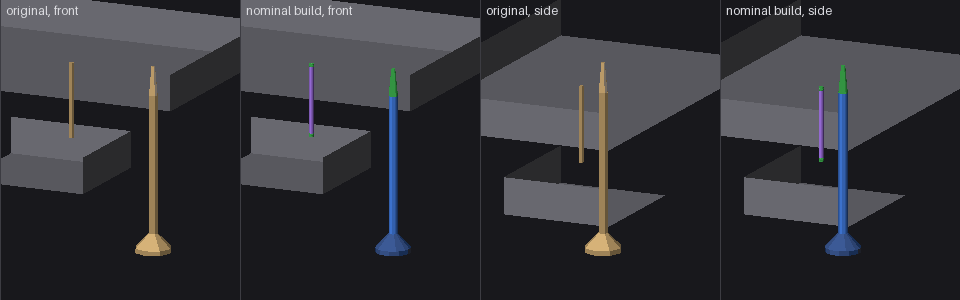

Seen in real model E2, E12.

**Generates.** Model: a 40 x 24 x 4 mm block from z 20 mm; a 14 x 12 x 4 mm block from z 8 mm. Supports: 1 trunk, 1 strut; 3 contacts (2 blunt rod end (no cone)). Styles: separate shells; side counts 8, 12, 16, 32 and the scene turned 17, 45 and 30 degrees.

**Checks.**

- 1 reader labels: 1 micro, 1 shaft, 1 tip part(s) read with the right axis, width and label.
- 2 layout: 1 trunk, 1 strut, with each tip's contact, socket and width, each shaft's width, foot or parent and line, and each brace's ends.
- 4a clips and 4b loops on the nominal build: nothing but tips inside the model, and 3 contact loop(s) at the truth's place and size.

**Result.** Base variant `m01_mm05__n8_r0_sep`: validate pass, 1 reader labels pass, 2 layout pass, 4a clips (nominal) pass, 4b loops (nominal) pass. Every cargo stage passes on 7 of 7 variants.

### m02_mms03

Micro support, model to model, 0.3 mm wide, 3 mm long.

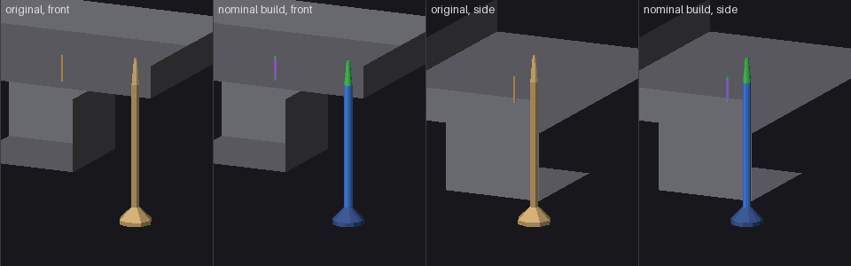

Seen in real model E2, E12.

**Generates.** Model: a 40 x 24 x 4 mm block from z 20 mm; a 14 x 12 x 9 mm block from z 8 mm. Supports: 1 trunk, 1 strut; 3 contacts (2 blunt rod end (no cone)). Styles: separate shells; side counts 8, 12, 16, 32 and the scene turned 17, 45 and 30 degrees.

**Checks.**

- 1 reader labels: 1 micro, 1 shaft, 1 tip part(s) read with the right axis, width and label.
- 2 layout: 1 trunk, 1 strut, with each tip's contact, socket and width, each shaft's width, foot or parent and line, and each brace's ends.
- 4a clips and 4b loops on the nominal build: nothing but tips inside the model, and 3 contact loop(s) at the truth's place and size.

**Result.** Base variant `m02_mms03__n8_r0_sep`: validate pass, 1 reader labels pass, 2 layout pass, 4a clips (nominal) pass, 4b loops (nominal) pass. Every cargo stage passes on 7 of 7 variants.

### m02_mms05

Micro support, model to model, 0.5 mm wide, 3 mm long.

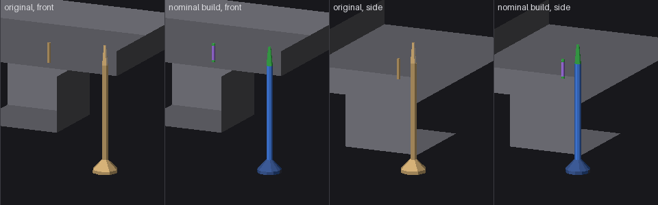

Seen in real model E2, E12.

**Generates.** Model: a 40 x 24 x 4 mm block from z 20 mm; a 14 x 12 x 9 mm block from z 8 mm. Supports: 1 trunk, 1 strut; 3 contacts (2 blunt rod end (no cone)). Styles: separate shells; side counts 8, 12, 16, 32 and the scene turned 17, 45 and 30 degrees.

**Checks.**

- 1 reader labels: 1 micro, 1 shaft, 1 tip part(s) read with the right axis, width and label.
- 2 layout: 1 trunk, 1 strut, with each tip's contact, socket and width, each shaft's width, foot or parent and line, and each brace's ends.
- 4a clips and 4b loops on the nominal build: nothing but tips inside the model, and 3 contact loop(s) at the truth's place and size.

**Result.** Base variant `m02_mms05__n8_r0_sep`: validate pass, 1 reader labels pass, 2 layout pass, 4a clips (nominal) pass, 4b loops (nominal) pass. Every cargo stage passes on 7 of 7 variants.

### m03_pm03

Micro support, pillar to model, 0.3 mm wide.

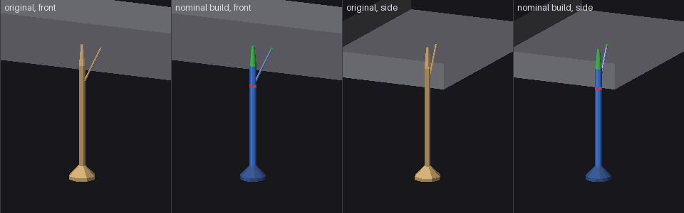

Seen in real model E2, E12.

**Generates.** Model: a 40 x 24 x 4 mm block from z 20 mm. Supports: 1 trunk, 1 branch; 2 contacts (1 blunt rod end (no cone)). Styles: separate shells, joined (shells welded at shared cap centres), welded (one unioned shell); side counts 8, 12, 16, 32 and the scene turned 17, 45 and 30 degrees.

**Checks.**

- 1 reader labels: 1 micro, 1 shaft, 1 tip part(s) read with the right axis, width and label.
- 2 layout: 1 trunk, 1 branch, with each tip's contact, socket and width, each shaft's width, foot or parent and line, and each brace's ends.
- 4a clips and 4b loops on the nominal build: nothing but tips inside the model, and 2 contact loop(s) at the truth's place and size.

**Result.** Base variant `m03_pm03__n8_r0_sep`: validate pass, 1 reader labels pass, 2 layout pass, 4a clips (nominal) pass, 4b loops (nominal) pass. Every cargo stage passes on 11 of 11 variants.

### m03_pm05

Micro support, pillar to model, 0.5 mm wide.

Seen in real model E2, E12.

**Generates.** Model: a 40 x 24 x 4 mm block from z 20 mm. Supports: 1 trunk, 1 branch; 2 contacts (1 blunt rod end (no cone)). Styles: separate shells, joined (shells welded at shared cap centres), welded (one unioned shell); side counts 8, 12, 16, 32 and the scene turned 17, 45 and 30 degrees.

**Checks.**

- 1 reader labels: 1 micro, 1 shaft, 1 tip part(s) read with the right axis, width and label.
- 2 layout: 1 trunk, 1 branch, with each tip's contact, socket and width, each shaft's width, foot or parent and line, and each brace's ends.
- 4a clips and 4b loops on the nominal build: nothing but tips inside the model, and 2 contact loop(s) at the truth's place and size.

**Result.** Base variant `m03_pm05__n8_r0_sep`: validate pass, 1 reader labels pass, 2 layout pass, 4a clips (nominal) pass, 4b loops (nominal) pass. Every cargo stage passes on 11 of 11 variants.

### n01_endin

A non-tip rod ending in the model.

**Generates.** Model: a 40 x 24 x 4 mm block from z 20 mm; a 11 x 12 x 4 mm block from z 4 mm. Supports: 1 trunk, 1 branch; 2 contacts (1 blunt rod end (no cone)). Styles: separate shells; side counts 8, 12, 16, 32 and the scene turned 17, 45 and 30 degrees.

**Checks.**

- 1 reader labels: 1 contact rod, 1 micro, 1 shaft, 1 tip part(s) read with the right axis, width and label.
- 2 layout: 1 trunk, 1 branch, with each tip's contact, socket and width, each shaft's width, foot or parent and line, and each brace's ends.
- 4a clips and 4b loops on the nominal build: nothing but tips inside the model, and 2 contact loop(s) at the truth's place and size.

**Result.** Base variant `n01_endin__n8_r0_sep`: validate pass, 1 reader labels pass, 2 layout pass, 4a clips (nominal) pass, 4b loops (nominal) pass. Every cargo stage passes on 7 of 7 variants.

### n02_endin_open

A rod ending in an open body (top face missing).

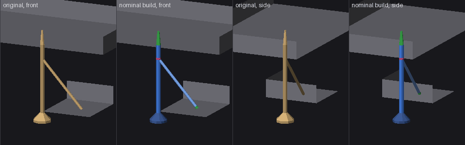

**Generates.** Model: a 40 x 24 x 4 mm block from z 20 mm; a 11 x 12 x 4 mm block from z 4 mm. Supports: 1 trunk, 1 branch; 2 contacts (1 blunt rod end (no cone)). Styles: separate shells; side counts 8, 12, 16, 32 and the scene turned 17, 45 and 30 degrees.

**Checks.**

- 1 reader labels: 1 contact rod, 1 micro, 1 shaft, 1 tip part(s) read with the right axis, width and label.
- 2 layout: 1 trunk, 1 branch, with each tip's contact, socket and width, each shaft's width, foot or parent and line, and each brace's ends.
- Open model: the model mesh is not closed.
- 4a clips and 4b loops on the nominal build: nothing but tips inside the model, and 2 contact loop(s) at the truth's place and size.

**Result.** Base variant `n02_endin_open__n8_r0_sep`: validate pass, 1 reader labels pass, 2 layout pass, 4a clips (nominal) pass, 4b loops (nominal) pass. Every cargo stage passes on 7 of 7 variants.

### n03_endin_nonman

A rod ending in a non-manifold body.

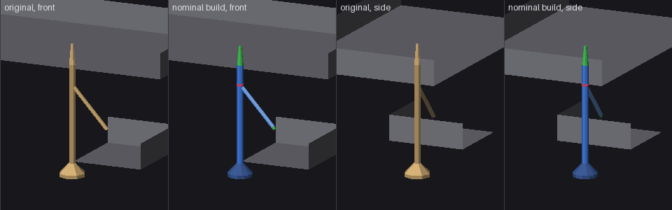

**Generates.** Model: a 40 x 24 x 4 mm block from z 20 mm; a 11 x 12 x 4 mm block from z 4 mm. Supports: 1 trunk, 1 branch; 2 contacts (1 blunt rod end (no cone)). Styles: separate shells; side counts 8, 12, 16, 32 and the scene turned 17, 45 and 30 degrees.

**Checks.**

- 1 reader labels: 1 contact rod, 1 micro, 1 shaft, 1 tip part(s) read with the right axis, width and label.
- 2 layout: 1 trunk, 1 branch, with each tip's contact, socket and width, each shaft's width, foot or parent and line, and each brace's ends.
- Open model: the model mesh is not closed.
- 4a clips and 4b loops on the nominal build: nothing but tips inside the model, and 2 contact loop(s) at the truth's place and size.

**Result.** Base variant `n03_endin_nonman__n8_r0_sep`: validate pass, 1 reader labels pass, 2 layout **fail**, 4a clips (nominal) pass, 4b loops (nominal) pass. Every cargo stage passes on 1 of 7 variants.

- `2: tip e contact off by 0.21 mm`
- `2: tip e contact 0.49 mm, is 0.70`

Failing variants: `n16_r0_sep` (2); `n16_r30_sep` (2); `n32_r0_sep` (2, 4b); `n8_r0_sep` (2); `n8_r17_sep` (2, 4b); `n8_r45_sep` (2).

### n04_buried

A part wholly inside the model, not to be exported.

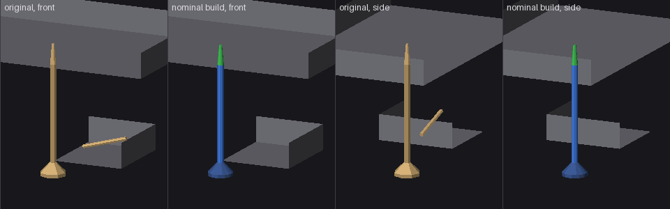

**Generates.** Model: a 40 x 24 x 4 mm block from z 20 mm; a 11 x 12 x 4 mm block from z 4 mm. Supports: 1 trunk; 1 contact; on a raft. Styles: separate shells; side counts 8, 12, 16, 32 and the scene turned 17, 45 and 30 degrees.

**Checks.**

- 1 reader labels: 1 shaft, 1 tip part(s) read with the right axis, width and label.
- 2 layout: 1 trunk, with each tip's contact, socket and width, each shaft's width, foot or parent and line, and each brace's ends.
- Passes through: the original itself runs through the model, so the truth's own clip is allowed in 4a.
- 4a clips and 4b loops on the nominal build: nothing but tips inside the model, and 1 contact loop(s) at the truth's place and size.

**Result.** Base variant `n04_buried__n8_r0_sep`: validate pass, 1 reader labels pass, 2 layout pass, 4a clips (nominal) pass, 4b loops (nominal) pass. Every cargo stage passes on 7 of 7 variants.

### n05_through

A shaft passing through a wall, then a tip on the body beyond.

**Generates.** Model: a 40 x 24 x 4 mm block from z 20 mm; a 20 x 20 x 1 mm block from z 12 mm. Supports: 1 trunk; 1 contact. Styles: separate shells; side counts 8, 12, 16, 32 and the scene turned 17, 45 and 30 degrees.

Note: The shaft passes through a thin wall on its way: truth has that crossing too.

**Checks.**

- 1 reader labels: 1 shaft, 1 tip part(s) read with the right axis, width and label.
- 2 layout: 1 trunk, with each tip's contact, socket and width, each shaft's width, foot or parent and line, and each brace's ends.
- Passes through: the original itself runs through the model, so the truth's own clip is allowed in 4a.
- 4a clips and 4b loops on the nominal build: nothing but tips inside the model, and 1 contact loop(s) at the truth's place and size.

**Result.** Base variant `n05_through__n8_r0_sep`: validate pass, 1 reader labels pass, 2 layout pass, 4a clips (nominal) pass, 4b loops (nominal) pass. Every cargo stage passes on 7 of 7 variants.

### n06_through_open

The same with the wall's body open.

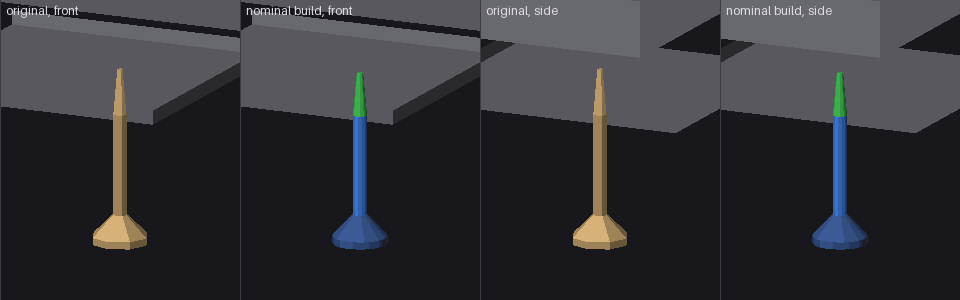

**Generates.** Model: a 40 x 24 x 4 mm block from z 20 mm; a 20 x 20 x 1 mm block from z 12 mm. Supports: 1 trunk; 1 contact. Styles: separate shells; side counts 8, 12, 16, 32 and the scene turned 17, 45 and 30 degrees.

Note: The shaft passes through a thin wall on its way: truth has that crossing too.

**Checks.**

- 1 reader labels: 1 shaft, 1 tip part(s) read with the right axis, width and label.
- 2 layout: 1 trunk, with each tip's contact, socket and width, each shaft's width, foot or parent and line, and each brace's ends.
- Passes through: the original itself runs through the model, so the truth's own clip is allowed in 4a.
- Open model: the model mesh is not closed.
- 4a clips and 4b loops on the nominal build: nothing but tips inside the model, and 1 contact loop(s) at the truth's place and size.

**Result.** Base variant `n06_through_open__n8_r0_sep`: validate pass, 1 reader labels pass, 2 layout pass, 4a clips (nominal) pass, 4b loops (nominal) pass. Every cargo stage passes on 7 of 7 variants.

### n07_cavity

A rod crossing a shell and ending in the cavity.

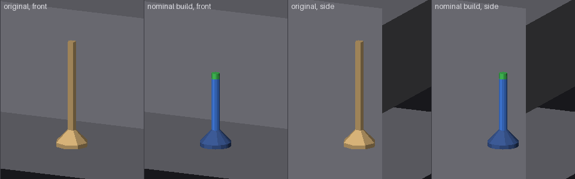

**Generates.** Model: a hollow 40 x 24 x 24 mm shell (cavity from z 9 to 20 mm). Supports: no supports; 0 contacts; on a raft. Styles: separate shells; side counts 8, 12, 16, 32 and the scene turned 17, 45 and 30 degrees.

Note: A rod crossing the shell and ending in the cavity: neither a contact nor required.

**Checks.**

- 2 layout: no supports, with each tip's contact, socket and width, each shaft's width, foot or parent and line, and each brace's ends.
- Flex: up to 1 more posts, legs or braces than the truth are accepted.
- Passes through: the original itself runs through the model, so the truth's own clip is allowed in 4a.
- 4a clips and 4b loops on the nominal build: nothing but tips inside the model, and 0 contact loop(s) at the truth's place and size.

**Result.** Base variant `n07_cavity__n8_r0_sep`: validate pass, 1 reader labels pass, 2 layout **fail**, 4a clips (nominal) **fail**, 4b loops (nominal) pass. Every cargo stage passes on 0 of 7 variants.

- `2: counts trunks 1/0`
- `2: 1 support(s) not in truth, contact [2.2, 1.4, 9.0]`
- `4: clips the model: 14.94 mm of root near [1.9, 3.3, 0.0], 58.36 mm2 buried`

Failing variants: `n12_r0_sep` (2, 4a); `n16_r0_sep` (2, 4a); `n16_r30_sep` (2, 4a); `n32_r0_sep` (2, 4a); `n8_r0_sep` (2, 4a); `n8_r17_sep` (2, 4a); `n8_r45_sep` (2, 4a).

### n08_close

Two tips 0.4 mm apart.

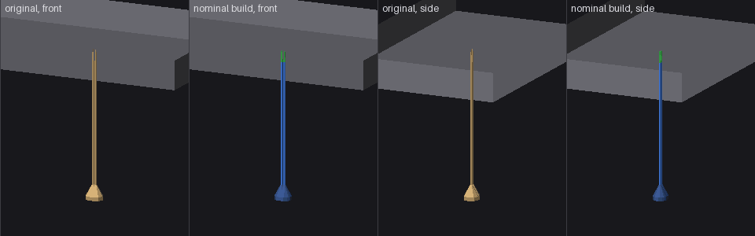

**Generates.** Model: a 40 x 24 x 4 mm block from z 20 mm. Supports: 2 trunks; 2 contacts. Styles: separate shells; side counts 8, 12, 16, 32 and the scene turned 17, 45 and 30 degrees.

**Checks.**

- 1 reader labels: 2 shaft, 2 tip part(s) read with the right axis, width and label.
- 2 layout: 2 trunks, with each tip's contact, socket and width, each shaft's width, foot or parent and line, and each brace's ends.
- 4a clips and 4b loops on the nominal build: nothing but tips inside the model, and 2 contact loop(s) at the truth's place and size.

**Result.** Base variant `n08_close__n8_r0_sep`: validate pass, 1 reader labels pass, 2 layout pass, 4a clips (nominal) pass, 4b loops (nominal) pass. Every cargo stage passes on 7 of 7 variants.

### n09_tilted

A tilted model: leaning trunks square to its underside, with a brace.

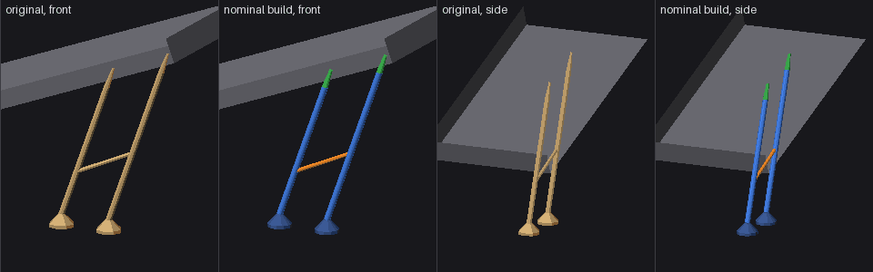

**Generates.** Model: a turned 44 x 24 x 4 mm block centred at z 26 mm. Supports: 2 trunks, 1 brace; 2 contacts. Styles: separate shells; side counts 8, 12, 16, 32 and the scene turned 17, 45 and 30 degrees.

**Checks.**

- 1 reader labels: 1 brace, 2 shaft, 2 tip part(s) read with the right axis, width and label.
- 2 layout: 2 trunks, 1 brace, with each tip's contact, socket and width, each shaft's width, foot or parent and line, and each brace's ends.
- 4a clips and 4b loops on the nominal build: nothing but tips inside the model, and 2 contact loop(s) at the truth's place and size.

**Result.** Base variant `n09_tilted__n8_r0_sep`: validate pass, 1 reader labels pass, 2 layout pass, 4a clips (nominal) pass, 4b loops (nominal) pass. Every cargo stage passes on 7 of 7 variants.

### p01_flat

Tip: flat cap.

**Generates.** Model: a 40 x 24 x 4 mm block from z 20 mm. Supports: 1 trunk; 1 contact. Styles: separate shells, joined (shells welded at shared cap centres), welded (one unioned shell); side counts 8, 12, 16, 32 and the scene turned 17, 45 and 30 degrees.

**Checks.**

- 1 reader labels: 1 shaft, 1 tip part(s) read with the right axis, width and label.
- 2 layout: 1 trunk, with each tip's contact, socket and width, each shaft's width, foot or parent and line, and each brace's ends.
- 4a clips and 4b loops on the nominal build: nothing but tips inside the model, and 1 contact loop(s) at the truth's place and size.

**Result.** Base variant `p01_flat__n8_r0_sep`: validate pass, 1 reader labels pass, 2 layout pass, 4a clips (nominal) pass, 4b loops (nominal) pass. Every cargo stage passes on 11 of 11 variants.

### p02_dome

Tip: dome.

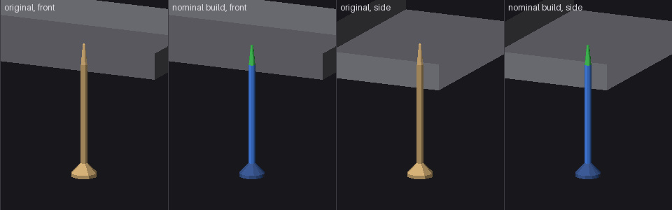

**Generates.** Model: a 40 x 24 x 4 mm block from z 20 mm. Supports: 1 trunk; 1 contact (1 rounded rod end). Styles: separate shells, joined (shells welded at shared cap centres), welded (one unioned shell); side counts 8, 12, 16, 32 and the scene turned 17, 45 and 30 degrees.

**Checks.**

- 1 reader labels: 1 shaft, 1 tip part(s) read with the right axis, width and label.
- 2 layout: 1 trunk, with each tip's contact, socket and width, each shaft's width, foot or parent and line, and each brace's ends.
- 4a clips and 4b loops on the nominal build: nothing but tips inside the model, and 1 contact loop(s) at the truth's place and size.

**Result.** Base variant `p02_dome__n8_r0_sep`: validate pass, 1 reader labels pass, 2 layout pass, 4a clips (nominal) pass, 4b loops (nominal) pass. Every cargo stage passes on 11 of 11 variants.

### p03_ball

Tip: separate ball shell.

**Generates.** Model: a 40 x 24 x 4 mm block from z 20 mm. Supports: 1 trunk; 1 contact (1 cone ending in a separate ball). Styles: separate shells; side counts 8, 12, 16, 32 and the scene turned 17, 45 and 30 degrees.

**Checks.**

- 1 reader labels: 1 shaft, 1 tip part(s) read with the right axis, width and label.
- 2 layout: 1 trunk, with each tip's contact, socket and width, each shaft's width, foot or parent and line, and each brace's ends.
- 4a clips and 4b loops on the nominal build: nothing but tips inside the model, and 1 contact loop(s) at the truth's place and size.

**Result.** Base variant `p03_ball__n8_r0_sep`: validate pass, 1 reader labels pass, 2 layout pass, 4a clips (nominal) pass, 4b loops (nominal) pass. Every cargo stage passes on 7 of 7 variants.

### p04_weldball

Tip: welded ball.

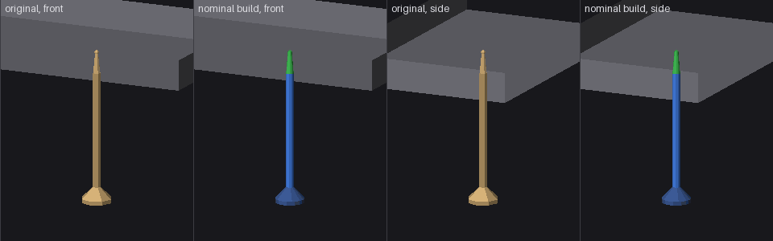

**Generates.** Model: a 40 x 24 x 4 mm block from z 20 mm. Supports: 1 trunk; 1 contact (1 cone with a ball welded on). Styles: separate shells; side counts 8, 12, 16, 32 and the scene turned 17, 45 and 30 degrees.

**Checks.**

- 1 reader labels: 1 shaft, 1 tip part(s) read with the right axis, width and label.
- 2 layout: 1 trunk, with each tip's contact, socket and width, each shaft's width, foot or parent and line, and each brace's ends.
- 4a clips and 4b loops on the nominal build: nothing but tips inside the model, and 1 contact loop(s) at the truth's place and size.

**Result.** Base variant `p04_weldball__n8_r0_sep`: validate pass, 1 reader labels **fail**, 2 layout pass, 4a clips (nominal) pass, 4b loops (nominal) pass. Every cargo stage passes on 3 of 7 variants.

- `1: a-tip width off by 0.40 mm`

Failing variants: `n12_r0_sep` (1); `n8_r0_sep` (1); `n8_r17_sep` (1); `n8_r45_sep` (1).

### p05_bent30

Tip bent 30 degrees, joined through a mitre ring (regular to within the ring tolerance).

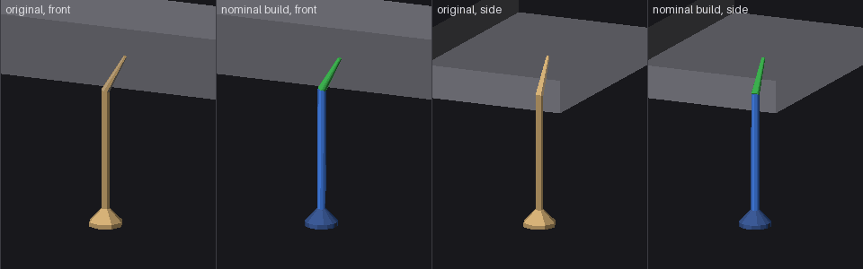

**Generates.** Model: a 40 x 24 x 4 mm block from z 20 mm. Supports: 1 trunk; 1 contact. Styles: separate shells; side counts 8, 12, 16, 32 and the scene turned 17, 45 and 30 degrees.

**Checks.**

- 1 reader labels: 1 shaft, 1 tip part(s) read with the right axis, width and label.
- 2 layout: 1 trunk, with each tip's contact, socket and width, each shaft's width, foot or parent and line, and each brace's ends.
- 4a clips and 4b loops on the nominal build: nothing but tips inside the model, and 1 contact loop(s) at the truth's place and size.

**Result.** Base variant `p05_bent30__n8_r0_sep`: validate pass, 1 reader labels pass, 2 layout pass, 4a clips (nominal) pass, 4b loops (nominal) pass. Every cargo stage passes on 7 of 7 variants.

### p05_bent60

Tip bent 60 degrees, joined through an irregular ring.

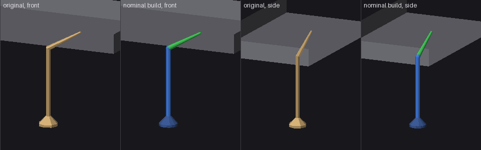

**Generates.** Model: a 40 x 24 x 4 mm block from z 20 mm. Supports: 1 trunk; 1 contact. Styles: separate shells; side counts 8, 12, 16, 32 and the scene turned 17, 45 and 30 degrees.

**Checks.**

- 1 reader labels: 1 shaft, 1 tip part(s) read with the right axis, width and label.
- 2 layout: 1 trunk, with each tip's contact, socket and width, each shaft's width, foot or parent and line, and each brace's ends.
- 4a clips and 4b loops on the nominal build: nothing but tips inside the model, and 1 contact loop(s) at the truth's place and size.

**Result.** Base variant `p05_bent60__n8_r0_sep`: validate pass, 1 reader labels pass, 2 layout pass, 4a clips (nominal) pass, 4b loops (nominal) pass. Every cargo stage passes on 7 of 7 variants.

### p06_rodend

Tip: plain rod end with no cone.

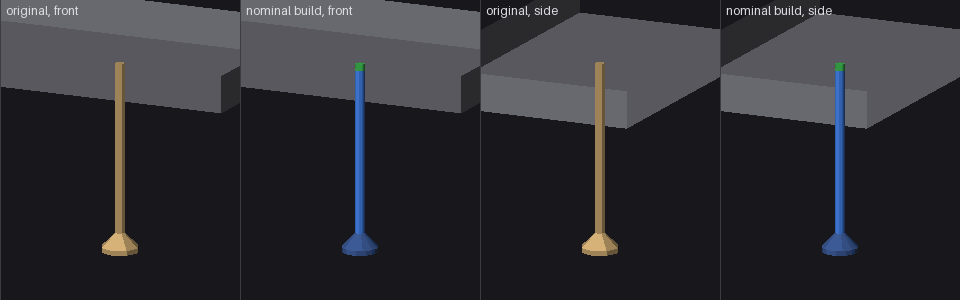

**Generates.** Model: a 40 x 24 x 4 mm block from z 20 mm. Supports: 1 trunk; 1 contact (1 blunt rod end (no cone)). Styles: separate shells, joined (shells welded at shared cap centres), welded (one unioned shell); side counts 8, 12, 16, 32 and the scene turned 17, 45 and 30 degrees.

**Checks.**

- 1 reader labels: 1 contact rod part(s) read with the right axis, width and label.
- 2 layout: 1 trunk, with each tip's contact, socket and width, each shaft's width, foot or parent and line, and each brace's ends.
- 4a clips and 4b loops on the nominal build: nothing but tips inside the model, and 1 contact loop(s) at the truth's place and size.

**Result.** Base variant `p06_rodend__n8_r0_sep`: validate pass, 1 reader labels pass, 2 layout pass, 4a clips (nominal) pass, 4b loops (nominal) pass. Every cargo stage passes on 11 of 11 variants.

### p07_bury01

Tip buried 0.1 mm.

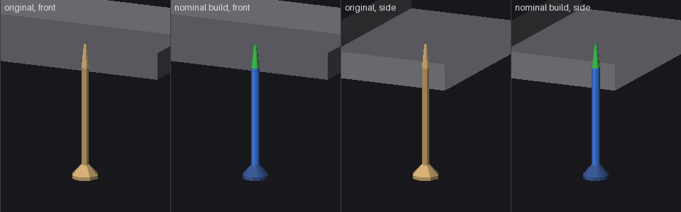

**Generates.** Model: a 40 x 24 x 4 mm block from z 20 mm. Supports: 1 trunk; 1 contact. Styles: separate shells, joined (shells welded at shared cap centres), welded (one unioned shell); side counts 8, 12, 16, 32 and the scene turned 17, 45 and 30 degrees.

**Checks.**

- 1 reader labels: 1 shaft, 1 tip part(s) read with the right axis, width and label.
- 2 layout: 1 trunk, with each tip's contact, socket and width, each shaft's width, foot or parent and line, and each brace's ends.
- 4a clips and 4b loops on the nominal build: nothing but tips inside the model, and 1 contact loop(s) at the truth's place and size.

**Result.** Base variant `p07_bury01__n8_r0_sep`: validate pass, 1 reader labels pass, 2 layout pass, 4a clips (nominal) pass, 4b loops (nominal) pass. Every cargo stage passes on 11 of 11 variants.

### p07_bury05

Tip buried 0.5 mm.

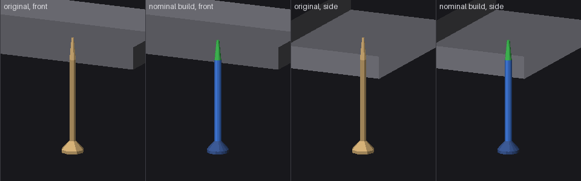

**Generates.** Model: a 40 x 24 x 4 mm block from z 20 mm. Supports: 1 trunk; 1 contact. Styles: separate shells, joined (shells welded at shared cap centres), welded (one unioned shell); side counts 8, 12, 16, 32 and the scene turned 17, 45 and 30 degrees.

**Checks.**

- 1 reader labels: 1 shaft, 1 tip part(s) read with the right axis, width and label.
- 2 layout: 1 trunk, with each tip's contact, socket and width, each shaft's width, foot or parent and line, and each brace's ends.
- 4a clips and 4b loops on the nominal build: nothing but tips inside the model, and 1 contact loop(s) at the truth's place and size.

**Result.** Base variant `p07_bury05__n8_r0_sep`: validate pass, 1 reader labels pass, 2 layout pass, 4a clips (nominal) pass, 4b loops (nominal) pass. Every cargo stage passes on 11 of 11 variants.

### p07_bury0

Tip buried 0.0 mm.

**Generates.** Model: a 40 x 24 x 4 mm block from z 20 mm. Supports: 1 trunk; 1 contact. Styles: separate shells, joined (shells welded at shared cap centres), welded (one unioned shell); side counts 8, 12, 16, 32 and the scene turned 17, 45 and 30 degrees.

**Checks.**

- 1 reader labels: 1 shaft, 1 tip part(s) read with the right axis, width and label.
- 2 layout: 1 trunk, with each tip's contact, socket and width, each shaft's width, foot or parent and line, and each brace's ends.
- 4a clips and 4b loops on the nominal build: nothing but tips inside the model, and 1 contact loop(s) at the truth's place and size.

**Result.** Base variant `p07_bury0__n8_r0_sep`: validate pass, 1 reader labels pass, 2 layout pass, 4a clips (nominal) pass, 4b loops (nominal) pass. Every cargo stage passes on 11 of 11 variants.

### p07_bury2

Tip buried 2.0 mm.

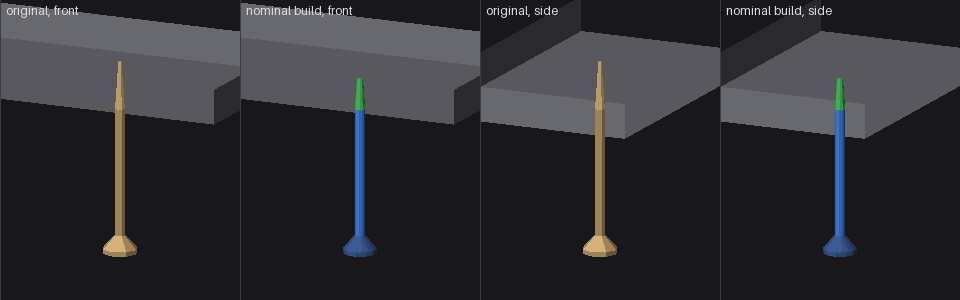

**Generates.** Model: a 40 x 24 x 4 mm block from z 20 mm. Supports: 1 trunk; 1 contact. Styles: separate shells, joined (shells welded at shared cap centres), welded (one unioned shell); side counts 8, 12, 16, 32 and the scene turned 17, 45 and 30 degrees.

**Checks.**

- 1 reader labels: 1 shaft, 1 tip part(s) read with the right axis, width and label.
- 2 layout: 1 trunk, with each tip's contact, socket and width, each shaft's width, foot or parent and line, and each brace's ends.
- 4a clips and 4b loops on the nominal build: nothing but tips inside the model, and 1 contact loop(s) at the truth's place and size.

**Result.** Base variant `p07_bury2__n8_r0_sep`: validate pass, 1 reader labels pass, 2 layout pass, 4a clips (nominal) pass, 4b loops (nominal) pass. Every cargo stage passes on 11 of 11 variants.

### p08_thin

Tip through a thin wall (0.6 mm).

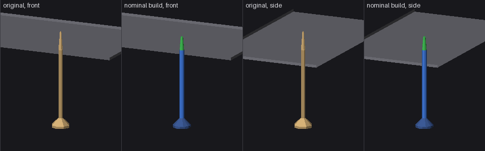

**Generates.** Model: a 40 x 24 x 0.6 mm block from z 20 mm. Supports: 1 trunk; 1 contact. Styles: separate shells, joined (shells welded at shared cap centres), welded (one unioned shell); side counts 8, 12, 16, 32 and the scene turned 17, 45 and 30 degrees.

Note: The cone's narrow end emerges past the wall's far face. The contact is the near face.

**Checks.**

- 1 reader labels: 1 shaft, 1 tip part(s) read with the right axis, width and label.
- 2 layout: 1 trunk, with each tip's contact, socket and width, each shaft's width, foot or parent and line, and each brace's ends.
- 4a clips and 4b loops on the nominal build: nothing but tips inside the model, and 1 contact loop(s) at the truth's place and size.

**Result.** Base variant `p08_thin__n8_r0_sep`: validate pass, 1 reader labels pass, 2 layout pass, 4a clips (nominal) pass, 4b loops (nominal) pass. Every cargo stage passes on 11 of 11 variants.

### p09_slant30

Upright tip on a 30 degree slanted surface.

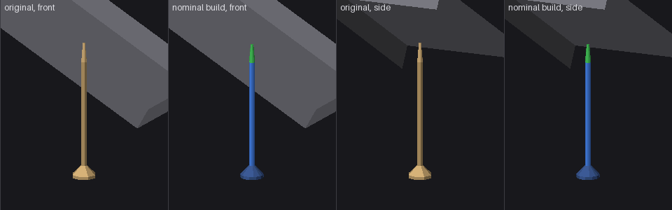

**Generates.** Model: a turned 44 x 24 x 4 mm block centred at z 26 mm. Supports: 1 trunk; 1 contact. Styles: separate shells, joined (shells welded at shared cap centres), welded (one unioned shell); side counts 8, 12, 16, 32 and the scene turned 17, 45 and 30 degrees.

**Checks.**

- 1 reader labels: 1 shaft, 1 tip part(s) read with the right axis, width and label.
- 2 layout: 1 trunk, with each tip's contact, socket and width, each shaft's width, foot or parent and line, and each brace's ends.
- 4a clips and 4b loops on the nominal build: nothing but tips inside the model, and 1 contact loop(s) at the truth's place and size.

**Result.** Base variant `p09_slant30__n8_r0_sep`: validate pass, 1 reader labels pass, 2 layout pass, 4a clips (nominal) pass, 4b loops (nominal) pass. Every cargo stage passes on 11 of 11 variants.

### p10_slant50

Upright tip on a 50 degree slanted surface.

**Generates.** Model: a turned 44 x 24 x 4 mm block centred at z 26 mm. Supports: 1 trunk; 1 contact. Styles: separate shells, joined (shells welded at shared cap centres), welded (one unioned shell); side counts 8, 12, 16, 32 and the scene turned 17, 45 and 30 degrees.

**Checks.**

- 1 reader labels: 1 shaft, 1 tip part(s) read with the right axis, width and label.
- 2 layout: 1 trunk, with each tip's contact, socket and width, each shaft's width, foot or parent and line, and each brace's ends.
- 4a clips and 4b loops on the nominal build: nothing but tips inside the model, and 1 contact loop(s) at the truth's place and size.

**Result.** Base variant `p10_slant50__n8_r0_sep`: validate pass, 1 reader labels pass, 2 layout pass, 4a clips (nominal) pass, 4b loops (nominal) pass. Every cargo stage passes on 11 of 11 variants.

### p11_slantn

Tip normal to a 40 degree surface, bent at a ball.

**Generates.** Model: a turned 44 x 24 x 4 mm block centred at z 26 mm. Supports: 1 trunk; 1 contact. Styles: separate shells, joined (shells welded at shared cap centres); side counts 8, 12, 16, 32 and the scene turned 17, 45 and 30 degrees.

**Checks.**

- 1 reader labels: 1 shaft, 1 tip part(s) read with the right axis, width and label.
- 2 layout: 1 trunk, with each tip's contact, socket and width, each shaft's width, foot or parent and line, and each brace's ends.
- 4a clips and 4b loops on the nominal build: nothing but tips inside the model, and 1 contact loop(s) at the truth's place and size.

**Result.** Base variant `p11_slantn__n8_r0_sep`: validate pass, 1 reader labels pass, 2 layout pass, 4a clips (nominal) pass, 4b loops (nominal) pass. Every cargo stage passes on 9 of 9 variants.

### p12_sphere

Tip on a sphere.

**Generates.** Model: a 30 mm ball centred at z 35 mm. Supports: 1 trunk; 1 contact. Styles: separate shells, joined (shells welded at shared cap centres), welded (one unioned shell); side counts 8, 12, 16, 32 and the scene turned 17, 45 and 30 degrees.

**Checks.**

- 1 reader labels: 1 shaft, 1 tip part(s) read with the right axis, width and label.
- 2 layout: 1 trunk, with each tip's contact, socket and width, each shaft's width, foot or parent and line, and each brace's ends.
- 4a clips and 4b loops on the nominal build: nothing but tips inside the model, and 1 contact loop(s) at the truth's place and size.

**Result.** Base variant `p12_sphere__n8_r0_sep`: validate pass, 1 reader labels pass, 2 layout pass, 4a clips (nominal) pass, 4b loops (nominal) pass. Every cargo stage passes on 11 of 11 variants.

### p13_coarse

Tip on a coarse box (12 triangles).

**Generates.** Model: a 40 x 24 x 4 mm block from z 20 mm. Supports: 1 trunk; 1 contact. Styles: separate shells; side counts 8, 12, 16, 32 and the scene turned 17, 45 and 30 degrees.

**Checks.**

- 1 reader labels: 1 shaft, 1 tip part(s) read with the right axis, width and label.
- 2 layout: 1 trunk, with each tip's contact, socket and width, each shaft's width, foot or parent and line, and each brace's ends.
- 4a clips and 4b loops on the nominal build: nothing but tips inside the model, and 1 contact loop(s) at the truth's place and size.

**Result.** Base variant `p13_coarse__n8_r0_sep`: validate pass, 1 reader labels pass, 2 layout pass, 4a clips (nominal) pass, 4b loops (nominal) pass. Every cargo stage passes on 7 of 7 variants.

### p14_open

Tip on an open model (top and side faces missing).

**Generates.** Model: a 40 x 24 x 4 mm block from z 20 mm. Supports: 1 trunk; 1 contact. Styles: separate shells; side counts 8, 12, 16, 32 and the scene turned 17, 45 and 30 degrees.

**Checks.**

- 1 reader labels: 1 shaft, 1 tip part(s) read with the right axis, width and label.
- 2 layout: 1 trunk, with each tip's contact, socket and width, each shaft's width, foot or parent and line, and each brace's ends.
- Open model: the model mesh is not closed.
- 4a clips and 4b loops on the nominal build: nothing but tips inside the model, and 1 contact loop(s) at the truth's place and size.

**Result.** Base variant `p14_open__n8_r0_sep`: validate pass, 1 reader labels pass, 2 layout pass, 4a clips (nominal) pass, 4b loops (nominal) pass. Every cargo stage passes on 7 of 7 variants.

### p15_nonman

Tip on a non-manifold model (internal sheet on a shared edge).

**Generates.** Model: a 40 x 24 x 4 mm block from z 20 mm. Supports: 1 trunk; 1 contact. Styles: separate shells; side counts 8, 12, 16, 32 and the scene turned 17, 45 and 30 degrees.

**Checks.**

- 1 reader labels: 1 shaft, 1 tip part(s) read with the right axis, width and label.
- 2 layout: 1 trunk, with each tip's contact, socket and width, each shaft's width, foot or parent and line, and each brace's ends.
- Open model: the model mesh is not closed.
- 4a clips and 4b loops on the nominal build: nothing but tips inside the model, and 1 contact loop(s) at the truth's place and size.

**Result.** Base variant `p15_nonman__n8_r0_sep`: validate pass, 1 reader labels pass, 2 layout pass, 4a clips (nominal) pass, 4b loops (nominal) pass. Every cargo stage passes on 7 of 7 variants.

### p17_mildtaper

Tip with a mild taper, 0.4 to 0.5 mm, on a 0.5 mm shaft.

**Generates.** Model: a 40 x 24 x 4 mm block from z 20 mm. Supports: 1 trunk; 1 contact. Styles: separate shells, joined (shells welded at shared cap centres), welded (one unioned shell); side counts 8, 12, 16, 32 and the scene turned 17, 45 and 30 degrees.

**Checks.**

- 1 reader labels: 1 shaft, 1 tip part(s) read with the right axis, width and label.
- 2 layout: 1 trunk, with each tip's contact, socket and width, each shaft's width, foot or parent and line, and each brace's ends.
- 4a clips and 4b loops on the nominal build: nothing but tips inside the model, and 1 contact loop(s) at the truth's place and size.

**Result.** Base variant `p17_mildtaper__n8_r0_sep`: validate pass, 1 reader labels pass, 2 layout pass, 4a clips (nominal) pass, 4b loops (nominal) pass. Every cargo stage passes on 11 of 11 variants.

### p18_contactball

Tip with a 1 mm ball centred on the contact, wider than the cone's end.

**Generates.** Model: a 40 x 24 x 4 mm block from z 20 mm. Supports: 1 trunk; 1 contact. Styles: separate shells; side counts 8, 12, 16, 32 and the scene turned 17, 45 and 30 degrees.

Note: The contact is the ball's: 1 mm across at the surface against a 0.4 mm cone end.

**Checks.**

- 1 reader labels: 1 shaft, 1 tip part(s) read with the right axis, width and label.
- 2 layout: 1 trunk, with each tip's contact, socket and width, each shaft's width, foot or parent and line, and each brace's ends.
- 4a clips and 4b loops on the nominal build: nothing but tips inside the model, and 1 contact loop(s) at the truth's place and size.

**Result.** Base variant `p18_contactball__n8_r0_sep`: validate pass, 1 reader labels pass, 2 layout pass, 4a clips (nominal) **fail**, 4b loops (nominal) pass. Every cargo stage passes on 0 of 7 variants.

- `4: clips the model: 3.04 mm of cone near [2.2, 0.9, 20.0], 0.74 mm2 buried`

Failing variants: `n12_r0_sep` (4a); `n16_r0_sep` (4a); `n16_r30_sep` (4a); `n32_r0_sep` (4a); `n8_r0_sep` (4a); `n8_r17_sep` (4a); `n8_r45_sep` (4a).

### r01_discs

Raft: discs.

**Generates.** Model: a 40 x 24 x 4 mm block from z 20 mm. Supports: 2 trunks, 1 brace; 2 contacts; on a raft. Styles: separate shells; side counts 8, 12, 16, 32 and the scene turned 17, 45 and 30 degrees.

**Checks.**

- 1 reader labels: 1 brace, 2 shaft, 2 tip part(s) read with the right axis, width and label.
- 2 layout: 2 trunks, 1 brace, with each tip's contact, socket and width, each shaft's width, foot or parent and line, and each brace's ends.
- 4a clips and 4b loops on the nominal build: nothing but tips inside the model, and 2 contact loop(s) at the truth's place and size.

**Result.** Base variant `r01_discs__n8_r0_sep`: validate pass, 1 reader labels pass, 2 layout pass, 4a clips (nominal) pass, 4b loops (nominal) pass. Every cargo stage passes on 7 of 7 variants.

### r01_rim

Raft: a slab with a rim.

**Generates.** Model: a 40 x 24 x 4 mm block from z 20 mm. Supports: 2 trunks, 1 brace; 2 contacts; on a raft. Styles: separate shells; side counts 8, 12, 16, 32 and the scene turned 17, 45 and 30 degrees.

**Checks.**

- 1 reader labels: 1 brace, 2 shaft, 2 tip part(s) read with the right axis, width and label.
- 2 layout: 2 trunks, 1 brace, with each tip's contact, socket and width, each shaft's width, foot or parent and line, and each brace's ends.
- 4a clips and 4b loops on the nominal build: nothing but tips inside the model, and 2 contact loop(s) at the truth's place and size.

**Result.** Base variant `r01_rim__n8_r0_sep`: validate pass, 1 reader labels pass, 2 layout pass, 4a clips (nominal) pass, 4b loops (nominal) pass. Every cargo stage passes on 7 of 7 variants.

### r01_thick

Raft: tiles above the raft band (3.6 mm).

**Generates.** Model: a 40 x 24 x 4 mm block from z 20 mm. Supports: 2 trunks, 1 brace; 2 contacts; on a raft. Styles: separate shells; side counts 8, 12, 16, 32 and the scene turned 17, 45 and 30 degrees.

**Checks.**

- 1 reader labels: 1 brace, 2 shaft, 2 tip part(s) read with the right axis, width and label.
- 2 layout: 2 trunks, 1 brace, with each tip's contact, socket and width, each shaft's width, foot or parent and line, and each brace's ends.
- 4a clips and 4b loops on the nominal build: nothing but tips inside the model, and 2 contact loop(s) at the truth's place and size.

**Result.** Base variant `r01_thick__n8_r0_sep`: validate pass, 1 reader labels pass, 2 layout pass, 4a clips (nominal) pass, 4b loops (nominal) pass. Every cargo stage passes on 7 of 7 variants.

### r01_tiles

Raft: square tiles.

**Generates.** Model: a 40 x 24 x 4 mm block from z 20 mm. Supports: 2 trunks, 1 brace; 2 contacts; on a raft. Styles: separate shells; side counts 8, 12, 16, 32 and the scene turned 17, 45 and 30 degrees.

**Checks.**

- 1 reader labels: 1 brace, 2 shaft, 2 tip part(s) read with the right axis, width and label.
- 2 layout: 2 trunks, 1 brace, with each tip's contact, socket and width, each shaft's width, foot or parent and line, and each brace's ends.
- 4a clips and 4b loops on the nominal build: nothing but tips inside the model, and 2 contact loop(s) at the truth's place and size.

**Result.** Base variant `r01_tiles__n8_r0_sep`: validate pass, 1 reader labels pass, 2 layout pass, 4a clips (nominal) pass, 4b loops (nominal) pass. Every cargo stage passes on 7 of 7 variants.

### r01_web

Raft: a line web.

**Generates.** Model: a 40 x 24 x 4 mm block from z 20 mm. Supports: 2 trunks, 1 brace; 2 contacts; on a raft. Styles: separate shells; side counts 8, 12, 16, 32 and the scene turned 17, 45 and 30 degrees.

**Checks.**

- 1 reader labels: 1 brace, 2 shaft, 2 tip part(s) read with the right axis, width and label.
- 2 layout: 2 trunks, 1 brace, with each tip's contact, socket and width, each shaft's width, foot or parent and line, and each brace's ends.
- 4a clips and 4b loops on the nominal build: nothing but tips inside the model, and 2 contact loop(s) at the truth's place and size.

**Result.** Base variant `r01_web__n8_r0_sep`: validate pass, 1 reader labels pass, 2 layout pass, 4a clips (nominal) pass, 4b loops (nominal) pass. Every cargo stage passes on 7 of 7 variants.

### r02_pad

Large raft pad as its own shell.

Seen in real model I12.

**Generates.** Model: a 40 x 24 x 4 mm block from z 20 mm. Supports: 1 trunk; 1 contact; on a raft. Styles: separate shells; side counts 8, 12, 16, 32 and the scene turned 17, 45 and 30 degrees.

Note: The 16 mm pad is 1.5 mm tall, inside the 3.0 mm raft band (changed from 3.6 mm at the owner's request: the real pads behind I12 are 1.5 mm or less). It is raft: never a root, ball or shaft, and the post's shaft keeps its own width.

**Checks.**

- 1 reader labels: 1 shaft, 1 tip part(s) read with the right axis, width and label.
- 2 layout: 1 trunk, with each tip's contact, socket and width, each shaft's width, foot or parent and line, and each brace's ends.
- 4a clips and 4b loops on the nominal build: nothing but tips inside the model, and 1 contact loop(s) at the truth's place and size.

**Result.** Base variant `r02_pad__n8_r0_sep`: validate pass, 1 reader labels pass, 2 layout pass, 4a clips (nominal) pass, 4b loops (nominal) pass. Every cargo stage passes on 7 of 7 variants.

### r03_padshell

Large raft pad in one shell with its post.

Seen in real model I12.

**Generates.** Model: a 40 x 24 x 4 mm block from z 20 mm. Supports: 1 trunk; 1 contact; on a raft. Styles: separate shells; side counts 8, 12, 16, 32 and the scene turned 17, 45 and 30 degrees.

Note: The 16 mm pad is 1.5 mm tall, inside the 3.0 mm raft band (changed from 3.6 mm at the owner's request: the real pads behind I12 are 1.5 mm or less). It is raft: never a root, ball or shaft, and the post's shaft keeps its own width.

**Checks.**

- 1 reader labels: 1 shaft, 1 tip part(s) read with the right axis, width and label.
- 2 layout: 1 trunk, with each tip's contact, socket and width, each shaft's width, foot or parent and line, and each brace's ends.
- 4a clips and 4b loops on the nominal build: nothing but tips inside the model, and 1 contact loop(s) at the truth's place and size.

**Result.** Base variant `r03_padshell__n8_r0_sep`: validate pass, 1 reader labels pass, 2 layout pass, 4a clips (nominal) pass, 4b loops (nominal) pass. Every cargo stage passes on 7 of 7 variants.

### r04_padbrace

Large raft pad with a rod near it that passes close by.

Seen in real model I12.

**Generates.** Model: a 40 x 24 x 4 mm block from z 20 mm. Supports: 2 trunks, 1 brace; 2 contacts; on a raft. Styles: separate shells; side counts 8, 12, 16, 32 and the scene turned 17, 45 and 30 degrees.

Note: A short brace whose low end sits just above the pad, as case I12: a brace, not a post on a root.

**Checks.**

- 1 reader labels: 1 brace, 2 shaft, 2 tip part(s) read with the right axis, width and label.
- 2 layout: 2 trunks, 1 brace, with each tip's contact, socket and width, each shaft's width, foot or parent and line, and each brace's ends.
- 4a clips and 4b loops on the nominal build: nothing but tips inside the model, and 2 contact loop(s) at the truth's place and size.

**Result.** Base variant `r04_padbrace__n8_r0_sep`: validate pass, 1 reader labels pass, 2 layout pass, 4a clips (nominal) pass, 4b loops (nominal) pass. Every cargo stage passes on 7 of 7 variants.

### r05_padfoot

Large raft pad with a slanted brace whose low end lands on it.

Seen in real model I12.

**Generates.** Model: a 40 x 24 x 4 mm block from z 20 mm. Supports: 2 trunks, 1 brace; 2 contacts; on a raft. Styles: separate shells; side counts 8, 12, 16, 32 and the scene turned 17, 45 and 30 degrees.

Note: Case I12 itself (added at the owner's request): a slanted brace whose low end lands on the 1.5 mm pad at a post's foot. It stays a brace: not a leg, post or root.

**Checks.**

- 1 reader labels: 1 brace, 2 shaft, 2 tip part(s) read with the right axis, width and label.
- 2 layout: 2 trunks, 1 brace, with each tip's contact, socket and width, each shaft's width, foot or parent and line, and each brace's ends.
- 4a clips and 4b loops on the nominal build: nothing but tips inside the model, and 2 contact loop(s) at the truth's place and size.

**Result.** Base variant `r05_padfoot__n8_r0_sep`: validate pass, 1 reader labels pass, 2 layout pass, 4a clips (nominal) pass, 4b loops (nominal) pass. Every cargo stage passes on 7 of 7 variants.

### s01_post

Post with no tip, braced to a trunk.

**Generates.** Model: a 40 x 24 x 4 mm block from z 20 mm. Supports: 1 trunk, 1 post, 1 brace; 1 contact. Styles: separate shells, joined (shells welded at shared cap centres), welded (one unioned shell); side counts 8, 12, 16, 32 and the scene turned 17, 45 and 30 degrees.

**Checks.**

- 1 reader labels: 1 brace, 1 post, 1 shaft, 1 tip part(s) read with the right axis, width and label.
- 2 layout: 1 trunk, 1 post, 1 brace, with each tip's contact, socket and width, each shaft's width, foot or parent and line, and each brace's ends.
- 4a clips and 4b loops on the nominal build: nothing but tips inside the model, and 1 contact loop(s) at the truth's place and size.

**Result.** Base variant `s01_post__n8_r0_sep`: validate pass, 1 reader labels pass, 2 layout pass, 4a clips (nominal) pass, 4b loops (nominal) pass. Every cargo stage passes on 11 of 11 variants.

### s02_kick

Kickstand on a root.

**Generates.** Model: a 40 x 24 x 4 mm block from z 20 mm. Supports: 1 trunk, 1 leg; 1 contact. Styles: separate shells, joined (shells welded at shared cap centres), welded (one unioned shell); side counts 8, 12, 16, 32 and the scene turned 17, 45 and 30 degrees.

**Checks.**

- 1 reader labels: 1 post, 1 shaft, 1 tip part(s) read with the right axis, width and label.
- 2 layout: 1 trunk, 1 leg, with each tip's contact, socket and width, each shaft's width, foot or parent and line, and each brace's ends.
- 4a clips and 4b loops on the nominal build: nothing but tips inside the model, and 1 contact loop(s) at the truth's place and size.

**Result.** Base variant `s02_kick__n8_r0_sep`: validate pass, 1 reader labels pass, 2 layout pass, 4a clips (nominal) pass, 4b loops (nominal) pass. Every cargo stage passes on 11 of 11 variants.

### s03_leg

Leg off a post.

**Generates.** Model: a 40 x 24 x 4 mm block from z 20 mm. Supports: 1 trunk, 1 post, 1 leg, 1 brace; 1 contact. Styles: separate shells, joined (shells welded at shared cap centres), welded (one unioned shell); side counts 8, 12, 16, 32 and the scene turned 17, 45 and 30 degrees.

**Checks.**

- 1 reader labels: 1 brace, 2 post, 1 shaft, 1 tip part(s) read with the right axis, width and label.
- 2 layout: 1 trunk, 1 post, 1 leg, 1 brace, with each tip's contact, socket and width, each shaft's width, foot or parent and line, and each brace's ends.
- 4a clips and 4b loops on the nominal build: nothing but tips inside the model, and 1 contact loop(s) at the truth's place and size.

**Result.** Base variant `s03_leg__n8_r0_sep`: validate pass, 1 reader labels pass, 2 layout pass, 4a clips (nominal) pass, 4b loops (nominal) pass. Every cargo stage passes on 11 of 11 variants.

### s05_touch_face

Side-by-side rods touching along a wall.

**Generates.** Model: a 40 x 24 x 4 mm block from z 20 mm. Supports: 2 trunks; 2 contacts. Styles: separate shells; side counts 8, 12, 16, 32 and the scene turned 17, 45 and 30 degrees.

**Checks.**

- 1 reader labels: 2 shaft, 2 tip part(s) read with the right axis, width and label.
- 2 layout: 2 trunks, with each tip's contact, socket and width, each shaft's width, foot or parent and line, and each brace's ends.
- 4a clips and 4b loops on the nominal build: nothing but tips inside the model, and 2 contact loop(s) at the truth's place and size.

**Result.** Base variant `s05_touch_face__n8_r0_sep`: validate pass, 1 reader labels pass, 2 layout pass, 4a clips (nominal) pass, 4b loops (nominal) pass. Every cargo stage passes on 7 of 7 variants.

### s06_touch_edge

Side-by-side rods sharing a wall edge (welds).

**Generates.** Model: a 40 x 24 x 4 mm block from z 20 mm. Supports: 2 trunks; 2 contacts. Styles: separate shells; side counts 8, 12, 16, 32 and the scene turned 17, 45 and 30 degrees.

**Checks.**

- 1 reader labels: 2 shaft, 2 tip part(s) read with the right axis, width and label.
- 2 layout: 2 trunks, with each tip's contact, socket and width, each shaft's width, foot or parent and line, and each brace's ends.
- 4a clips and 4b loops on the nominal build: nothing but tips inside the model, and 2 contact loop(s) at the truth's place and size.

**Result.** Base variant `s06_touch_edge__n8_r0_sep`: validate pass, 1 reader labels pass, 2 layout pass, 4a clips (nominal) pass, 4b loops (nominal) pass. Every cargo stage passes on 7 of 7 variants.

### s07_touch_lap

Side-by-side rods overlapping by 0.1 mm.

**Generates.** Model: a 40 x 24 x 4 mm block from z 20 mm. Supports: 2 trunks; 2 contacts. Styles: separate shells; side counts 8, 12, 16, 32 and the scene turned 17, 45 and 30 degrees.

**Checks.**

- 1 reader labels: 2 shaft, 2 tip part(s) read with the right axis, width and label.
- 2 layout: 2 trunks, with each tip's contact, socket and width, each shaft's width, foot or parent and line, and each brace's ends.
- 4a clips and 4b loops on the nominal build: nothing but tips inside the model, and 2 contact loop(s) at the truth's place and size.

**Result.** Base variant `s07_touch_lap__n8_r0_sep`: validate pass, 1 reader labels pass, 2 layout pass, 4a clips (nominal) pass, 4b loops (nominal) pass. Every cargo stage passes on 7 of 7 variants.

### s08_touch_near

Near-coincident rods, 0.1 mm centre to centre.

**Generates.** Model: a 40 x 24 x 4 mm block from z 20 mm. Supports: 1 trunk, 1 post; 1 contact. Styles: separate shells; side counts 8, 12, 16, 32 and the scene turned 17, 45 and 30 degrees.

**Checks.**

- 1 reader labels: 1 post, 1 shaft, 1 tip part(s) read with the right axis, width and label.
- 2 layout: 1 trunk, 1 post, with each tip's contact, socket and width, each shaft's width, foot or parent and line, and each brace's ends.
- 4a clips and 4b loops on the nominal build: nothing but tips inside the model, and 1 contact loop(s) at the truth's place and size.

**Result.** Base variant `s08_touch_near__n8_r0_sep`: validate pass, 1 reader labels pass, 2 layout pass, 4a clips (nominal) pass, 4b loops (nominal) pass. Every cargo stage passes on 7 of 7 variants.

### s09_parallel07

Parallel thin shafts with a 0.1 mm gap between them.

**Generates.** Model: a 40 x 24 x 4 mm block from z 20 mm. Supports: 2 trunks; 2 contacts. Styles: separate shells; side counts 8, 12, 16, 32 and the scene turned 17, 45 and 30 degrees.

**Checks.**

- 1 reader labels: 2 shaft, 2 tip part(s) read with the right axis, width and label.
- 2 layout: 2 trunks, with each tip's contact, socket and width, each shaft's width, foot or parent and line, and each brace's ends.
- 4a clips and 4b loops on the nominal build: nothing but tips inside the model, and 2 contact loop(s) at the truth's place and size.

**Result.** Base variant `s09_parallel07__n8_r0_sep`: validate pass, 1 reader labels pass, 2 layout pass, 4a clips (nominal) pass, 4b loops (nominal) pass. Every cargo stage passes on 7 of 7 variants.

### s10_parallel06

Parallel thin shafts 0.05 mm apart, 0.4 mm wide.

**Generates.** Model: a 40 x 24 x 4 mm block from z 20 mm. Supports: 2 trunks; 2 contacts. Styles: separate shells; side counts 8, 12, 16, 32 and the scene turned 17, 45 and 30 degrees.

**Checks.**

- 1 reader labels: 2 shaft, 2 tip part(s) read with the right axis, width and label.
- 2 layout: 2 trunks, with each tip's contact, socket and width, each shaft's width, foot or parent and line, and each brace's ends.
- 4a clips and 4b loops on the nominal build: nothing but tips inside the model, and 2 contact loop(s) at the truth's place and size.

**Result.** Base variant `s10_parallel06__n8_r0_sep`: validate pass, 1 reader labels pass, 2 layout pass, 4a clips (nominal) pass, 4b loops (nominal) pass. Every cargo stage passes on 7 of 7 variants.

### s11_parbrace

Two parallel braces 0.8 mm apart (0.2 mm gap).

**Generates.** Model: a 40 x 24 x 4 mm block from z 20 mm. Supports: 2 trunks, 2 braces; 2 contacts. Styles: separate shells; side counts 8, 12, 16, 32 and the scene turned 17, 45 and 30 degrees.

**Checks.**

- 1 reader labels: 2 brace, 2 shaft, 2 tip part(s) read with the right axis, width and label.
- 2 layout: 2 trunks, 2 braces, with each tip's contact, socket and width, each shaft's width, foot or parent and line, and each brace's ends.
- 4a clips and 4b loops on the nominal build: nothing but tips inside the model, and 2 contact loop(s) at the truth's place and size.

**Result.** Base variant `s11_parbrace__n8_r0_sep`: validate pass, 1 reader labels pass, 2 layout pass, 4a clips (nominal) pass, 4b loops (nominal) pass. Every cargo stage passes on 7 of 7 variants.

### t01_trunk

Straight trunk on a root.

**Generates.** Model: a 40 x 24 x 4 mm block from z 20 mm. Supports: 1 trunk; 1 contact. Styles: separate shells, joined (shells welded at shared cap centres), welded (one unioned shell); side counts 8, 12, 16, 32 and the scene turned 17, 45 and 30 degrees.

**Checks.**

- 1 reader labels: 1 shaft, 1 tip part(s) read with the right axis, width and label.
- 2 layout: 1 trunk, with each tip's contact, socket and width, each shaft's width, foot or parent and line, and each brace's ends.
- 4a clips and 4b loops on the nominal build: nothing but tips inside the model, and 1 contact loop(s) at the truth's place and size.

**Result.** Base variant `t01_trunk__n8_r0_sep`: validate pass, 1 reader labels pass, 2 layout pass, 4a clips (nominal) pass, 4b loops (nominal) pass. Every cargo stage passes on 11 of 11 variants.

### t02_tilt10

Tilted trunk, 10 degrees.

**Generates.** Model: a 40 x 24 x 4 mm block from z 20 mm. Supports: 1 trunk; 1 contact. Styles: separate shells, joined (shells welded at shared cap centres), welded (one unioned shell); side counts 8, 12, 16, 32 and the scene turned 17, 45 and 30 degrees.

**Checks.**

- 1 reader labels: 1 shaft, 1 tip part(s) read with the right axis, width and label.
- 2 layout: 1 trunk, with each tip's contact, socket and width, each shaft's width, foot or parent and line, and each brace's ends.
- 4a clips and 4b loops on the nominal build: nothing but tips inside the model, and 1 contact loop(s) at the truth's place and size.

**Result.** Base variant `t02_tilt10__n8_r0_sep`: validate pass, 1 reader labels pass, 2 layout pass, 4a clips (nominal) pass, 4b loops (nominal) pass. Every cargo stage passes on 11 of 11 variants.

### t03_tilt25

Tilted trunk, 25 degrees.

**Generates.** Model: a 40 x 24 x 4 mm block from z 20 mm. Supports: 1 trunk; 1 contact. Styles: separate shells, joined (shells welded at shared cap centres), welded (one unioned shell); side counts 8, 12, 16, 32 and the scene turned 17, 45 and 30 degrees.

**Checks.**

- 1 reader labels: 1 shaft, 1 tip part(s) read with the right axis, width and label.
- 2 layout: 1 trunk, with each tip's contact, socket and width, each shaft's width, foot or parent and line, and each brace's ends.
- 4a clips and 4b loops on the nominal build: nothing but tips inside the model, and 1 contact loop(s) at the truth's place and size.

**Result.** Base variant `t03_tilt25__n8_r0_sep`: validate pass, 1 reader labels pass, 2 layout pass, 4a clips (nominal) pass, 4b loops (nominal) pass. Every cargo stage passes on 11 of 11 variants.

### t04_rings_abut

Shaft cut into 0.6 mm sections, ends exactly meeting (their caps weld).

**Generates.** Model: a 40 x 24 x 4 mm block from z 20 mm. Supports: 1 trunk; 1 contact. Styles: separate shells; side counts 8, 12, 16, 32 and the scene turned 17, 45 and 30 degrees.

**Checks.**

- 1 reader labels: 1 shaft, 1 tip part(s) read with the right axis, width and label.
- 2 layout: 1 trunk, with each tip's contact, socket and width, each shaft's width, foot or parent and line, and each brace's ends.
- 4a clips and 4b loops on the nominal build: nothing but tips inside the model, and 1 contact loop(s) at the truth's place and size.

**Result.** Base variant `t04_rings_abut__n8_r0_sep`: validate pass, 1 reader labels pass, 2 layout pass, 4a clips (nominal) pass, 4b loops (nominal) pass. Every cargo stage passes on 7 of 7 variants.

### t04_rings_short

Shaft cut into 0.6 mm sections, separate shells overlapping 0.05 mm.

**Generates.** Model: a 40 x 24 x 4 mm block from z 20 mm. Supports: 1 trunk; 1 contact. Styles: separate shells; side counts 8, 12, 16, 32 and the scene turned 17, 45 and 30 degrees.

**Checks.**

- 1 reader labels: 1 shaft, 1 tip part(s) read with the right axis, width and label.
- 2 layout: 1 trunk, with each tip's contact, socket and width, each shaft's width, foot or parent and line, and each brace's ends.
- 4a clips and 4b loops on the nominal build: nothing but tips inside the model, and 1 contact loop(s) at the truth's place and size.

**Result.** Base variant `t04_rings_short__n8_r0_sep`: validate pass, 1 reader labels pass, 2 layout pass, 4a clips (nominal) pass, 4b loops (nominal) pass. Every cargo stage passes on 7 of 7 variants.

### t05_rings_long

Shaft cut into 2 mm sections, separate shells overlapping 0.05 mm.

**Generates.** Model: a 40 x 24 x 4 mm block from z 20 mm. Supports: 1 trunk; 1 contact. Styles: separate shells; side counts 8, 12, 16, 32 and the scene turned 17, 45 and 30 degrees.

**Checks.**

- 1 reader labels: 1 shaft, 1 tip part(s) read with the right axis, width and label.
- 2 layout: 1 trunk, with each tip's contact, socket and width, each shaft's width, foot or parent and line, and each brace's ends.
- 4a clips and 4b loops on the nominal build: nothing but tips inside the model, and 1 contact loop(s) at the truth's place and size.

**Result.** Base variant `t05_rings_long__n8_r0_sep`: validate pass, 1 reader labels pass, 2 layout pass, 4a clips (nominal) pass, 4b loops (nominal) pass. Every cargo stage passes on 7 of 7 variants.

### t06_rings_shared

Shaft with many rings in one shell.

**Generates.** Model: a 40 x 24 x 4 mm block from z 20 mm. Supports: 1 trunk; 1 contact. Styles: separate shells; side counts 8, 12, 16, 32 and the scene turned 17, 45 and 30 degrees.

**Checks.**

- 1 reader labels: 1 shaft, 1 tip part(s) read with the right axis, width and label.
- 2 layout: 1 trunk, with each tip's contact, socket and width, each shaft's width, foot or parent and line, and each brace's ends.
- 4a clips and 4b loops on the nominal build: nothing but tips inside the model, and 1 contact loop(s) at the truth's place and size.

**Result.** Base variant `t06_rings_shared__n8_r0_sep`: validate pass, 1 reader labels pass, 2 layout pass, 4a clips (nominal) pass, 4b loops (nominal) pass. Every cargo stage passes on 7 of 7 variants.

### t07_taper_strong

Tapered shaft, 1.6 to 0.8 mm (2:1, three width steps).

**Generates.** Model: a 40 x 24 x 4 mm block from z 20 mm. Supports: 1 trunk; 1 contact. Styles: separate shells, joined (shells welded at shared cap centres), welded (one unioned shell); side counts 8, 12, 16, 32 and the scene turned 17, 45 and 30 degrees.

Note: A 2.0:1 taper: written as 3 constant-width segments (owner's stepped-taper rule); shaft_d stays the mean

**Checks.**

- 1 reader labels: 1 cone other, 1 post, 1 shaft, 1 tip part(s) read with the right axis, width and label.
- 2 layout: 1 trunk, with each tip's contact, socket and width, each shaft's width, foot or parent and line, and each brace's ends.
- Stepped widths: a must be written in the truth's number of constant-width steps, each within the width tolerance.
- 4a clips and 4b loops on the nominal build: nothing but tips inside the model, and 1 contact loop(s) at the truth's place and size.

**Result.** Base variant `t07_taper_strong__n8_r0_sep`: validate pass, 1 reader labels pass, 2 layout pass, 4a clips (nominal) pass, 4b loops (nominal) pass. Every cargo stage passes on 11 of 11 variants.

### t08_taper_mild

Tapered shaft, 1.1 to 0.9 mm (reads as a rod, one width).

**Generates.** Model: a 40 x 24 x 4 mm block from z 20 mm. Supports: 1 trunk; 1 contact. Styles: separate shells, joined (shells welded at shared cap centres), welded (one unioned shell); side counts 8, 12, 16, 32 and the scene turned 17, 45 and 30 degrees.

Note: DragonFruit has one width per segment here, so the oracle draws the mean width

**Checks.**

- 1 reader labels: 1 cone other, 1 post, 1 shaft, 1 tip part(s) read with the right axis, width and label.
- 2 layout: 1 trunk, with each tip's contact, socket and width, each shaft's width, foot or parent and line, and each brace's ends.
- 4a clips and 4b loops on the nominal build: nothing but tips inside the model, and 1 contact loop(s) at the truth's place and size.

**Result.** Base variant `t08_taper_mild__n8_r0_sep`: validate pass, 1 reader labels pass, 2 layout pass, 4a clips (nominal) pass, 4b loops (nominal) pass. Every cargo stage passes on 11 of 11 variants.

### t09_chamfer

Rod with chamfered ends.

**Generates.** Model: a 40 x 24 x 4 mm block from z 20 mm. Supports: 1 trunk; 1 contact. Styles: separate shells; side counts 8, 12, 16, 32 and the scene turned 17, 45 and 30 degrees.

**Checks.**

- 1 reader labels: 1 shaft, 1 tip part(s) read with the right axis, width and label.
- 2 layout: 1 trunk, with each tip's contact, socket and width, each shaft's width, foot or parent and line, and each brace's ends.
- 4a clips and 4b loops on the nominal build: nothing but tips inside the model, and 1 contact loop(s) at the truth's place and size.

**Result.** Base variant `t09_chamfer__n8_r0_sep`: validate pass, 1 reader labels pass, 2 layout pass, 4a clips (nominal) pass, 4b loops (nominal) pass. Every cargo stage passes on 7 of 7 variants.

### x01_sep

X brace: separate rods.

**Generates.** Model: a 40 x 24 x 4 mm block from z 20 mm. Supports: 2 trunks, 2 braces; 2 contacts. Styles: separate shells, joined (shells welded at shared cap centres), welded (one unioned shell); side counts 8, 12, 16, 32 and the scene turned 17, 45 and 30 degrees.

**Checks.**

- 1 reader labels: 2 brace, 2 shaft, 2 tip part(s) read with the right axis, width and label.
- 2 layout: 2 trunks, 2 braces, with each tip's contact, socket and width, each shaft's width, foot or parent and line, and each brace's ends.
- 4a clips and 4b loops on the nominal build: nothing but tips inside the model, and 2 contact loop(s) at the truth's place and size.

**Result.** Base variant `x01_sep__n8_r0_sep`: validate pass, 1 reader labels pass, 2 layout pass, 4a clips (nominal) pass, 4b loops (nominal) pass. Every cargo stage passes on 11 of 11 variants.

### x03_cut

X brace: cut into two halves at the crossing.

**Generates.** Model: a 40 x 24 x 4 mm block from z 20 mm. Supports: 2 trunks, 2 braces; 2 contacts. Styles: separate shells, joined (shells welded at shared cap centres); side counts 8, 12, 16, 32 and the scene turned 17, 45 and 30 degrees.

**Checks.**

- 1 reader labels: 2 brace, 2 shaft, 2 tip part(s) read with the right axis, width and label.
- 2 layout: 2 trunks, 2 braces, with each tip's contact, socket and width, each shaft's width, foot or parent and line, and each brace's ends.
- 4a clips and 4b loops on the nominal build: nothing but tips inside the model, and 2 contact loop(s) at the truth's place and size.

**Result.** Base variant `x03_cut__n8_r0_sep`: validate pass, 1 reader labels pass, 2 layout pass, 4a clips (nominal) pass, 4b loops (nominal) pass. Every cargo stage passes on 9 of 9 variants.

### x04_samewidth

X brace: same width as the posts.

**Generates.** Model: a 40 x 24 x 4 mm block from z 20 mm. Supports: 2 trunks, 2 braces; 2 contacts. Styles: separate shells, joined (shells welded at shared cap centres), welded (one unioned shell); side counts 8, 12, 16, 32 and the scene turned 17, 45 and 30 degrees.

**Checks.**

- 1 reader labels: 2 brace, 2 shaft, 2 tip part(s) read with the right axis, width and label.
- 2 layout: 2 trunks, 2 braces, with each tip's contact, socket and width, each shaft's width, foot or parent and line, and each brace's ends.
- 4a clips and 4b loops on the nominal build: nothing but tips inside the model, and 2 contact loop(s) at the truth's place and size.

**Result.** Base variant `x04_samewidth__n8_r0_sep`: validate pass, 1 reader labels pass, 2 layout pass, 4a clips (nominal) pass, 4b loops (nominal) pass. Every cargo stage passes on 11 of 11 variants.

### x05_thin

X brace: thinner than the posts.

**Generates.** Model: a 40 x 24 x 4 mm block from z 20 mm. Supports: 2 trunks, 2 braces; 2 contacts. Styles: separate shells, joined (shells welded at shared cap centres), welded (one unioned shell); side counts 8, 12, 16, 32 and the scene turned 17, 45 and 30 degrees.

**Checks.**

- 1 reader labels: 2 brace, 2 shaft, 2 tip part(s) read with the right axis, width and label.
- 2 layout: 2 trunks, 2 braces, with each tip's contact, socket and width, each shaft's width, foot or parent and line, and each brace's ends.
- 4a clips and 4b loops on the nominal build: nothing but tips inside the model, and 2 contact loop(s) at the truth's place and size.

**Result.** Base variant `x05_thin__n8_r0_sep`: validate pass, 1 reader labels pass, 2 layout pass, 4a clips (nominal) pass, 4b loops (nominal) pass. Every cargo stage passes on 11 of 11 variants.

### x06_close15

X brace: posts 1.5 mm apart.

**Generates.** Model: a 40 x 24 x 4 mm block from z 20 mm. Supports: 2 trunks, 2 braces; 2 contacts. Styles: separate shells, joined (shells welded at shared cap centres), welded (one unioned shell); side counts 8, 12, 16, 32 and the scene turned 17, 45 and 30 degrees.

**Checks.**

- 1 reader labels: 2 brace, 2 shaft, 2 tip part(s) read with the right axis, width and label.
- 2 layout: 2 trunks, 2 braces, with each tip's contact, socket and width, each shaft's width, foot or parent and line, and each brace's ends.
- 4a clips and 4b loops on the nominal build: nothing but tips inside the model, and 2 contact loop(s) at the truth's place and size.

**Result.** Base variant `x06_close15__n8_r0_sep`: validate pass, 1 reader labels pass, 2 layout pass, 4a clips (nominal) pass, 4b loops (nominal) pass. Every cargo stage passes on 11 of 11 variants.

### x06_close20

X brace: posts 2.0 mm apart.

**Generates.** Model: a 40 x 24 x 4 mm block from z 20 mm. Supports: 2 trunks, 2 braces; 2 contacts. Styles: separate shells, joined (shells welded at shared cap centres), welded (one unioned shell); side counts 8, 12, 16, 32 and the scene turned 17, 45 and 30 degrees.

**Checks.**

- 1 reader labels: 2 brace, 2 shaft, 2 tip part(s) read with the right axis, width and label.
- 2 layout: 2 trunks, 2 braces, with each tip's contact, socket and width, each shaft's width, foot or parent and line, and each brace's ends.
- 4a clips and 4b loops on the nominal build: nothing but tips inside the model, and 2 contact loop(s) at the truth's place and size.

**Result.** Base variant `x06_close20__n8_r0_sep`: validate pass, 1 reader labels pass, 2 layout pass, 4a clips (nominal) pass, 4b loops (nominal) pass. Every cargo stage passes on 11 of 11 variants.

### x06_close30

X brace: posts 3.0 mm apart.

**Generates.** Model: a 40 x 24 x 4 mm block from z 20 mm. Supports: 2 trunks, 2 braces; 2 contacts. Styles: separate shells, joined (shells welded at shared cap centres), welded (one unioned shell); side counts 8, 12, 16, 32 and the scene turned 17, 45 and 30 degrees.

**Checks.**

- 1 reader labels: 2 brace, 2 shaft, 2 tip part(s) read with the right axis, width and label.
- 2 layout: 2 trunks, 2 braces, with each tip's contact, socket and width, each shaft's width, foot or parent and line, and each brace's ends.
- 4a clips and 4b loops on the nominal build: nothing but tips inside the model, and 2 contact loop(s) at the truth's place and size.

**Result.** Base variant `x06_close30__n8_r0_sep`: validate pass, 1 reader labels pass, 2 layout pass, 4a clips (nominal) pass, 4b loops (nominal) pass. Every cargo stage passes on 11 of 11 variants.

### z01_chain

Zigzag chain sharing ends.

**Generates.** Model: a 40 x 24 x 4 mm block from z 20 mm. Supports: 2 trunks, 3 braces; 2 contacts. Styles: separate shells, joined (shells welded at shared cap centres), welded (one unioned shell); side counts 8, 12, 16, 32 and the scene turned 17, 45 and 30 degrees.

**Checks.**

- 1 reader labels: 3 brace, 2 shaft, 2 tip part(s) read with the right axis, width and label.
- 2 layout: 2 trunks, 3 braces, with each tip's contact, socket and width, each shaft's width, foot or parent and line, and each brace's ends.
- 4a clips and 4b loops on the nominal build: nothing but tips inside the model, and 2 contact loop(s) at the truth's place and size.

**Result.** Base variant `z01_chain__n8_r0_sep`: validate pass, 1 reader labels pass, 2 layout pass, 4a clips (nominal) pass, 4b loops (nominal) pass. Every cargo stage passes on 11 of 11 variants.

### z02_rungs

Level rungs.

**Generates.** Model: a 40 x 24 x 4 mm block from z 20 mm. Supports: 2 trunks, 2 braces; 2 contacts. Styles: separate shells, joined (shells welded at shared cap centres), welded (one unioned shell); side counts 8, 12, 16, 32 and the scene turned 17, 45 and 30 degrees.

**Checks.**

- 1 reader labels: 2 brace, 2 shaft, 2 tip part(s) read with the right axis, width and label.
- 2 layout: 2 trunks, 2 braces, with each tip's contact, socket and width, each shaft's width, foot or parent and line, and each brace's ends.
- 4a clips and 4b loops on the nominal build: nothing but tips inside the model, and 2 contact loop(s) at the truth's place and size.

**Result.** Base variant `z02_rungs__n8_r0_sep`: validate pass, 1 reader labels pass, 2 layout pass, 4a clips (nominal) pass, 4b loops (nominal) pass. Every cargo stage passes on 11 of 11 variants.

### z03_ballend

Brace ending at a joint ball.

**Generates.** Model: a 40 x 24 x 4 mm block from z 20 mm. Supports: 2 trunks, 1 brace; 2 contacts. Styles: separate shells; side counts 8, 12, 16, 32 and the scene turned 17, 45 and 30 degrees.

**Checks.**

- 1 reader labels: 1 brace, 2 shaft, 2 tip part(s) read with the right axis, width and label.
- 2 layout: 2 trunks, 1 brace, with each tip's contact, socket and width, each shaft's width, foot or parent and line, and each brace's ends.
- 4a clips and 4b loops on the nominal build: nothing but tips inside the model, and 2 contact loop(s) at the truth's place and size.

**Result.** Base variant `z03_ballend__n8_r0_sep`: validate pass, 1 reader labels pass, 2 layout pass, 4a clips (nominal) pass, 4b loops (nominal) pass. Every cargo stage passes on 7 of 7 variants.

### z05_band25

Brace ending low in the raft band (z = 2.5).

Seen in real model B4, C2.

**Generates.** Model: a 40 x 24 x 4 mm block from z 20 mm. Supports: 2 trunks, 1 brace; 2 contacts. Styles: separate shells, joined (shells welded at shared cap centres), welded (one unioned shell); side counts 8, 12, 16, 32 and the scene turned 17, 45 and 30 degrees.

**Checks.**

- 1 reader labels: 1 brace, 2 shaft, 2 tip part(s) read with the right axis, width and label.
- 2 layout: 2 trunks, 1 brace, with each tip's contact, socket and width, each shaft's width, foot or parent and line, and each brace's ends.
- 4a clips and 4b loops on the nominal build: nothing but tips inside the model, and 2 contact loop(s) at the truth's place and size.

**Result.** Base variant `z05_band25__n8_r0_sep`: validate pass, 1 reader labels pass, 2 layout pass, 4a clips (nominal) pass, 4b loops (nominal) pass. Every cargo stage passes on 11 of 11 variants.

### z05_band32

Brace ending low in the raft band (z = 3.2).

Seen in real model B4, C2.

**Generates.** Model: a 40 x 24 x 4 mm block from z 20 mm. Supports: 2 trunks, 1 brace; 2 contacts. Styles: separate shells, joined (shells welded at shared cap centres), welded (one unioned shell); side counts 8, 12, 16, 32 and the scene turned 17, 45 and 30 degrees.

**Checks.**

- 1 reader labels: 1 brace, 2 shaft, 2 tip part(s) read with the right axis, width and label.
- 2 layout: 2 trunks, 1 brace, with each tip's contact, socket and width, each shaft's width, foot or parent and line, and each brace's ends.
- 4a clips and 4b loops on the nominal build: nothing but tips inside the model, and 2 contact loop(s) at the truth's place and size.

**Result.** Base variant `z05_band32__n8_r0_sep`: validate pass, 1 reader labels pass, 2 layout pass, 4a clips (nominal) pass, 4b loops (nominal) pass. Every cargo stage passes on 11 of 11 variants.

### z06_brief10

Short brace, 1.0 mm axis to axis.

Seen in real model D1, E5.

**Generates.** Model: a 40 x 24 x 4 mm block from z 20 mm. Supports: 2 trunks, 1 brace; 2 contacts. Styles: separate shells, joined (shells welded at shared cap centres), welded (one unioned shell); side counts 8, 12, 16, 32 and the scene turned 17, 45 and 30 degrees.

**Checks.**

- 1 reader labels: 1 brace, 2 shaft, 2 tip part(s) read with the right axis, width and label.
- 2 layout: 2 trunks, 1 brace, with each tip's contact, socket and width, each shaft's width, foot or parent and line, and each brace's ends.
- 4a clips and 4b loops on the nominal build: nothing but tips inside the model, and 2 contact loop(s) at the truth's place and size.

**Result.** Base variant `z06_brief10__n8_r0_sep`: validate pass, 1 reader labels pass, 2 layout pass, 4a clips (nominal) pass, 4b loops (nominal) pass. Every cargo stage passes on 11 of 11 variants.

### z06_brief14

Short brace, 1.4 mm axis to axis.

Seen in real model D1, E5.

**Generates.** Model: a 40 x 24 x 4 mm block from z 20 mm. Supports: 2 trunks, 1 brace; 2 contacts. Styles: separate shells, joined (shells welded at shared cap centres), welded (one unioned shell); side counts 8, 12, 16, 32 and the scene turned 17, 45 and 30 degrees.

**Checks.**

- 1 reader labels: 1 brace, 2 shaft, 2 tip part(s) read with the right axis, width and label.
- 2 layout: 2 trunks, 1 brace, with each tip's contact, socket and width, each shaft's width, foot or parent and line, and each brace's ends.
- 4a clips and 4b loops on the nominal build: nothing but tips inside the model, and 2 contact loop(s) at the truth's place and size.

**Result.** Base variant `z06_brief14__n8_r0_sep`: validate pass, 1 reader labels pass, 2 layout pass, 4a clips (nominal) pass, 4b loops (nominal) pass. Every cargo stage passes on 11 of 11 variants.

### z06_brief18

Short brace, 1.8 mm axis to axis.

Seen in real model D1, E5.

**Generates.** Model: a 40 x 24 x 4 mm block from z 20 mm. Supports: 2 trunks, 1 brace; 2 contacts. Styles: separate shells, joined (shells welded at shared cap centres), welded (one unioned shell); side counts 8, 12, 16, 32 and the scene turned 17, 45 and 30 degrees.

**Checks.**

- 1 reader labels: 1 brace, 2 shaft, 2 tip part(s) read with the right axis, width and label.
- 2 layout: 2 trunks, 1 brace, with each tip's contact, socket and width, each shaft's width, foot or parent and line, and each brace's ends.
- 4a clips and 4b loops on the nominal build: nothing but tips inside the model, and 2 contact loop(s) at the truth's place and size.

**Result.** Base variant `z06_brief18__n8_r0_sep`: validate pass, 1 reader labels pass, 2 layout pass, 4a clips (nominal) pass, 4b loops (nominal) pass. Every cargo stage passes on 11 of 11 variants.

### z07_brief18w

Short brace, 1.8 mm, 1.3 mm wide.

Seen in real model D1.

**Generates.** Model: a 40 x 24 x 4 mm block from z 20 mm. Supports: 2 trunks, 1 brace; 2 contacts. Styles: separate shells, joined (shells welded at shared cap centres), welded (one unioned shell); side counts 8, 12, 16, 32 and the scene turned 17, 45 and 30 degrees.

**Checks.**

- 1 reader labels: 1 brace, 2 shaft, 2 tip part(s) read with the right axis, width and label.
- 2 layout: 2 trunks, 1 brace, with each tip's contact, socket and width, each shaft's width, foot or parent and line, and each brace's ends.
- 4a clips and 4b loops on the nominal build: nothing but tips inside the model, and 2 contact loop(s) at the truth's place and size.

**Result.** Base variant `z07_brief18w__n8_r0_sep`: validate pass, 1 reader labels pass, 2 layout pass, 4a clips (nominal) pass, 4b loops (nominal) pass. Every cargo stage passes on 11 of 11 variants.

### t10_taper_over

Trunk tapering 1.55 to 1.0 mm over its lowest 7 mm (just over the step threshold: two widths).

**Generates.** Model: a 40 x 24 x 4 mm block from z 20 mm. Supports: 1 trunk; 1 contact. Styles: separate shells, joined (shells welded at shared cap centres), welded (one unioned shell); side counts 8, 12, 16, 32 and the scene turned 17, 45 and 30 degrees.

Note: A 1.55:1 taper over 7 mm under a 1.0 mm rod: 2 width steps

**Checks.**

- 1 reader labels: 1 cone other, 1 post, 2 shaft, 1 tip part(s) read with the right axis, width and label.
- 2 layout: 1 trunk, with each tip's contact, socket and width, each shaft's width, foot or parent and line, and each brace's ends.
- Stepped widths: a must be written in the truth's number of constant-width steps, each within the width tolerance.
- 4a clips and 4b loops on the nominal build: nothing but tips inside the model, and 1 contact loop(s) at the truth's place and size.

**Result.** Base variant `t10_taper_over__n8_r0_sep`: validate pass, 1 reader labels pass, 2 layout pass, 4a clips (nominal) pass, 4b loops (nominal) pass. Every cargo stage passes on 11 of 11 variants.

### t11_taper_under

Trunk tapering 1.4 to 1.0 mm over its lowest 7 mm (just under the step threshold: one width).

**Generates.** Model: a 40 x 24 x 4 mm block from z 20 mm. Supports: 1 trunk; 1 contact. Styles: separate shells, joined (shells welded at shared cap centres), welded (one unioned shell); side counts 8, 12, 16, 32 and the scene turned 17, 45 and 30 degrees.

Note: A 1.40:1 taper over 7 mm under a 1.0 mm rod: under the step threshold, one width

**Checks.**

- 1 reader labels: 1 cone other, 1 post, 2 shaft, 1 tip part(s) read with the right axis, width and label.
- 2 layout: 1 trunk, with each tip's contact, socket and width, each shaft's width, foot or parent and line, and each brace's ends.
- 4a clips and 4b loops on the nominal build: nothing but tips inside the model, and 1 contact loop(s) at the truth's place and size.

**Result.** Base variant `t11_taper_under__n8_r0_sep`: validate pass, 1 reader labels pass, 2 layout pass, 4a clips (nominal) pass, 4b loops (nominal) pass. Every cargo stage passes on 11 of 11 variants.

### t12_taper_long

Long strong taper, 2.6 to 1.3 mm over about 60 mm (as fd7a5cf0: three widths).

Seen in real model fd7a5cf0.

**Generates.** Model: a 40 x 24 x 4 mm block from z 64 mm. Supports: 1 trunk; 1 contact. Styles: separate shells, joined (shells welded at shared cap centres), welded (one unioned shell); side counts 8, 12, 16, 32 and the scene turned 17, 45 and 30 degrees.

**Checks.**

- 1 reader labels: 1 cone other, 1 post, 1 shaft, 1 tip part(s) read with the right axis, width and label.
- 2 layout: 1 trunk, with each tip's contact, socket and width, each shaft's width, foot or parent and line, and each brace's ends.
- Stepped widths: a must be written in the truth's number of constant-width steps, each within the width tolerance.
- 4a clips and 4b loops on the nominal build: nothing but tips inside the model, and 1 contact loop(s) at the truth's place and size.

**Result.** Base variant `t12_taper_long__n8_r0_sep`: validate pass, 1 reader labels pass, 2 layout pass, 4a clips (nominal) pass, 4b loops (nominal) pass. Every cargo stage passes on 11 of 11 variants.

### t13_taper_post

Tapered post with no tip, 2.0 to 1.0 mm, braced at its top to a trunk (three widths).

**Generates.** Model: a 40 x 24 x 4 mm block from z 20 mm. Supports: 1 trunk, 1 post, 1 brace; 1 contact. Styles: separate shells, joined (shells welded at shared cap centres), welded (one unioned shell); side counts 8, 12, 16, 32 and the scene turned 17, 45 and 30 degrees.

Note: A post narrowing 2:1 to a brace at its top: three width steps

**Checks.**

- 1 reader labels: 1 brace, 1 post, 1 shaft, 1 tip part(s) read with the right axis, width and label.
- 2 layout: 1 trunk, 1 post, 1 brace, with each tip's contact, socket and width, each shaft's width, foot or parent and line, and each brace's ends.
- Stepped widths: p must be written in the truth's number of constant-width steps, each within the width tolerance.
- 4a clips and 4b loops on the nominal build: nothing but tips inside the model, and 1 contact loop(s) at the truth's place and size.

**Result.** Base variant `t13_taper_post__n8_r0_sep`: validate pass, 1 reader labels pass, 2 layout pass, 4a clips (nominal) pass, 4b loops (nominal) pass. Every cargo stage passes on 11 of 11 variants.

### t14_taper_knot

Tapered trunk, 1.8 to 0.9 mm, with a branch partway: a step reuses the branch's knot.

**Generates.** Model: a 40 x 24 x 4 mm block from z 20 mm. Supports: 1 trunk, 1 branch; 2 contacts. Styles: separate shells, joined (shells welded at shared cap centres), welded (one unioned shell); side counts 8, 12, 16, 32 and the scene turned 17, 45 and 30 degrees.

Note: The step nearest the branch's knot (z 10.5) is cut there, not beside it

**Checks.**

- 1 reader labels: 1 cone other, 1 post, 2 shaft, 2 tip part(s) read with the right axis, width and label.
- 2 layout: 1 trunk, 1 branch, with each tip's contact, socket and width, each shaft's width, foot or parent and line, and each brace's ends.
- Stepped widths: a must be written in the truth's number of constant-width steps, each within the width tolerance.
- 4a clips and 4b loops on the nominal build: nothing but tips inside the model, and 2 contact loop(s) at the truth's place and size.

**Result.** Base variant `t14_taper_knot__n8_r0_sep`: validate pass, 1 reader labels pass, 2 layout pass, 4a clips (nominal) pass, 4b loops (nominal) pass. Every cargo stage passes on 11 of 11 variants.

### t15_taper_kick

Tapered kickstand, 1.6 to 0.8 mm up to its knot (three width steps).

**Generates.** Model: a 40 x 24 x 4 mm block from z 20 mm. Supports: 1 trunk, 1 leg; 1 contact. Styles: separate shells; side counts 8, 12, 16, 32 and the scene turned 17, 45 and 30 degrees.

Note: A leg narrowing 2:1 up to its knot: three width steps (DragonFruit's own kickstand taper is drawn but not sliced)

**Checks.**

- 1 reader labels: 1 post, 1 shaft, 1 tip part(s) read with the right axis, width and label.
- 2 layout: 1 trunk, 1 leg, with each tip's contact, socket and width, each shaft's width, foot or parent and line, and each brace's ends.
- Stepped widths: k must be written in the truth's number of constant-width steps, each within the width tolerance.
- 4a clips and 4b loops on the nominal build: nothing but tips inside the model, and 1 contact loop(s) at the truth's place and size.

**Result.** Base variant `t15_taper_kick__n8_r0_sep`: validate pass, 1 reader labels pass, 2 layout pass, 4a clips (nominal) pass, 4b loops (nominal) pass. Every cargo stage passes on 7 of 7 variants.

### s12_sleeve

A branch's shaft doubled inside its trunk's column down to the plate.

Seen in real model a4278c33.

**Generates.** Model: a 40 x 24 x 4 mm block from z 20 mm; a 4 x 6 x 2 mm block from z 18 mm. Supports: 1 trunk, 1 branch; 2 contacts. Styles: separate shells; side counts 8, 12, 16, 32 and the scene turned 17, 45 and 30 degrees.

Note: A shaft running inside the trunk along its line to the branch's tip (real model a4278c33): part of the trunk, a sleeve that adds nothing to the build.

**Checks.**

- 1 reader labels: 3 shaft, 2 tip part(s) read with the right axis, width and label.
- 2 layout: 1 trunk, 1 branch, with each tip's contact, socket and width, each shaft's width, foot or parent and line, and each brace's ends.
- 4a clips and 4b loops on the nominal build: nothing but tips inside the model, and 2 contact loop(s) at the truth's place and size.

**Result.** Base variant `s12_sleeve__n8_r0_sep`: validate pass, 1 reader labels pass, 2 layout pass, 4a clips (nominal) pass, 4b loops (nominal) pass. Every cargo stage passes on 7 of 7 variants.

### s13_sleeve_part

A doubled rod 0.12 mm off its trunk's line, about 85% shared (as e1c9688c).

Seen in real model e1c9688c.

**Generates.** Model: a 40 x 24 x 4 mm block from z 20 mm; a 4 x 6 x 2 mm block from z 18 mm. Supports: 1 trunk, 1 branch; 2 contacts. Styles: separate shells; side counts 8, 12, 16, 32 and the scene turned 17, 45 and 30 degrees.

Note: A 1.0 mm rod 0.12 mm off a 1.0 mm trunk's line (0.85 of its volume inside the trunk): a sleeve under the owner's rule (share >= 0.6); the sliver outside the trunk is not built.

**Checks.**

- 1 reader labels: 3 shaft, 2 tip part(s) read with the right axis, width and label.
- 2 layout: 1 trunk, 1 branch, with each tip's contact, socket and width, each shaft's width, foot or parent and line, and each brace's ends.
- 4a clips and 4b loops on the nominal build: nothing but tips inside the model, and 2 contact loop(s) at the truth's place and size.

**Result.** Base variant `s13_sleeve_part__n8_r0_sep`: validate pass, 1 reader labels pass, 2 layout pass, 4a clips (nominal) pass, 4b loops (nominal) pass. Every cargo stage passes on 7 of 7 variants.

### s14_sleeve_twin

Two doubled rods in one column, up to two different branches (as a4278c33).

Seen in real model a4278c33.

**Generates.** Model: a 40 x 24 x 4 mm block from z 20 mm; a 4 x 6 x 2 mm block from z 18 mm; a 4 x 6 x 2 mm block from z 18 mm. Supports: 1 trunk, 2 branches; 3 contacts. Styles: separate shells; side counts 8, 12, 16, 32 and the scene turned 17, 45 and 30 degrees.

Note: Two branches' shafts doubled down one trunk's column to the plate: both sleeves of the trunk.

**Checks.**

- 1 reader labels: 5 shaft, 3 tip part(s) read with the right axis, width and label.
- 2 layout: 1 trunk, 2 branches, with each tip's contact, socket and width, each shaft's width, foot or parent and line, and each brace's ends.
- 4a clips and 4b loops on the nominal build: nothing but tips inside the model, and 3 contact loop(s) at the truth's place and size.

**Result.** Base variant `s14_sleeve_twin__n8_r0_sep`: validate pass, 1 reader labels pass, 2 layout pass, 4a clips (nominal) pass, 4b loops (nominal) pass. Every cargo stage passes on 7 of 7 variants.

### s15_sleeve_thin

A 1.0 mm doubled rod inside a 1.5 mm trunk (as e1c9688c's piece 75).

Seen in real model e1c9688c.

**Generates.** Model: a 40 x 24 x 4 mm block from z 20 mm; a 4 x 6 x 2 mm block from z 18 mm. Supports: 1 trunk, 1 branch; 2 contacts. Styles: separate shells; side counts 8, 12, 16, 32 and the scene turned 17, 45 and 30 degrees.

Note: A thin rod wholly inside a wider trunk: a sleeve.

**Checks.**

- 1 reader labels: 3 shaft, 2 tip part(s) read with the right axis, width and label.
- 2 layout: 1 trunk, 1 branch, with each tip's contact, socket and width, each shaft's width, foot or parent and line, and each brace's ends.
- 4a clips and 4b loops on the nominal build: nothing but tips inside the model, and 2 contact loop(s) at the truth's place and size.

**Result.** Base variant `s15_sleeve_thin__n8_r0_sep`: validate pass, 1 reader labels pass, 2 layout pass, 4a clips (nominal) pass, 4b loops (nominal) pass. Every cargo stage passes on 7 of 7 variants.

### h05_flat_strut

Short flat-ended strut, 4 mm, 1 mm wide, rod ends square on both faces (a twig).

**Generates.** Model: a hollow 40 x 24 x 24 mm shell (cavity from z 3 to 20 mm); a 16 x 12 x 13 mm block from z 3 mm. Supports: 1 strut; 2 contacts (2 blunt rod end (no cone)). Styles: separate shells; side counts 8, 12, 16, 32 and the scene turned 17, 45 and 30 degrees.

Note: Flat rod ends on both faces: written as a twig (contact disks), not a stick.

**Checks.**

- 1 reader labels: 1 contact rod, 1 micro, 1 shaft part(s) read with the right axis, width and label.
- 2 layout: 1 strut, with each tip's contact, socket and width, each shaft's width, foot or parent and line, and each brace's ends.
- 4a clips and 4b loops on the nominal build: nothing but tips inside the model, and 2 contact loop(s) at the truth's place and size.

**Result.** Base variant `h05_flat_strut__n8_r0_sep`: validate pass, 1 reader labels pass, 2 layout pass, 4a clips (nominal) pass, 4b loops (nominal) pass. Every cargo stage passes on 7 of 7 variants.
